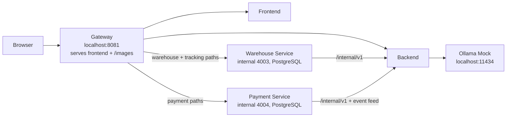
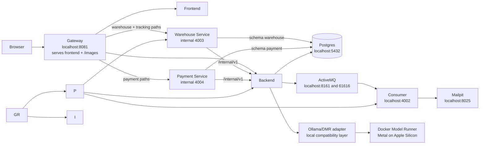
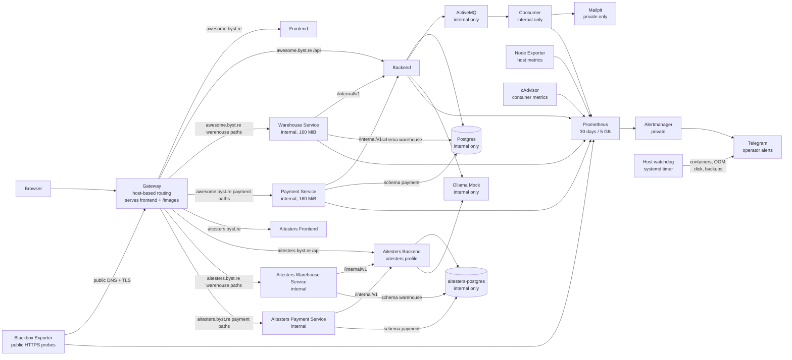

# Awesome LocalStack

Docker orchestration for the training stack built from separate backend,
frontend, warehouse-service, payment-service, JMS consumer, and model-mock repositories.

This README is organized by the three main profiles:

- lightweight
- full
- server

For the detailed published-port matrix, see [docs/PROFILE_URLS.md](docs/PROFILE_URLS.md).

Every profile also serves a browsable documentation wiki (architecture,
business flows, operations, test ideas) at `/docs/`, for example
`http://localhost:8081/docs/` or `https://awesome.byst.re/docs/`. Its sources
are in [docs-site/](docs-site/); the existing `docs/*.md` files are published
unchanged in its Reference section.

For classroom or workshop use focused on the lightweight stack, see [docs/STUDENT_GUIDE.md](docs/STUDENT_GUIDE.md).

SSO, the mocked Google/GitHub social login and Keycloak (port `8082`) were removed from every profile on 2026-11-12 (backend 3.18.0 and frontend 3.13.0 have no SSO code). Sign in with the application password users below.

For repository-owned image publishing and the first-party compatibility set
(six published images; payment-service 1.0.0 joins once its digest is pinned),
see [docs/CONTAINER_RELEASES.md](docs/CONTAINER_RELEASES.md).

For the coupon, review, wishlist, CSV, idempotent checkout and conditional
update training features (pending release; warehouse fulfilment, returns and
purchasing follow in a later release), see
[docs/COMMERCE_FULFILMENT.md](docs/COMMERCE_FULFILMENT.md). Warehouse
fulfilment, returns and purchasing are served by `warehouse-service`; its API
boundary (including shipment tracking) is documented in
[docs/WAREHOUSE_SERVICE_CONTRACT.md](docs/WAREHOUSE_SERVICE_CONTRACT.md). Card
payments with simulated test cards are served by `payment-service`; see
[docs/PAYMENT_SERVICE_CONTRACT.md](docs/PAYMENT_SERVICE_CONTRACT.md) and, for the
signed payment notifications and user webhooks, [docs/WEBHOOKS.md](docs/WEBHOOKS.md).

Each main compose file now has its own fixed Compose project name. That means switching between `lightweight`, `full`, and `server` should no longer produce normal orphan warnings just because the profiles define different services.

This does not mean the profiles can run side by side on the same machine. `lightweight` and `full` still publish overlapping host ports such as `8081` and `11434`, so stop one profile before starting the other.

## Lightweight Profile

Use this most of the time for local work.

It uses the same immutable backend, frontend, and model-mock releases as the
reviewed server compatibility set; the backend, `warehouse-service` and
`payment-service` are GraalVM native images. The backend (`local` profile),
warehouse-service and payment-service (`docker,demo`) share one small tmpfs
PostgreSQL (schemas `warehouse` and `payment`, each with its own role), so data
resets whenever the stack is recreated.

Start it with:

```bash
docker compose -f lightweight-docker-compose.yml up -d
```

Main app URL:

- `http://localhost:8081/login`

Other useful lightweight URLs:

- Swagger UI: `http://localhost:8081/swagger-ui/index.html` (definitions: backend JSON, backend YAML, "Warehouse service" and "Payment service")
- OpenAPI JSON: `http://localhost:8081/v3/api-docs`
- warehouse-service OpenAPI JSON: `http://localhost:8081/warehouse/v3/api-docs`
- payment-service OpenAPI JSON: `http://localhost:8081/payment/v3/api-docs`
- public parcel tracking: `http://localhost:8081/api/v1/tracking/{trackingNumber}`
- image through gateway: `http://localhost:8081/images/iphone.png`
- mocked LLM generate endpoint: `http://localhost:11434/api/generate`

Password-login demo users:

- `admin` / `LocalDemoAdmin123!`
- `client` / `client`
- `client2` / `client2`
- `client3` / `client3`
- `warehouse` / `warehouse` (warehouse role)

Architecture:



What students should verify:

```bash
docker compose -f lightweight-docker-compose.yml ps -a
curl -i http://localhost:8081/login
curl -i http://localhost:8081/v3/api-docs
curl -i http://localhost:8081/warehouse/v3/api-docs
curl -i http://localhost:8081/payment/v3/api-docs
curl -i http://localhost:8081/images/iphone.png
curl -i -X POST http://localhost:11434/api/generate \
  -H 'Content-Type: application/json' \
  -d '{"model":"qwen3.5:2b","prompt":"hello"}'
```

Expected:

- long-running containers are `Up`; the one-shot `postgres-roles` shows `Exited (0)`
- login page loads
- Swagger and the three OpenAPI documents (backend, warehouse and payment) respond with `200`
- product image responds with `200`
- the mocked model path responds with the same `qwen3.5:2b` default used across the migration
- mocked LLM generate endpoint responds with `200`

Useful logs:

```bash
docker compose -f lightweight-docker-compose.yml logs -f backend warehouse-service payment-service gateway
docker compose -f lightweight-docker-compose.yml logs -f ollama-mock
```

Stop it with:

```bash
docker compose -f lightweight-docker-compose.yml down
```

## Full Profile

Use this when you want the local app plus DB, queueing, email testing,
consumer, and a real GPU-accelerated local model. Monitoring is an opt-in
overlay (see [Local monitoring for k6 trainings](#local-monitoring-for-k6-trainings)).

Start it with:

```bash
docker compose up -d
```

The full profile uses the isolated Compose project name `awesome-full-native`.
This prevents an older checkout that still defines the legacy containerized
Ollama stack (`awesome-full`) from silently replacing the native runtime. The
backend transport is fixed to the Docker Model Runner adapter, while the model
itself remains selectable with `OLLAMA_MODEL` or the model field in the UI.

For a clean, verified startup that also removes obsolete services and adds the
monitoring overlay for k6 trainings (`WITH_MONITORING=false` skips it), use:

```bash
./run-docker-compose.sh
```

The monitoring overlay uses InfluxDB `1.12.4`. Before starting it against a named
volume last written by the older `1.8` image, back up the `influxdb-storage`
volume. InfluxDB 3 is a separate migration target and is not a drop-in image
replacement for this profile.

InfluxDB `1.12.4` runs as UID/GID `1500`. A volume created by the older image
may still be owned by UID `999` or root and must be backed up and recursively
re-owned before the first `1.12.4` startup. The Artemis `2.55.0` image uses the
explicit `activemq-data` volume; do not attach an anonymous instance volume
created by the retired `apache/activemq-artemis` image. Drain or export pending
messages before the first broker upgrade.

This local full stack intentionally starts the backend with `docker,demo`, so PostgreSQL-backed demo users, products, and sample orders are available with the same seeded admin credentials as the lightweight profile.

`warehouse-service` and `payment-service` run against the same PostgreSQL
database in the `warehouse` and `payment` schemas (each with its own role,
prepared by the one-shot `postgres-roles`); with the monitoring overlay,
Prometheus scrapes them as `spring_warehouse_micrometer` and
`spring_payment_micrometer`.

Main app URL:

- `http://localhost:8081/login`

Other useful full-profile URLs:

- Swagger UI: `http://localhost:8081/swagger-ui/index.html` (definitions: backend JSON, backend YAML, "Warehouse service" and "Payment service")
- OpenAPI JSON: `http://localhost:8081/v3/api-docs`
- warehouse-service OpenAPI JSON: `http://localhost:8081/warehouse/v3/api-docs`
- payment-service OpenAPI JSON: `http://localhost:8081/payment/v3/api-docs`
- public parcel tracking: `http://localhost:8081/api/v1/tracking/{trackingNumber}`
- Prometheus (monitoring overlay): `http://localhost:9090/graph`
- Grafana (monitoring overlay): `http://localhost:3000/login` (`admin` / `grafana`)
- ActiveMQ console: `http://localhost:8161`
- Mailpit UI: `http://localhost:8025/`
- consumer metrics: `http://localhost:4002/actuator/prometheus`
- Docker Model Runner status: `docker model status`
- Postgres: `localhost:5432`

If you need to refresh seeded PostgreSQL demo data after fixture or credential changes:

```bash
docker compose down -v
docker compose up -d
```

The full profile declares Bonsai directly as a Compose model:

```text
hf.co/prism-ml/Bonsai-27B-gguf:Q1_0
```

Docker Desktop Model Runner downloads the GGUF once, caches it outside the
application containers, and serves its Ollama-compatible API with the Metal
llama.cpp backend on Apple Silicon. This avoids the large custom Ollama image
and keeps normal startup to one command.

Compose also builds a small, model-neutral `ollama-dmr-adapter` image locally.
It normalizes the wire-format differences needed by the current backend:
null JSON-Schema members and streamed/stringified tool arguments. The adapter
does not contain the model; its local image is about 17 MB, while Docker Model
Runner owns the cached GGUF.

Enable Model Runner once on a new Mac:

```bash
docker desktop enable model-runner
docker model status
```

Then normal startup is always:

```bash
docker compose up -d
```

To use a different Docker Model Runner or Hugging Face GGUF artifact, override
`OLLAMA_MODEL` without editing Compose:

```bash
OLLAMA_MODEL=hf.co/unsloth/Qwen3.5-2B-GGUF:Q4_K_M docker compose up -d
```

The model name sent from the frontend must match the selected artifact. The
frontend model field remains user-editable, so it can be changed at runtime.

Verify the actual Compose path (backend -> adapter -> Docker Model Runner):

```bash
docker compose exec -T backend printenv OLLAMA_BASE_URL
docker run --rm --network awesome-full-native_my-private-ntwk \
  curlimages/curl:8.21.0@sha256:7c12af72ceb38b7432ab85e1a265cff6ae58e06f95539d539b654f2cfa64bb13 \
  http://ollama-dmr-adapter:11434/api/tags
docker model ps
```

Docker Model Runner models are not containers, so Bonsai appears in
`docker model ps`, not `docker compose ps`. Models are loaded lazily on the
first inference request.

Architecture:



Quick verification:

```bash
./run-docker-compose.sh
```

That script waits for the main local services and endpoints to come up.

If you ever need to force cleanup after interrupted local runs, `--remove-orphans` remains a fallback, but it should no longer be part of normal profile switching.

Database access:

- host: `localhost`
- port: `5432`
- database: `testdb`
- user: `postgres`
- password: `postgres`

Connect with Docker:

```bash
docker compose exec postgres psql -U postgres -d testdb
```

Useful logs:

```bash
docker compose -f docker-compose.yml logs -f backend
docker compose -f docker-compose.yml logs -f gateway
docker compose -f docker-compose.yml logs -f consumer
```

Stop it with:

```bash
docker compose -f docker-compose.yml down
```

## Local monitoring for k6 trainings

`docker-compose.monitoring.yml` is an opt-in overlay for either local profile.
It adds Prometheus (`9090`), Grafana (`3000`, `admin` / `grafana`), InfluxDB
(`8086`, database `db0` for `k6 run --out influxdb=http://localhost:8086/db0`),
cAdvisor and Node Exporter, and provisions the **k6 Load Testing Results**,
**Spring Boot 3.x Statistics**, **Spring Boot Http (3.x)** and
**Container Resources** dashboards.

```bash
# Full profile (./run-docker-compose.sh already includes the overlay)
docker compose -f docker-compose.yml -f docker-compose.monitoring.yml up -d

# Lightweight profile
docker compose -f lightweight-docker-compose.yml -f docker-compose.monitoring.yml up -d
```

Stop it with the same `-f` files and `down`. Move the host ports with
`GRAFANA_PORT`, `PROMETHEUS_PORT` and `INFLUXDB_PORT` when they are taken.
Prometheus discovers the application services through Docker DNS, so a service
the chosen profile does not run (the consumer in the lightweight profile) has
no target rather than a DOWN one. It also accepts k6 remote write
(`k6 run -o experimental-prometheus-rw`). `scripts/verify-monitoring-overlay.sh`
starts a profile with the overlay and checks the dashboards and targets; CI
runs it for the lightweight profile.

## Server Profile

Use this for the deployed production-like environment.

Server operations:

```bash
make ansible-ssh
make ansible-deploy
make ansible-verify
make ansible-cleanup
make ansible-reset-demo-state
make ansible-reset-aitesters-state
```

- `make ansible-ssh`: open a shell on the VPS using the Ansible/Vault connection settings
- `make ansible-deploy`: run the local preflight (server Compose config, strict docs build), converge the server stack and run post-deploy verification
- `make ansible-deploy-backend-upgrade`: prepare the release (asset mirror, env files, image pulls, docs build) while the old backends run, then stop both old backends, take a quiesced encrypted PostgreSQL backup, converge and verify (a failure before `docker compose up` restarts the stopped backends); use for incompatible database or ciphertext upgrades
- `make ansible-verify`: run health checks without changing deployment state
- `make ansible-cleanup`: run the checksum- and retention-guarded container cleanup
- `make ansible-reset-demo-state`: destructively reset Postgres and Mailpit-backed demo state, then redeploy
- `make ansible-reset-aitesters-state`: recreate the aitesters database (fresh volume), backend, warehouse-service and payment-service and reseed local demo data

Main public URLs:

- stable public playground: `https://awesome.byst.re/login`
- disposable API/UI testing sandbox: `https://aitesters.byst.re/login`

Other stable playground URLs:

- Swagger UI: `https://awesome.byst.re/swagger-ui/index.html` (definitions: backend JSON, backend YAML, "Warehouse service" and "Payment service")
- OpenAPI JSON: `https://awesome.byst.re/v3/api-docs`
- warehouse-service OpenAPI JSON: `https://awesome.byst.re/warehouse/v3/api-docs`
- payment-service OpenAPI JSON: `https://awesome.byst.re/payment/v3/api-docs`
- public parcel tracking: `https://awesome.byst.re/api/v1/tracking/{trackingNumber}`
- sign in API: `https://awesome.byst.re/api/v1/users/signin`
- image through gateway: `https://awesome.byst.re/images/iphone.png`

Other aitesters sandbox URLs:

- Swagger UI: `https://aitesters.byst.re/swagger-ui/index.html` (definitions: backend JSON, backend YAML, "Warehouse service" and "Payment service")
- OpenAPI JSON: `https://aitesters.byst.re/v3/api-docs`
- sign in API: `https://aitesters.byst.re/api/v1/users/signin`
- local email outbox: `https://aitesters.byst.re/api/v1/local/email/outbox`
- image through gateway: `https://aitesters.byst.re/images/iphone.png`

For the long-lived domain and routing architecture, see [docs/PROFILE_URLS.md](docs/PROFILE_URLS.md).

Architecture:



Production hardening in this profile:

- only the gateway is published on the host
- Postgres is not published
- Mailpit UI is not published
- Mailpit SMTP is not published
- Mailpit API is not published
- ActiveMQ is internal-only
- the production PostgreSQL password is supplied by Ansible Vault and is not
  stored in Compose
- consumer metrics are internal-only
- warehouse-service (`4003`) is internal-only behind the gateway, receives only
  its JWT key, service token and database password through `.env.warehouse`,
  and runs as a GraalVM native image within a 160 MiB container limit
- payment-service (`4004`) is internal-only behind the gateway, receives only
  its service token, webhook secret and database password through
  `.env.payment`, and runs as a GraalVM native image within a 160 MiB limit
- the gateway answers `/internal/` with `404`; the backend internal API is
  reachable only from warehouse-service and payment-service on the Compose network
- Node Exporter, cAdvisor, Blackbox Exporter, Prometheus, and Alertmanager are internal-only
- Prometheus history is persisted and bounded by 30-day and 5 GB retention limits
- Blackbox Exporter checks the public login, backend OpenAPI,
  warehouse-service OpenAPI and payment-service OpenAPI routes every 30 seconds,
  including DNS, TLS, HTTP status, and latency
- Blackbox Exporter also probes the aitesters login and OpenAPI routes
- Alertmanager sends only sustained critical alerts (no resolved messages,
  24-hour repeat) to a Vault-configured private Telegram chat; warnings stay
  in the Prometheus and Alertmanager APIs
- there is no Grafana in production (lean monitoring phase A frees about
  450 MiB); `make ansible-tunnel-prometheus` opens the Prometheus UI instead
- a host watchdog (systemd timer, no resident process) reports unhealthy,
  exited, restarting or missing containers, OOM kills, disk and memory
  exhaustion, failed or stale backups to the same Telegram chat, once per
  problem and once per recovery, and can ping an external dead-man check
- every long-running service except the distroless consumer has a Docker
  healthcheck; the watchdog probes the consumer through the gateway
- the deployment contains a guarded 1 GiB swap role and Prometheus swap alerts,
  but swap remains disabled on the current MIKR.US LXC host because its
  virtualization layer rejects `swapon`
- the backends, consumer, warehouse-services and payment-services run as GraalVM native images with
  explicit heap arguments and container memory limits
- aitesters backend, frontend, warehouse-service and payment-service are
  internal-only behind the same gateway; the sandbox has its own
  `aitesters-postgres`, signing key, service tokens and webhook secret, and the nightly reset recreates it from a fresh volume
- both public training backends use explicitly increased IP-keyed rate-limit
  capacities for repeated parallel API regression suites while retaining the
  original policy windows; per-account MFA and password-forgot limits stay at 20;
  see `docs/PROFILE_URLS.md` for the per-policy values
- images are served directly by the gateway
- the aitesters backend and frontend reuse the exact current application images;
  their sandbox behavior comes from runtime configuration, not stale releases
- deployment verification checks every running image against its reviewed
  immutable reference and exercises Artemis-to-consumer-to-Mailpit delivery
- unused images are pruned only after 30 days; the retired Artemis volume also
  requires a verified encrypted backup, no attachments, and the same retention
  period before removal

Use `make ansible-tunnel-prometheus` and open `http://localhost:9090` for
PromQL queries and the firing alerts.

The public probes and the watchdog run on the VPS, so they cannot detect loss
of the entire VPS. The watchdog's optional dead-man ping
(`watchdog_healthcheck_url`, for example a Healthchecks.io check) covers that
once the owner creates the external check; see
[docs/PRODUCTION_MONITORING_PLAN.md](docs/PRODUCTION_MONITORING_PLAN.md#lean-monitoring-phases-a-b-and-c).

Quick public verification:

```bash
curl -i https://awesome.byst.re/login
curl -i https://awesome.byst.re/v3/api-docs
curl -i https://awesome.byst.re/warehouse/v3/api-docs
curl -i https://awesome.byst.re/payment/v3/api-docs
curl -i https://awesome.byst.re/images/iphone.png
curl -i https://awesome.byst.re/mailpit/api/v1/messages
curl -i https://aitesters.byst.re/login
curl -i https://aitesters.byst.re/v3/api-docs
curl -i https://aitesters.byst.re/warehouse/v3/api-docs
curl -i https://aitesters.byst.re/payment/v3/api-docs
curl -i https://aitesters.byst.re/images/iphone.png
curl -i https://aitesters.byst.re/api/v1/local/email/outbox
```

Expected:

- `awesome.byst.re/login` returns `200`
- the AI Lab shell and recorded Attention deep route return `200`; this curl check does not verify the application session required to view course content
- `awesome.byst.re/v3/api-docs` returns `200`
- `awesome.byst.re/warehouse/v3/api-docs` returns `200`
- `awesome.byst.re/payment/v3/api-docs` returns `200`
- `awesome.byst.re/images/iphone.png` returns `200`
- `awesome.byst.re/mailpit/api/v1/messages` returns `404`
- `aitesters.byst.re/login` returns `200`
- `aitesters.byst.re/v3/api-docs` returns `200`
- `aitesters.byst.re/warehouse/v3/api-docs` returns `200`
- `aitesters.byst.re/payment/v3/api-docs` returns `200`
- `aitesters.byst.re/images/iphone.png` returns `200`
- `aitesters.byst.re/api/v1/local/email/outbox` returns `401` without a token

Server operations:

Deployment and server access are managed through Ansible. See [docs/ANSIBLE.md](docs/ANSIBLE.md), [docs/SSH_SERVER.md](docs/SSH_SERVER.md), and [docs/SSH_TUNNELLING.md](docs/SSH_TUNNELLING.md).

Tail backend logs on the server:

```bash
cd /opt/awesome-localstack
docker compose -f docker-compose.server.yml logs --tail=200 -f backend
```

Tail gateway logs:

```bash
cd /opt/awesome-localstack
docker compose -f docker-compose.server.yml logs --tail=200 -f gateway
```

Stop the server stack on the VPS with:

```bash
cd /opt/awesome-localstack
docker compose -f docker-compose.server.yml down
```

## Shared App Routes

Across the main profiles, the gateway serves:

- frontend pages under `/`
- backend API under `/api/v1/...`
- warehouse fulfilment, returns and purchasing paths under `/api/v1/...`,
  routed to warehouse-service, including shipment tracking
  (`/api/v1/orders/{id}/shipment/tracking`, public `/api/v1/tracking/{number}`)
- card payment paths (`/api/v1/payments`, `/api/v1/admin/payments`,
  `/api/v1/orders/{id}/payments`) routed to payment-service
  (see `docs/PROFILE_URLS.md`)
- Swagger UI under `/swagger-ui/...`, with a definition dropdown for the backend
  (JSON and YAML), "Warehouse service" and "Payment service"
- OpenAPI under `/v3/api-docs`, warehouse-service OpenAPI under
  `/warehouse/v3/api-docs` and payment-service OpenAPI under
  `/payment/v3/api-docs`
- `/internal/` always returns `404`
- any other `/api` path outside the routed `/api/v1/...` APIs (for example
  `/api/v2/users`) returns `404` JSON `{"message":"Not found"}` instead of the SPA
- the documentation wiki under `/docs/` (MkDocs site built from `docs-site/`,
  served by the `docs` container; see `docs-site/docs/operations/docs-site.md`)
- public health status at `/actuator/health`; other actuator routes are blocked by the gateway
- traffic WebSocket under `/api/v1/ws-traffic`
- static images under `/images/...`

## Related Projects

- [test-secure-backend](https://github.com/slawekradzyminski/test-secure-backend)
- [vite-react-frontend](https://github.com/slawekradzyminski/vite-react-frontend)
- [jms-email-consumer](https://github.com/slawekradzyminski/jms-email-consumer)
- [warehouse-service](https://github.com/slawekradzyminski/warehouse-service)
- payment-service (new sibling repository; publication pending)
- [ollama-mock](https://github.com/slawekradzyminski/ollama-mock)

## Troubleshooting

- If the app returns `502`, backend startup is usually still in progress.
- If Swagger generates the wrong host or scheme, inspect `/v3/api-docs` and check `.servers[0].url`.
- If images are missing in the app, check the gateway URL first.
- If nginx config changes do not seem to apply, recreate `gateway`.

For the native gRPC inventory API, see [the gRPC guide](docs/GRPC_INVENTORY.md).
The lightweight Compose override publishes it only on host loopback and uses the
same pinned backend release.

For equivalent REST, GraphQL, and native gRPC inventory exercises, see the
[protocol testing lab](docs/PROTOCOL_TESTING_LAB.md). For a ready-to-run lightweight
Docker exercise, use the [gRPC classroom runbook](docs/GRPC_TRAINING_RUNBOOK.md).
Traffic Monitor shows safe protocol summaries; the lab explains session headers,
HTTP versus execution status, and correlation IDs.
