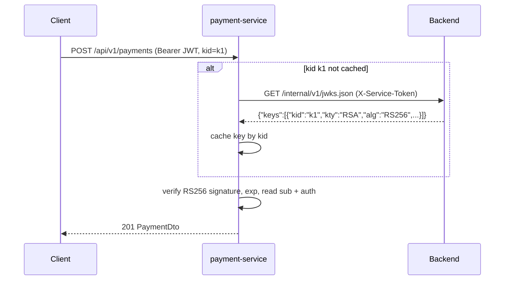

# Authentication

The **backend is the only issuer** of application tokens. Password login, MFA
and SSO all end with the same pair: a short-lived access token (JWT) and a
long-lived refresh token. Every public API — backend, warehouse-service and
payment-service — accepts only the access token, in
`Authorization: Bearer <token>`.

## Roles

| Role | Who | Typical access |
| --- | --- | --- |
| `ROLE_CLIENT` | Every user created by sign-up or SSO | Shopping, own orders, payments, returns, loyalty, webhooks |
| `ROLE_WAREHOUSE` | Demo user `warehouse` | `/api/v1/warehouse/**` (queue, shipments, carrier advance) |
| `ROLE_ADMIN` | Demo `admin` locally, the bootstrap admin in production | Everything, including admin catalogue, coupons, gift cards, VAT, currencies, returns, purchasing, payments, users |

## Access token

| Property | Value |
| --- | --- |
| Algorithm | RS256 (RSA, 2048 bits or more), header `kid` identifies the key |
| Claims | `sub` = username, `auth` = list of roles, `iat`, `exp` |
| Lifetime | 1 hour (`security.jwt.token.expire-length: 3600000`) |
| Key | `JWT_SIGNING_KEY`: base64 PKCS#8 RSA private key. Empty locally = new ephemeral key at every backend start. Production sets `JWT_REQUIRE_SECURE_KEY=true`, so the backend refuses to start without a valid key |
| Public key | JSON Web Key Set at `GET /internal/v1/jwks.json` (service-token protected, never public) |

!!! warning "PKCS#8, not PKCS#1"
    `openssl genpkey -outform DER` writes PKCS#1 with OpenSSL 3. Convert with
    `openssl pkcs8 -topk8 -nocrypt -outform DER | base64 | tr -d '\n'`, or the
    backend rejects the key.

### How the other services verify tokens

- warehouse-service and payment-service hold **no signing material**. They
  cache keys by `kid` and refetch the set for an unknown `kid` at most once per
  `JWT_JWKS_REFRESH_INTERVAL` (10 s), so a backend restart or key rotation is
  picked up automatically.
- Tokens with another algorithm (including HMAC), without a `kid` or with an
  unknown `kid` are `401`. If the backend is unreachable before a key is
  cached, the services answer `503`.
- There is no user lookup: the token is the source of truth for the username
  and roles. A user deleted after the token was issued keeps access to these
  two services until the token expires.

## Refresh tokens

- Returned as `refreshToken` by sign-in, MFA completion and SSO exchange.
  Valid for 7 days (`604800000` ms).
- `POST /api/v1/users/refresh` **rotates** the token: the old one is marked
  consumed and a new one from the same *family* is issued with a new access
  token.
- **Reuse detection:** presenting a refresh token that was already consumed
  revokes the whole family, so a stolen token and the legitimate one both stop
  working.
- `POST /api/v1/users/logout` revokes the current refresh token. A completed
  password reset and disabling MFA revoke all refresh tokens of the user.

## Multi-factor authentication (TOTP)

Opt-in, application-owned TOTP (RFC 6238) for password accounts; compatible
with Microsoft Authenticator, Google Authenticator and similar apps.

| Setting | Value |
| --- | --- |
| Period | 30 seconds |
| Accepted window | the current step and one adjacent step either way |
| Replay protection | the last accepted step is recorded and cannot be reused |
| Login challenge | opaque, single-use, 5 minutes (`APP_MFA_CHALLENGE_TTL`), only its SHA-256 is stored |
| Pending setup | 15 minutes (`APP_MFA_SETUP_TTL`) |
| Secret storage | AES-256-GCM with `APP_MFA_ENCRYPTION_PASSWORD` / `APP_MFA_ENCRYPTION_SALT` |
| Recovery codes | shown once at confirmation; verifier part hashed with the password encoder |

SSO accounts cannot enrol: their identity provider owns the second factor.
The flow is described in [Accounts, MFA and SSO](../flows/accounts.md#mfa).

## Single sign-on (local profiles)

Keycloak (realm `awesome-testing`, client `awesome-testing-frontend`) is the
identity provider in the lightweight and full profiles. The frontend runs the
OIDC Authorization Code flow with PKCE, then exchanges the **ID token** at
`POST /api/v1/users/sso/exchange`. The backend validates it against the
realm's JWKS, issuer and audience, creates or reuses a local user, and returns
the normal application token pair. Raw Keycloak tokens are never accepted by
the APIs. Production runs without Keycloak (`APP_SSO_ENABLED=false`).

Details: [SSO flow](../reference/SSO_FLOW.md),
[Social login](../reference/SOCIAL_LOGIN.md).

## Rate limiting

When `SECURITY_RATE_LIMIT_ENABLED=true` (production), the backend limits
sign-up, sign-in (per IP, per username and per IP+username), MFA, password
forgot/reset, refresh, email, QR, LLM, gift-card lookups and webhook test or
redeliver calls with token buckets per policy. Production raises the
capacities so parallel course suites can run; the values are in
[Profile URLs](../reference/PROFILE_URLS.md).

## Request logging hygiene

The backend's request log redacts `Authorization`, `X-Service-Token`,
cookies and JSON fields such as `password`, `token`, `refreshToken`,
`challengeToken`, `code`, `secret`, `otpAuthUri`, `qrCodeDataUri` and
`recoveryCodes`. payment-service never logs card numbers or CVCs.
