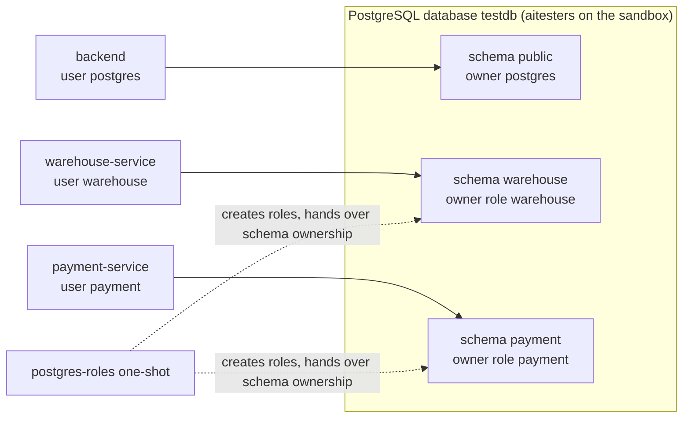

# Data and databases

All three Spring services use **one PostgreSQL 16 server** and one database,
but each owns a separate **schema** and connects as its own **role**.

## Roles and isolation

The one-shot `postgres-roles` container runs `postgres/service-roles.sh`
before every warehouse-service and payment-service start. For each of
`warehouse` and `payment` it:

1. creates the role if missing, sets `LOGIN NOSUPERUSER NOCREATEDB NOCREATEROLE NOREPLICATION`
   and the password from `WAREHOUSE_DB_PASSWORD` / `PAYMENT_DB_PASSWORD`;
2. grants `CONNECT` on the database;
3. creates the schema with that role as owner, and transfers ownership of any
   tables, views and sequences left in it by an earlier superuser-owned
   deployment or a restore.

The roles cannot read the backend's `public` tables; the production `verify`
role checks exactly that after every deploy. The services connect with
`?currentSchema=<schema>` and run their own Flyway migrations inside it.

## Migrations

| Service | Flyway location | Migrations |
| --- | --- | --- |
| backend | `public` schema | `V1` baseline … `V7` commerce, `V8` order fulfilment state, `V9` email retry and order refunds, `V10` commerce foundation, `V11` payments, `V12` loyalty and gift cards, `V13` VAT and currency, `V14` webhooks, `V15` product search indexes |
| warehouse-service | `warehouse` | `V1` schema, `V2` notification outbox and order locks, `V3` shipment tracking (`shipments.simulated`, `tracking_events`) |
| payment-service | `payment` | `V1` baseline, `V2` order payment locks |

## Main tables

=== "backend (public)"

    | Area | Tables |
    | --- | --- |
    | Users and security | `app_user`, `user_entity_roles`, `refresh_token`, `password_reset_token`, `mfa_credential`, `mfa_challenge`, `mfa_recovery_code` |
    | Catalog and stock | `products`, `inventory_movements`, `product_reviews`, `wishlist_items` |
    | Cart | `cart_items`, `cart_coupons`, `cart_tenders` (gift card and points) |
    | Orders | `orders` (incl. `fulfilment_state`, tax and tender columns), `order_items`, `order_idempotency_keys`, `order_refunds` |
    | Coupons | `coupons`, `coupon_redemptions` |
    | Gift cards and loyalty | `gift_cards`, `gift_card_transactions`, `loyalty_accounts`, `loyalty_transactions` |
    | Payments (backend side) | `order_payments`, `payment_notifications`, `payment_refund_outbox` |
    | Tax and money | `vat_rates`, `currency_rates` |
    | Messaging | `email_event` |
    | Webhooks | `webhook_subscriptions`, `webhook_deliveries`, `webhook_inboxes`, `webhook_inbox_requests` |
    | Diagnostics | `traffic_log` |

=== "warehouse"

    `shipments`, `tracking_events`, `return_requests`, `return_items`,
    `suppliers`, `purchase_orders`, `purchase_order_lines`,
    `purchase_receipts`, `notification_outbox`, `order_locks`.

    warehouse-service stores **snapshots** (order id, owner, unit prices,
    totals) instead of foreign keys into the backend: it never joins across
    schemas.

=== "payment"

    `payments`, `payment_idempotency_keys`, `payment_outbox`, `refunds`,
    `order_payment_locks`.

    Only the card brand and the last four digits are stored. The
    idempotency fingerprint is an HMAC of the request, never the card number.

## Connection pools

warehouse-service and payment-service use Hikari with `maximum-pool-size: 3`,
`minimum-idle: 1` and a 2-minute idle timeout. The lightweight PostgreSQL runs
with `max_connections=40` and `shared_buffers=32MB` inside a 256 MiB limit.

## Data lifetime per environment

| Environment | Persistence | Reset |
| --- | --- | --- |
| lightweight | tmpfs | every `docker compose ... up` that recreates `postgres` |
| full | named volume `postgres-data` | `docker compose down -v` |
| awesome.byst.re | named volume, encrypted daily backups | `make ansible-reset-demo-state` (destructive) |
| aitesters.byst.re | `aitesters-postgres` volume | nightly `aitesters-reset` timer, or `make ansible-reset-aitesters-state` |

Database access in the full profile: `localhost:5432`, database `testdb`,
user and password `postgres`, or
`docker compose exec postgres psql -U postgres -d testdb`.
