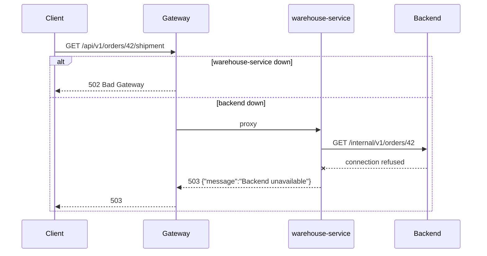

# Gateway routing

The gateway is nginx. Two configuration files exist:

- `nginx/conf.d/lightweight-app-gateway.conf` — one `server` block for
  `localhost`, used by the lightweight, full and compatibility profiles;
  forwards `X-Forwarded-Proto: http`.
- `nginx/conf.d/app-gateway.conf` — the server profile, with one `server`
  block per host: `awesome.byst.re` and `aitesters.byst.re`
  (`aitesters.awesome.byst.re`). Forwards `X-Forwarded-Proto: https` and
  `X-Forwarded-Port: 443`, because TLS ends at the hosting provider's proxy.

## How nginx picks a location

nginx chooses an **exact** match (`location = /x`) first, then the **longest
prefix**; a prefix marked `^~` stops the search, otherwise **regex** locations
(`~`) are tried in order and the first match beats the prefix. That is why the
warehouse and payment paths, which are longer prefixes or regexes, win over
the generic `/api/v1/` route to the backend.

## Route table

| Path | Match | Upstream | Notes |
| --- | --- | --- | --- |
| `/api/v1/ws-traffic` | prefix | backend | WebSocket upgrade for the traffic monitor |
| `/api/v1/warehouse/` | prefix | warehouse-service | Queue, shipments, pick list, transitions, carrier advance |
| `= /api/v1/returns`, `/api/v1/returns/` | exact + prefix | warehouse-service | Customer returns |
| `= /api/v1/admin/returns`, `/api/v1/admin/returns/` | exact + prefix | warehouse-service | Return administration |
| `= /api/v1/admin/suppliers`, `/api/v1/admin/suppliers/` | exact + prefix | warehouse-service | Suppliers |
| `= /api/v1/admin/purchase-orders`, `/api/v1/admin/purchase-orders/` | exact + prefix | warehouse-service | Purchase orders and receipts |
| `= /api/v1/admin/inventory/reorder-suggestions` | exact | warehouse-service | Other `/api/v1/admin/inventory` paths stay on the backend |
| <code>~ ^/api/v1/orders/\d+/(shipment&#124;shipment/tracking&#124;returns)$</code> | regex | warehouse-service | Order shipment, tracking and return creation |
| `/api/v1/tracking/` | prefix | warehouse-service | Public parcel tracking, no token |
| `^~ /warehouse/v3/api-docs` | prefix, stops search | warehouse-service `/v3/api-docs` | Rewritten; `/warehouse` itself stays a frontend page |
| `= /api/v1/payments`, `/api/v1/payments/` | exact + prefix | payment-service | Create, 3-D Secure, read |
| `= /api/v1/admin/payments` | exact | payment-service | Admin payment list |
| `~ ^/api/v1/orders/\d+/payments$` | regex | payment-service | Payments of one order |
| `^~ /payment/v3/api-docs` | prefix, stops search | payment-service `/v3/api-docs` | Rewritten |
| `/internal/` | prefix | — | Always `404`: the service-to-service API is never public |
| `/api/v1/` | prefix | backend | Everything else under the API, including GraphQL (`/api/v1/graphql`) and GraphiQL |
| `/swagger-ui/`, `/v3/api-docs` | prefix | backend | Swagger UI and the backend OpenAPI document |
| `/actuator/` | prefix | backend (local) | Server: only `= /actuator/health` is proxied, the rest is `404` |
| `/images/`, `/branding/` | prefix | gateway filesystem | Product images and logos served by nginx itself |
| `/mailpit/...`, `/mailhog/...` | exact + prefix | — | Server only: always `404` so the inbox never leaks |
| `= /docs`, `/docs/` | exact + prefix | docs | This wiki; `/docs` redirects to `/docs/` |
| `/` | prefix | frontend | The SPA; unknown paths are handled by the client-side router |

On the server, the `aitesters.byst.re` block routes the same paths to the
`aitesters-*` services. Both hosts serve the same `docs` container.

## Starting without optional services

warehouse-service, payment-service and docs are addressed through **variables**
resolved at request time by Docker's DNS (`resolver 127.0.0.11`):

```nginx
set $warehouse_upstream http://warehouse-service:4003;
set $payment_upstream   http://payment-service:4004;
set $docs_upstream      http://docs:80;

location /api/v1/payments/ {
  proxy_pass $payment_upstream;
  ...
}
```

With a literal hostname, nginx refuses to start when the name does not
resolve. With a variable, the gateway (and therefore the shop and backend API)
starts even when one of these services is absent or restarting; only its paths
answer `502 Bad Gateway` until it is back. The backend and frontend are literal
upstreams: the gateway waits for a healthy backend.

## What a failure looks like



## Proxy headers

Every proxied location sets `Host`, `X-Real-IP`, `X-Forwarded-For`,
`X-Forwarded-Host`, `X-Forwarded-Port` and `X-Forwarded-Proto`. The Spring
services run with `SERVER_FORWARD_HEADERS_STRATEGY=framework`, so redirects,
generated links and the OpenAPI `servers` URL use the public scheme and host.
Swagger UI's "Try it out" therefore calls `https://awesome.byst.re` in
production and `http://localhost:8081` locally.

On the server, the **edge** proxy trusts `X-Forwarded-For` only from the
hosting provider's proxy range (`set_real_ip_from 2a01:4f9::/32`), so a client
cannot spoof the address used by rate limiting. See
[Production edge proxy](../reference/PRODUCTION_EDGE_PROXY.md).
