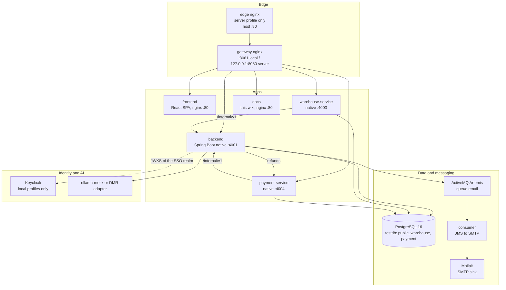

# Architecture

The platform is a set of containers orchestrated by Docker Compose. One nginx
**gateway** is the only entry point for browsers and test tools; behind it, a
Spring Boot **backend** owns users, the catalog, carts and orders, while two
smaller services own **warehouse fulfilment** and **card payments**.

## Design principles

- **One public origin.** The SPA, every API and the OpenAPI documents are
  served from the same host, so browsers never need CORS through the gateway.
- **The backend issues identity.** It signs RS256 access tokens; the other
  services verify them with the backend's public key set (JWKS) and hold no
  signing secret. See [Authentication](auth.md).
- **Services own their data.** warehouse-service and payment-service share the
  PostgreSQL server but each uses its own schema and its own database role,
  which cannot read the backend's tables. See [Data and databases](data.md).
- **Service calls are authenticated and idempotent.** `/internal/v1` calls
  carry a per-caller `X-Service-Token`; payment results are HMAC-signed; every
  write that can be retried carries a `requestId`. See
  [Service-to-service trust](service-trust.md).
- **Outboxes, not dual writes.** Emails, notifications, payment results, card
  refunds and webhooks are written to a table in the same transaction as the
  business change and delivered afterwards with retries.
- **Small footprint.** The JVM services are GraalVM native images with explicit
  heap caps, so the whole production stack fits a 1-vCPU, ~4 GiB VPS.

## Pages in this section

- [Services and ports](services.md) — every container, its port and its job.
- [Compose profiles](profiles.md) — lightweight, full, server and the overrides.
- [Gateway routing](gateway.md) — which path goes to which service.
- [Authentication](auth.md) — JWT, refresh tokens, MFA, SSO and roles.
- [Service-to-service trust](service-trust.md) — service tokens, signatures, outboxes.
- [Data and databases](data.md) — schemas, roles, migrations and tables.
