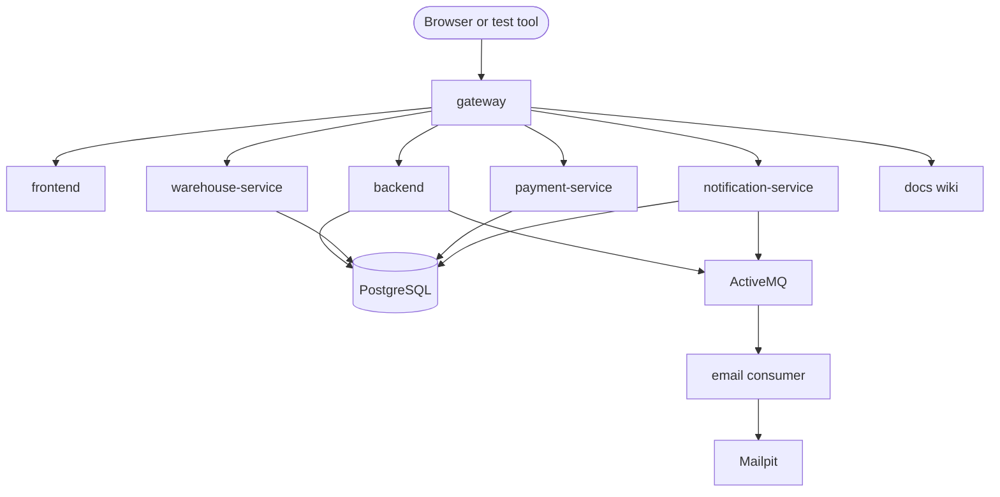
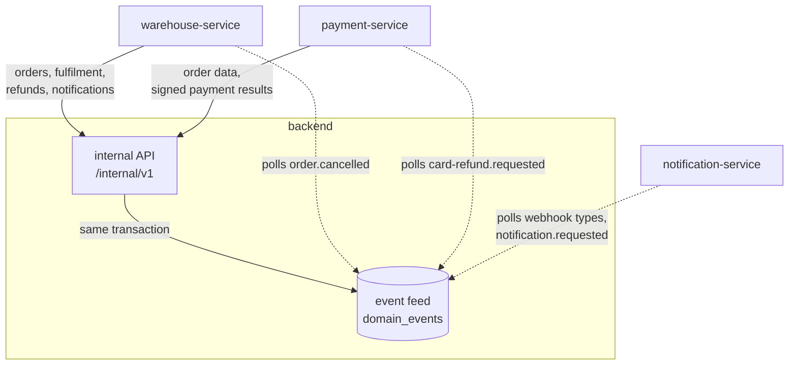

# Architecture

The platform is a set of containers orchestrated by Docker Compose. One nginx
**gateway** is the only entry point for browsers and test tools; behind it, a
Spring Boot **backend** owns users, the catalog, carts and orders, while three
smaller services own **warehouse fulfilment**, **card payments** and
**notifications** (user webhooks and commerce emails).

warehouse-service and payment-service also call the backend's internal API
(order data, fulfilment, payment results), and all three services poll its
**event feed**; the backend never calls them. See [Service integration](#service-integration) below
and [Service-to-service trust](service-trust.md).
Every request carries an `X-Request-Id` and a W3C `traceparent` from the
gateway through the services, the event feed and the outboxes; see
[Tracing a request](../operations/tracing.md).
Not shown: the **edge** nginx in front of the gateway on the server, the **LLM** (ollama-mock or Docker Model Runner)
behind the backend (see [LLM integration](llm.md)), and the monitoring stack. Ports and images for every
container are in [Services and ports](services.md).

## Service integration

Every service-to-service arrow points **to the backend**. Commands the services
need answered at once (read an order, mirror a fulfilment step, report a
payment result) are synchronous calls to `/internal/v1`. Changes the backend
makes on its own (a cancellation, a card refund to give back) are recorded as
domain events in the same transaction and **pulled** by the services from
`GET /internal/v1/events` every five seconds.

Solid arrows are calls made when needed, dotted arrows are polls every 5 s
(events become visible after a 3 s settle delay, so expect 5–8 s end to end).
The reasons, and why this is not an ActiveMQ topic, are in the
[architecture decisions](../reference/ARCHITECTURE_DECISIONS.md); the feed
contract is in [Event feed](../reference/EVENT_FEED.md).

## Design principles

- **One public origin.** The SPA, every API and the OpenAPI documents are
  served from the same host, so browsers never need CORS through the gateway.
- **The backend issues identity.** It signs RS256 access tokens; the other
  services verify them with the backend's public key set (JWKS) and hold no
  signing secret. See [Authentication](auth.md).
- **Services own their data.** warehouse-, payment- and notification-service share the
  PostgreSQL server but each uses its own schema and its own database role,
  which cannot read the backend's tables. See [Data and databases](data.md).
- **Dependencies point to the backend.** warehouse-, payment- and
  notification-service depend on the backend, never the other way round; the
  backend learns nothing from them except through calls they make. See
  [ADR 1](../reference/ARCHITECTURE_DECISIONS.md#adr-1-internal-integration-via-a-pull-event-feed).
- **Service calls are authenticated and idempotent.** `/internal/v1` calls
  carry a per-caller `X-Service-Token`; payment results are HMAC-signed; every
  write that can be retried carries a `requestId`. See
  [Service-to-service trust](service-trust.md).
- **Outboxes and a feed, not dual writes.** Emails, notifications, payment
  results and webhooks are written to an outbox in the same transaction as the
  business change and delivered afterwards with retries; domain events (card
  refunds and cancellations among them) are written to the event feed in the
  same transaction and pulled by the services.
- **Small footprint.** The JVM services are GraalVM native images with explicit
  heap caps, so the whole production stack fits a 1-vCPU, ~4 GiB VPS.

## Pages in this section

- [Services and ports](services.md) — every container, its port and its job.
- [Compose profiles](profiles.md) — lightweight, full, server and the overrides.
- [Gateway routing](gateway.md) — which path goes to which service.
- [Authentication](auth.md) — JWT, refresh tokens, MFA and roles.
- [Service-to-service trust](service-trust.md) — service tokens, signatures, outboxes.
- [Data and databases](data.md) — schemas, roles, migrations and tables.
- [Architecture decisions](../reference/ARCHITECTURE_DECISIONS.md) — why the
  services integrate through a pull feed, why the backend keeps fulfilment
  state, why outboxes are per service, and why one PostgreSQL server.
