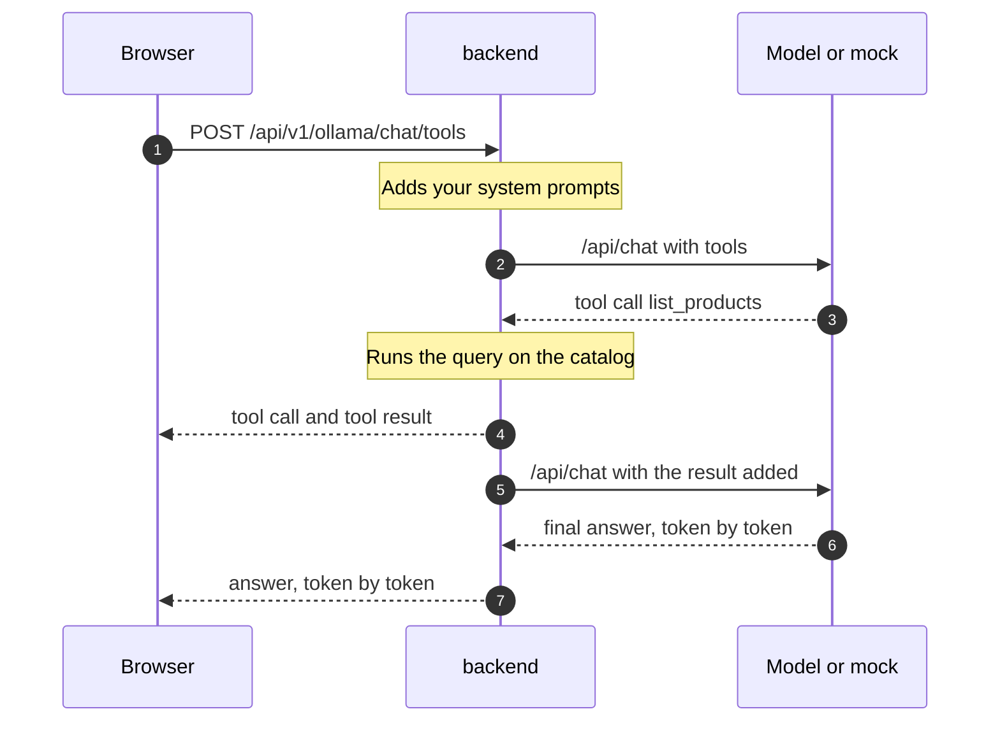

# LLM integration

The shop has an **LLM** section (`/llm` in the frontend) with three modes:
**Generate** (one prompt, one answer), **Chat** (a conversation) and
**Chat + Tools** (the model may call backend functions that read the product
catalog). This page explains where the model actually runs in each profile,
what the mock is, and how a tool call works.

## The short version

- The browser never talks to a model. It calls the **backend**
  (`/api/v1/ollama/...`), which forwards the request to whatever answers at
  `OLLAMA_BASE_URL`.
- That address speaks the **Ollama API** (`/api/generate`, `/api/chat`). The
  backend does not know or care whether a real model or a mock is behind it.
- Only the **full** profile runs a real model. Lightweight, the stable
  production host and the sandbox all use **ollama-mock**, a small service
  that replays scripted answers.

## Which model answers, per profile

| Profile | `OLLAMA_BASE_URL` | What answers |
| --- | --- | --- |
| Lightweight | `http://ollama-mock:11434` | ollama-mock (scripted) |
| Full | `http://ollama-dmr-adapter:11434` | A real model in Docker Model Runner on your machine |
| Full + `docker-compose.model-mock.yml` | `http://ollama:11434` | ollama-mock, for machines without Docker Model Runner |
| Production, `awesome.byst.re` | `http://ollama-mock:11434` | ollama-mock |
| Production, `aitesters.byst.re` | `http://ollama-mock:11434` | ollama-mock |

Production uses the mock on purpose: the server has one vCPU and no GPU, a
real model would cost money per request, and answers that change every time
cannot be asserted in a test.

=== "Lightweight and production"

    ```mermaid
    flowchart TB
        B[Browser] --> G[gateway]
        G --> BE[backend]
        BE -->|Ollama API| M[ollama-mock]
    ```

=== "Full profile"

    ```mermaid
    flowchart TB
        B[Browser] --> G[gateway]
        G --> BE[backend]
        BE -->|Ollama API| A[ollama-dmr-adapter]
        A -->|OpenAI API| D[Docker Model Runner]
        D --> L[local model]
    ```

## The real model (full profile)

Docker Model Runner runs models on the host, outside the Compose network,
and is reached at `model-runner.docker.internal`. Compose declares it in a
top-level `models:` block:

| Setting | Value |
| --- | --- |
| Model | `${OLLAMA_MODEL}`, default `hf.co/prism-ml/Bonsai-27B-gguf:Q1_0` |
| Context window | 8192 tokens |
| Enable once | `docker desktop enable model-runner` |

Model Runner exposes an Ollama-compatible API, but it ignores two things the
app needs: turning off "thinking" (`think: false`) and returning token
probabilities (`logprobs`). **ollama-dmr-adapter** is a small Python proxy
(in `ollama-dmr-adapter/` of this repository) that rewrites only those
requests into llama.cpp's OpenAI-style API and translates the answers back.
Every other request passes through unchanged.

Expect real-model behaviour here: answers differ between runs, the first
token can take many seconds, and a small quantised model can be wrong.

## The mock: ollama-mock

[ollama-mock](https://github.com/slawekradzyminski/ollama-mock) is a Spring
Boot service that implements the same Ollama endpoints and returns
**deterministic, scripted** answers. It exists so that UI and API tests of
the LLM features are fast, free and repeatable.

How it chooses an answer:

1. It takes the prompt (Generate) or the last user message (Chat), trims it
   and lower-cases it.
2. It looks for a scenario with exactly that text in its scenario files.
3. Found: it streams that scenario's answer word by word, with a short fixed
   delay between chunks, so the UI looks like a real model typing.
4. Not found: it answers with a message that lists every supported prompt.
   It never invents text.

The model name defaults to `qwen3.5:2b`; any name you send is echoed back.
"Thinking" chunks are sent only when the request has `"think": true`.

### Prompts the mock understands

| Mode | Prompt (case does not matter) | Tools it calls |
| --- | --- | --- |
| Generate | Summarize the release plan | — |
| Generate | Provide a motivational quote | — |
| Generate | Walk me through the streaming demo for /api/generate | — |
| Chat | Give me a quick status update on the Ollama mock | — |
| Chat | How do I switch the backend to this mock? | — |
| Chat | What limitations should I expect from the mock? | — |
| Chat | Narrate the full streaming timeline for this mock | — |
| Chat + Tools | What iphones do we have available? Tell me the details about them | `list_products`, `get_product_snapshot` |
| Chat + Tools | What Beauty products do we have available? | `list_products` |
| Chat + Tools | Do we have any smart home devices in stock? | `list_products`, `get_product_snapshot` |
| Chat + Tools | List the laptops under $1500. | `list_products` |
| Chat + Tools | What gaming accessories can you recommend? | `list_products` |
| Chat + Tools | Show me the streaming timeline when a tool call is involved | `list_products`, `get_product_snapshot` |
| Chat + Tools | Walk me through a two-step catalog lookup where you narrate between tool calls | `list_products`, `get_product_snapshot` |

The list comes from the mock's scenario files
(`src/main/resources/scenarios/*.json` in the ollama-mock repository).

## Tool calling ("Chat + Tools")

A model cannot read the database. Instead, the request lists **tools** (name,
description, JSON schema of the arguments). The model may answer with a
**tool call** instead of text; the backend runs that function against the
real catalog, appends the result to the conversation and asks the model
again. This repeats until the model answers with text, at most
8 rounds (`ollama.max-tool-call-iterations`).

| Tool | What the backend returns |
| --- | --- |
| `list_products` | Products, optionally filtered by `category` and `inStockOnly`; `limit` 25 by default, at most 100 |
| `get_product_snapshot` | One product (by `productId` or exact `name`) with price and stock |

`GET /api/v1/ollama/chat/tools/definitions` returns the exact schemas.



The browser sees every step: the tool call, the tool result and the final
answer all arrive in the same stream. With the mock, the **tool results are
real** (they come from the backend's database); only the model's words are
scripted.

## Your system prompts

Each user has two stored **system prompts** that the backend puts in front
of every conversation before sending it to the model:

| Endpoint | Used by |
| --- | --- |
| `GET`/`PUT /api/v1/users/chat-system-prompt` | Chat and Chat + Tools |
| `GET`/`PUT /api/v1/users/tool-system-prompt` | Chat + Tools only (added after the chat prompt) |

The backend removes an older copy of the prompt from the history first, so
it never appears twice. With the mock, changing the prompt changes nothing
in the answer; with the real model it does.

## Endpoints and limits

| Endpoint | Body | Response |
| --- | --- | --- |
| `POST /api/v1/ollama/generate` | `model`, `prompt`, `think`, `options` | stream of `GenerateResponseDto` |
| `POST /api/v1/ollama/chat` | `model`, `messages`, `think`, `options` | stream of `ChatResponseDto` |
| `POST /api/v1/ollama/chat/tools` | as chat, plus `tools` | stream of `ChatResponseDto` |
| `GET /api/v1/ollama/chat/tools/definitions` | — | JSON list |

- All require a bearer token.
- **Chat is stateless:** the server keeps no conversation. The browser
  resends the whole history on every request.
- **Rate limit** per signed-in user, counted over 5 minutes: 4000 requests
  on `awesome.byst.re`, 200 on `aitesters.byst.re`; above it `429`. Rate
  limiting is switched off in the local profiles.
- **Errors before the first chunk** (unknown model, invalid body, model
  down) come back as a normal JSON error with the upstream status. **Errors
  after streaming started** can only end the stream early; the status is
  already `200`.
- The backend waits up to 5 minutes for the model (connect timeout 5 s).

How the stream itself travels to the browser is explained in
[Streaming and WebSockets](realtime.md).

## Test ideas

| Scenario | Expected |
| --- | --- |
| Send a supported prompt twice (mock) | identical answers, same chunks |
| Send an unsupported prompt (mock) | `200`, answer lists the supported prompts |
| Generate with `think: true` vs `false` | thinking chunks only with `true` |
| Chat + Tools: "List the laptops under $1500." | a `list_products` call, then an answer, both in one stream |
| Call `/chat/tools` with an empty `tools` array | no answer is streamed ("At least one tool definition is required") |
| 201 requests within 5 minutes on `aitesters.byst.re` | the 201st is `429` |
| No token | `401` |
| Stop `ollama-mock`, send a prompt | the request fails and the UI shows an error; note the status you get |
| Full profile: same prompt twice | different answers — assert on structure, not text |
