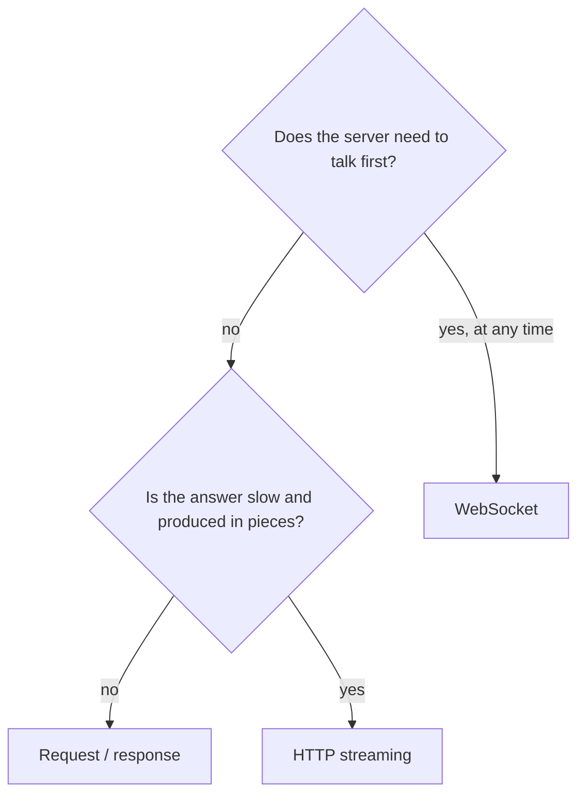
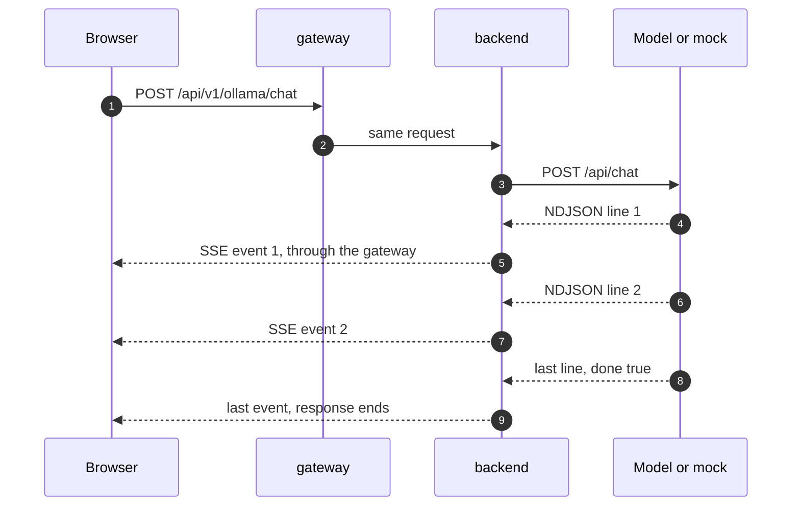
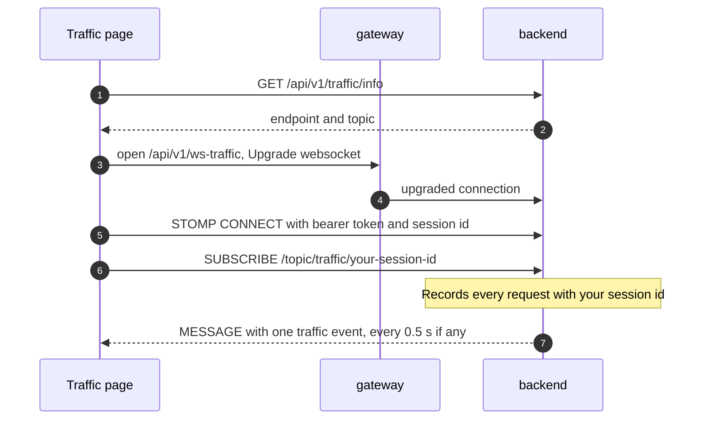

# Streaming and WebSockets

Most of the API is plain **request → response**: the client asks, the
server answers once, the connection is done. Two features need more:

- **LLM answers** are produced word by word over many seconds. Waiting for
  the whole answer would feel broken, so the server **streams** it over one
  long HTTP response.
- The **traffic monitor** (`/traffic`) shows your own API calls as they
  happen. The server must **push** events at any time, so it uses a
  **WebSocket**.

## Four ways to get data to the client

| Technique | Who starts each message | Connection | Used here for |
| --- | --- | --- | --- |
| Request / response | client | one per request | almost every endpoint |
| Polling | client, repeatedly | one per poll | payment status while `PROCESSING` ([Card payments](../flows/payments.md)) |
| HTTP streaming (SSE) | server, after one request | one long response | LLM answers |
| WebSocket | either side, any time | one long two-way connection | traffic monitor |



## HTTP streaming (LLM answers)

### What travels on the wire

One HTTP request, one response that stays open while the model writes. The
response has no `Content-Length`; it is sent in pieces (**chunked transfer
encoding**) and ends when the last piece is sent.

Two formats are involved:

| Hop | Format | Content-Type | One message is |
| --- | --- | --- | --- |
| model or mock → backend | NDJSON (newline-delimited JSON) | `application/x-ndjson` | one JSON object per line |
| backend → browser | Server-Sent Events (SSE) | `text/event-stream` | `data:{json}` followed by an empty line |

The backend reads the NDJSON stream as a reactive `Flux` (Spring WebFlux
`WebClient`) and re-emits each object as an SSE event the moment it arrives.
It does not wait for the full answer.

A Generate stream from the mock, shortened (real events also carry `created_at` and timing fields):

```text
data:{"model":"qwen3.5:2b","response":"Release","done":false}

data:{"model":"qwen3.5:2b","response":" plan:","done":false}

data:{"model":"qwen3.5:2b","response":"","done":true}
```

The last event has `"done": true`. Chat events carry `message.content`
(and `message.thinking`, `message.tool_calls`) instead of `response`.



### How the browser reads it

The browser's built-in `EventSource` only supports `GET` and cannot send an
`Authorization` header, so the frontend does not use it. It sends a normal
`fetch` `POST` with the bearer token and reads `response.body` piece by
piece (`getReader()`), splitting on the empty line between events
(`src/lib/sse.ts` in the frontend). A network piece can hold half an event
or several events, so the reader keeps the unfinished tail in a buffer.

### The gateway

The gateway forwards LLM calls with the ordinary `/api/v1/` rule. nginx
passes each piece on as soon as it arrives; measured through the same
proxy settings, mock tokens reached the client about 50 ms apart, not in one
batch at the end. The gateway's default read timeout (60 s) applies
**between** pieces, not to the whole answer.

### What to test

| Scenario | Expected |
| --- | --- |
| `curl -N` a stream (with a token) | events appear one by one, not all at the end |
| Count events, check the last one | exactly one event with `"done": true`, last |
| Concatenate every `response` | the full answer text |
| Abort the request half-way (close the tab, `Ctrl+C`), then send another | the next request streams normally |
| Bad request body | normal JSON error with `4xx`, no stream |
| Model fails after the first event | status is already `200`; the stream just ends early — check for a missing `done` event |

```bash
TOKEN=$(curl -s -X POST http://localhost:8081/api/v1/users/signin \
  -H 'Content-Type: application/json' \
  -d '{"username":"client","password":"client"}' | jq -r .token)
curl -N http://localhost:8081/api/v1/ollama/generate \
  -H "Authorization: Bearer $TOKEN" -H 'Content-Type: application/json' \
  -d '{"model":"qwen3.5:2b","prompt":"Summarize the release plan"}'
```

## WebSocket (traffic monitor)

### What a WebSocket is

A WebSocket starts as an HTTP request with `Upgrade: websocket`. If the
server agrees (`101 Switching Protocols`), the same TCP connection stays open
and both sides can send **frames** at any time, in both directions, without
a new request each time.

On top of the raw socket the app uses two well-known libraries:

| Layer | What it adds | Library |
| --- | --- | --- |
| SockJS | Falls back to HTTP streaming or long polling when a proxy blocks WebSockets | `sockjs-client`, Spring SockJS |
| STOMP | Simple text messages with commands: `CONNECT`, `SUBSCRIBE`, `MESSAGE`, `DISCONNECT`; named destinations like `/topic/...` | `@stomp/stompjs`, Spring's simple broker |

### How the traffic monitor works

Every API call from the frontend carries an `X-Client-Session-Id` header: a
random id per browser session (16–128 letters, digits, `_` or `-`). The
backend records each request (method, path, status, duration, protocol) and
remembers that id. The monitor subscribes to the topic for its own id, so
you only see your own traffic.



Rules enforced by the backend:

- `CONNECT` without a valid bearer token is refused.
- `CONNECT` without a valid `X-Client-Session-Id` is refused.
- `SUBSCRIBE` to any topic other than `/topic/traffic/<your session id>` is
  refused, so you cannot read another user's traffic.
- Events are queued and sent in batches every 500 ms; at most 1000 are
  queued, so a flood of requests can drop events.
- A single message is limited to 128 KiB.

Stored entries can also be read later over plain HTTP:
`GET /api/v1/traffic/logs` and `/api/v1/traffic/logs/{correlationId}`
(kept for one day).

### The gateway

A WebSocket needs the proxy to forward the upgrade. The gateway has a
dedicated rule for it:

```nginx
location /api/v1/ws-traffic {
  proxy_pass http://backend:4001;
  proxy_http_version 1.1;
  proxy_set_header Upgrade $http_upgrade;
  proxy_set_header Connection "upgrade";
}
```

Without `Upgrade` and `Connection` nginx would turn the request into a
normal HTTP call and the handshake would fail. SockJS would then fall back
to its HTTP transports, which is why the page can still work behind
strict proxies.

### What to test

| Scenario | Expected |
| --- | --- |
| Open `/traffic`, click around the shop in another tab of the same session | your calls appear within about a second |
| Open `/traffic` in a second browser (different session) | it does not show the first browser's calls |
| STOMP `CONNECT` with an expired token | connection refused |
| `SUBSCRIBE` to someone else's `/topic/traffic/...` | refused, connection closed |
| Copy the session id from the page into GraphiQL or gRPC metadata | those calls appear in the monitor too |
| DevTools → Network → WS | one `ws-traffic` connection, frames flowing in |

See also: [LLM integration](llm.md), [Gateway routing](gateway.md),
[API explorers](../operations/api-explorers.md).
