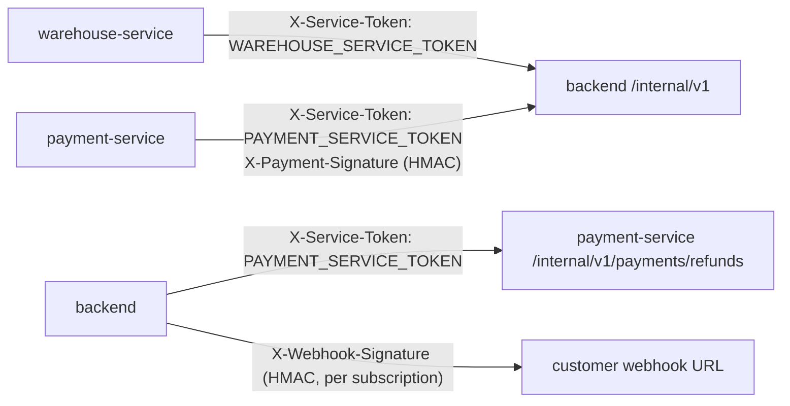

# Service-to-service trust

Three services cooperate on one order. They trust each other through
**service tokens**, **HMAC signatures** and **idempotency keys**, never through
user JWTs.



## Internal API (`/internal/v1` on the backend)

- Not routed by the gateway (`/internal/` is `404` on every host), not in the
  OpenAPI document, no CORS, not captured by the traffic monitor, and the
  `X-Service-Token` header is redacted from logs.
- Each **caller** has its own token. Tokens are compared in constant time.

| Caller | Backend property | Environment variable | `local` profile default |
| --- | --- | --- | --- |
| warehouse | `internal.service-tokens.warehouse` (alias `warehouse.service-token`) | `WAREHOUSE_SERVICE_TOKEN` | `local-warehouse-token` |
| payment | `internal.service-tokens.payment` | `PAYMENT_SERVICE_TOKEN` | `local-payment-token` |

The Compose files set their own development defaults
(`local-warehouse-service-token-change-me`,
`local-payment-service-token-change-me`) on both sides; production takes the
values from Ansible Vault.

| Endpoint | Accepted callers |
| --- | --- |
| `GET /internal/v1/orders/{id}`, `GET /internal/v1/jwks.json` | warehouse, payment |
| `POST /internal/v1/orders/{id}/payment` | payment only |
| everything else (`orders` queue, `fulfilment`, `refunds`, `warehouse-cancel`, `products`, `inventory/receipts`, `notifications`) | warehouse only |

| Situation | Response |
| --- | --- |
| No token configured for any caller of that path | `404 {"message":"Not found"}` |
| Missing token, wrong token, or another caller's token | `401 {"message":"Invalid service token"}` — even with a valid user JWT |

The full endpoint list is in the
[warehouse contract](../reference/WAREHOUSE_SERVICE_CONTRACT.md#internal-api-backend-called-by-warehouse-service)
and the [payment contract](../reference/PAYMENT_SERVICE_CONTRACT.md#internal-api).

## Payment result signature

payment-service reports every final payment result to
`POST /internal/v1/orders/{orderId}/payment` with two credentials:

```http
X-Service-Token: <PAYMENT_SERVICE_TOKEN>
X-Payment-Signature: t=1794346833,v1=<hex>
```

`v1` is the lowercase hex HMAC-SHA256 of `t + "." + rawBody`, keyed with
`PAYMENT_WEBHOOK_SECRET`. The backend rejects (`401 Invalid payment signature`)
a missing or wrong signature, a changed body, a timestamp more than 5 minutes
away, or a blank secret. The stored body is resent byte for byte and re-signed
on every retry.

The same scheme (`t=…,v1=…`, HMAC-SHA256 of `t.body`) signs
[user webhooks](../flows/webhooks.md#signature), with a per-subscription
`whsec_…` secret.

## Idempotency everywhere

| Call | Key | Replay behaviour |
| --- | --- | --- |
| Checkout `POST /api/v1/orders` | optional `Idempotency-Key` header, per user, 24 h | same address → original order, `201`, `Idempotent-Replayed: true`; different address → `409` |
| Payment `POST /api/v1/payments` | required `Idempotency-Key`, per caller | same body → original payment in its current state, `200`, `Idempotent-Replayed: true`; other body → `409` |
| Payment result → backend | `requestId` | same order, payment and status → first answer, no side effects; anything else → `409` |
| Refund → payment-service | `requestId` | first answer returned again |
| Return refund → backend | `requestId = UUID.nameUUIDFromBytes("refund-" + returnId)` | same order and amount → order unchanged; else `409` |
| Stock receipts → backend | receipt `requestId` | same type and lines → original movement ids; else `409` |
| Notifications → backend | `requestId` | accepted again, no second email |
| Fulfilment state → backend | the target state | repeating the current state is a no-op `200` |

Idempotency keys must match `^[A-Za-z0-9_-]{8,64}$`.

## Outboxes and retries

Every cross-service side effect is written to an outbox table in the same
database transaction as the business change, sent right after the commit, and
retried by a scheduled job. A crash between "commit" and "send" therefore
delays the message instead of losing it.

| Outbox | Owner | Delivers to | Retry policy |
| --- | --- | --- | --- |
| `notification_outbox` | warehouse-service | backend `POST /internal/v1/notifications` | every 30 s, exponential backoff, up to 10 attempts, while the backend answers `503`; other rejections are final |
| `payment_outbox` | payment-service | backend payment result | 30 s doubling to 30 min, at most 10 attempts, on `5xx` or connection errors; `409` to a capture voids the payment; `401`/`422` are final |
| `payment_refund_outbox` | backend | payment-service refunds | 30 s doubling to 30 min, `FAILED` after 10 attempts; `404` → `SKIPPED`; `400`/`409`/`422` → `FAILED` |
| `email_event` + `EmailRetryJob` | backend | ActiveMQ queue `email` | every minute, backoff 1, 2, 4, 8 minutes, five attempts in total |
| `webhook_deliveries` + `WebhookRetryJob` | backend | customer URLs | 1, 2, 4… minutes, 8 attempts, auto-disable after 20 consecutive failures |

## Write ordering in warehouse-service

warehouse-service follows **validate locally → call the backend → persist**,
so a failed backend call leaves no orphaned local state. Creating a shipment is
the one place where the local row is written first and removed again if the
backend refuses; a lost response is recovered because the backend accepts a
repeated `AWAITING_PICK`. A reconciler runs every minute to catch customer
cancellations and orders released without a shipment. See
[Warehouse fulfilment](../flows/fulfilment.md#consistency-with-the-backend).
