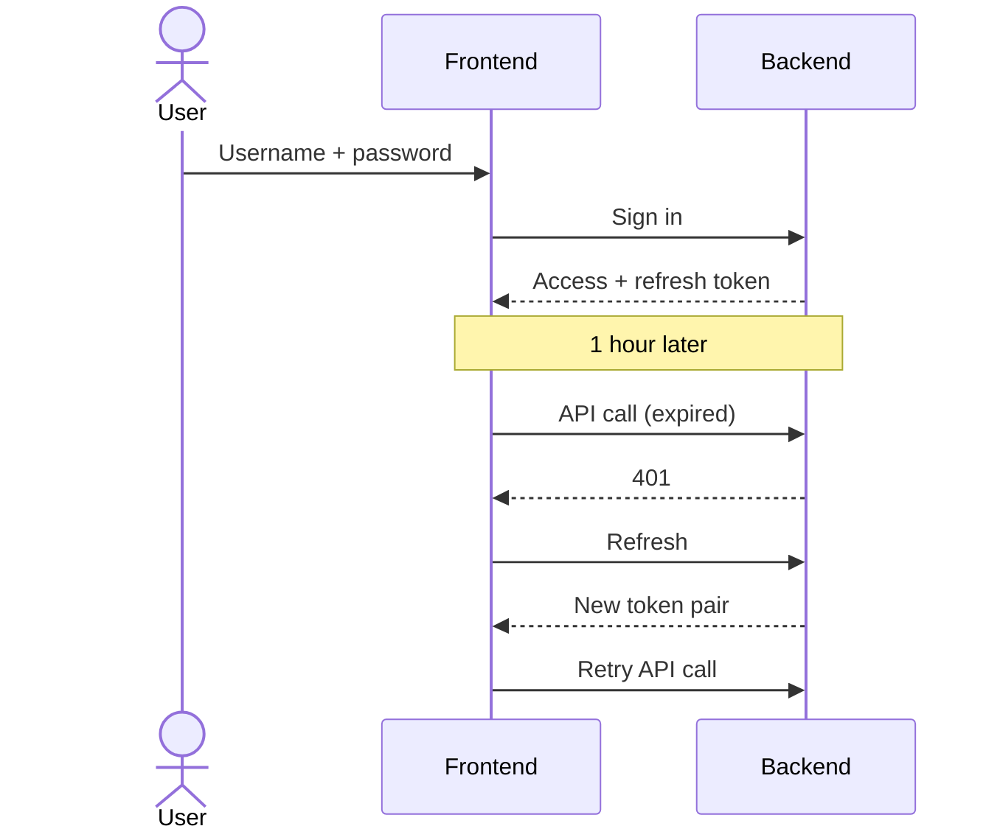
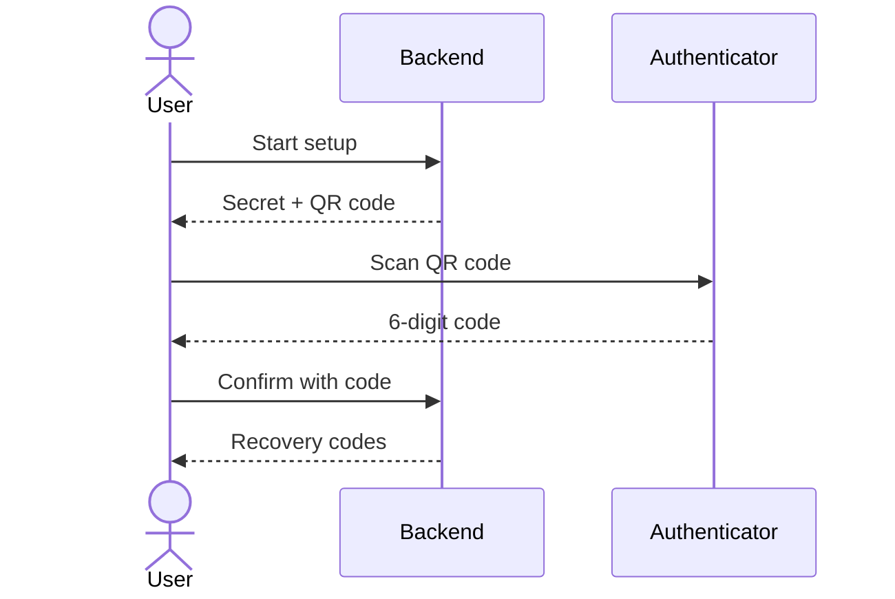
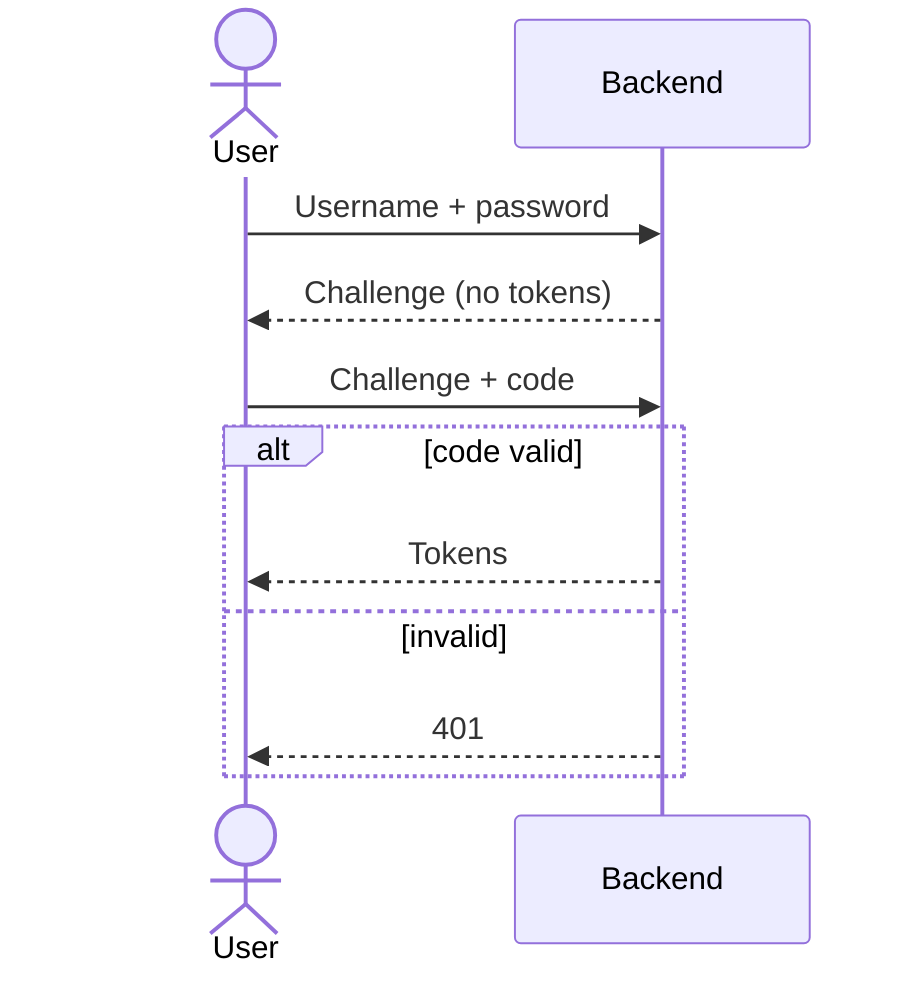
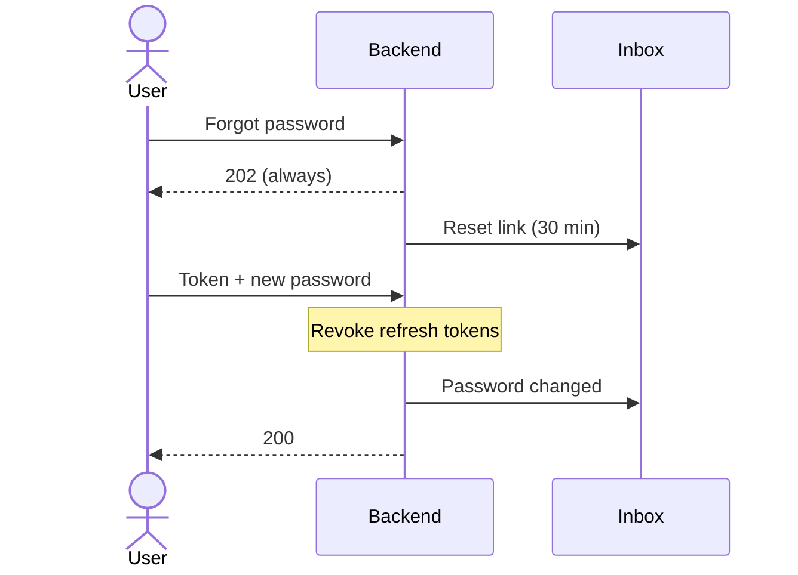

# Accounts and MFA

All account endpoints live in the backend under `/api/v1/users`. The token
model (RS256 access token, rotating refresh token) is explained in
[Authentication](../architecture/auth.md).

## Endpoints

| Method and path | Auth | Result |
| --- | --- | --- |
| `POST /api/v1/users/signup` `{username, email, password, firstName, lastName}` | none | `201`; always creates `ROLE_CLIENT`. Username 4–255, password 8–255, first and last name 4–255, valid email |
| `POST /api/v1/users/signin` `{username, password}` | none | `200 LoginResponseDto`; `422` wrong credentials; MFA accounts get a challenge instead of tokens |
| `POST /api/v1/users/signin/2fa` `{challengeToken, code}` | none | `200` with tokens; `401` invalid challenge or code |
| `POST /api/v1/users/refresh` `{refreshToken}` | none | `200` new access and refresh token; `401` invalid, expired, revoked or reused |
| `POST /api/v1/users/logout` | Bearer | revokes the refresh token |
| `POST /api/v1/users/password/forgot` `{identifier}` | none | always `202` (username or email; no account enumeration) |
| `POST /api/v1/users/password/reset` `{token, newPassword, confirmPassword}` | none | `200`; `400` mismatch, invalid, expired or used token |
| `POST /api/v1/users/sso/exchange` `{idToken}` | none | `404`: SSO is disabled in every profile since it was [removed](../architecture/auth.md#single-sign-on-removed) |
| `GET /api/v1/users/me` | Bearer | current user |
| `GET /api/v1/users/me/email-events` | Bearer | the caller's latest email statuses (`QUEUED`, `SENT_TO_SMTP_SINK`, `FAILED`) |
| `GET /api/v1/users/2fa/status` | Bearer | enabled flag and remaining recovery codes |
| `POST /api/v1/users/2fa/setup` | Bearer | `{secret, otpAuthUri, qrCodeDataUri, expiresAt}`; `409` already enabled |
| `POST /api/v1/users/2fa/confirm` `{code}` | Bearer | enables MFA, returns `recoveryCodes` once |
| `POST /api/v1/users/2fa/recovery-codes` `{password, code}` | Bearer | replaces all recovery codes |
| `POST /api/v1/users/2fa/disable` `{password, code}` | Bearer | removes MFA (TOTP or recovery code), revokes all refresh tokens |
| `GET /api/v1/users`, `GET/PUT/DELETE /api/v1/users/{username}` | Bearer | user administration (list and delete are admin only) |
| `DELETE /api/v1/users/{username}/right-to-be-forgotten` | Bearer | erases the user's data |

`LoginResponseDto`: `token`, `refreshToken`, `username`, `email`, `firstName`,
`lastName`, `roles`, `mfaRequired`, `challengeToken`, `challengeExpiresAt`.

## Password sign-in and refresh

If an attacker replays a refresh token that was already exchanged, the backend
revokes the whole family; the next refresh from the real user also fails and
they must sign in again.

## MFA

### Enrolment

### Sign-in with a second factor

Rules worth testing:

- The challenge is single-use, expires after 5 minutes and is invalidated by a
  newer password sign-in.
- A TOTP code is accepted for the current 30-second step and one step either
  side, and the same step cannot be used twice.
- A recovery code works once.
- Password reset does **not** disable or bypass MFA.
- Disabling MFA and regenerating recovery codes need the current password and
  a second factor.

## Password reset

- The link base is `PASSWORD_RESET_FRONTEND_BASE_URL` (`http://localhost:8081/reset`
  locally, `https://awesome.byst.re/reset` in production).
- In the lightweight profile (`local`) the response also contains the raw
  `token` (`expose-token-in-response: true`) and the email is visible in the
  local outbox `GET /api/v1/local/email/outbox`; other profiles never expose it.
