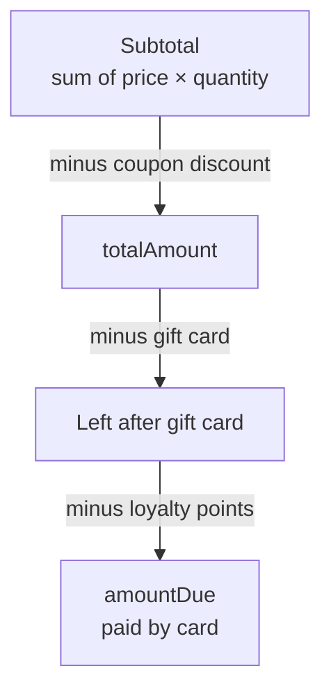

# Cart, coupons, gift cards and loyalty points

Each user has one server-side cart. A coupon lowers the order **total**; a gift
card and loyalty points are **tenders** that pay part of the total, lowering
the **amount due** on the card.

## Cart endpoints

| Method and path | Result |
| --- | --- |
| `GET /api/v1/cart` | Cart with items, subtotal, discount and, only when applied, tender fields |
| `POST /api/v1/cart/items` `{productId, quantity}` | Add |
| `PUT /api/v1/cart/items/{productId}` `{quantity}` | Change quantity |
| `DELETE /api/v1/cart/items/{productId}` | Remove |
| `DELETE /api/v1/cart` | Clear (drops gift card and points too) |
| `PUT` / `DELETE /api/v1/cart/coupon` | Apply / remove a coupon |
| `PUT` / `DELETE /api/v1/cart/gift-card` | Apply / remove a gift card `{code}` |
| `PUT` / `DELETE /api/v1/cart/loyalty-points` | Apply / remove points `{points}` |
| `GET /api/v1/cart/tax-preview?country=PL` | VAT contained in the cart total for a country, see [Checkout](checkout.md#vat) |

The cart JSON is **unchanged** for carts without a gift card or points:
`giftCardCode`, `giftCardAmount`, `pointsRedeemed`, `pointsAmount` and
`amountDue` appear only while one of them is applied.

## Coupons

Admin CRUD under `/api/v1/admin/coupons`. One coupon per cart; applying another
replaces it.

| Rule | Result |
| --- | --- |
| Code `^[A-Z0-9-]{3,32}$`, trimmed and upper-cased | `400` on violation |
| Unknown code | `404 Coupon not found` |
| `active = false` | `400 Coupon is not active` |
| Before `validFrom` / after `validUntil` | `400 Coupon is not valid yet` / `400 Coupon has expired` |
| Subtotal below `minOrderAmount` | `400 Order subtotal must be at least <amount>` |
| Global `maxRedemptions` reached | `409 Coupon usage limit reached` |
| User's `perUserLimit` reached | `409 Coupon already used the maximum number of times` |
| Empty cart | `400 Cart is empty` |

- `PERCENTAGE` (1–100): discount = subtotal × value / 100, half-up to cents.
- `FIXED_AMOUNT` (> 0): discount = min(value, subtotal).
- Checkout re-validates the coupon; if it no longer qualifies, checkout fails
  with `409 Applied coupon is no longer valid: <reason>` and the cart is kept.
- Cancelling an order (or refunding it in full) releases the redemption. A
  coupon with redemptions cannot be deleted (`409`); deactivate it instead.

Demo coupons (lightweight and full): `WELCOME10` (10 % from 50.00), `SAVE50`
(50.00 off from 300.00, 100 uses), `EXPIRED20` (expired), `SPRING25` (starts in
a week).

## Gift cards

| Method and path | Behaviour |
| --- | --- |
| `POST /api/v1/admin/gift-cards` `{amount, expiresAt?, recipientUsername?, note?}` | `201`; generated code `GC-XXXX-XXXX-XXXX` (alphabet without 0/O, 1/I/L); amount 1.00–1000.00, 2 decimals; future `expiresAt`; unknown recipient `404`; recipient gets `GIFT_CARD_ISSUED` |
| `GET /api/v1/admin/gift-cards?status&page&size` | Page, newest first |
| `GET /api/v1/admin/gift-cards/{code}` | Card with its ledger (`transactions`, oldest first) |
| `POST /api/v1/admin/gift-cards/{code}/disable` | Balance kept but unspendable; already disabled `409` |
| `GET /api/v1/gift-cards/{code}` | Customer balance check: `{code, balance, status, expiresAt}` only |

- Codes are case-insensitive; malformed → `400`, unknown → `404`.
- Effective status, in priority order: `DISABLED`, `EXPIRED` (now ≥
  `expiresAt`), `REDEEMED` (balance 0), `ACTIVE`.
- Applying a disabled or expired card → `400`, a card without balance → `409`,
  empty cart → `400`.
- Balance checks and applying a card share a per-user rate limit (30 per 15
  minutes when rate limiting is on) to make code guessing expensive.
- Every balance change locks the card row and writes a ledger row: `ISSUED`,
  `REDEEMED`, `RESTORED`, `DISABLED`.

## Loyalty points

| Method and path | Result |
| --- | --- |
| `GET /api/v1/loyalty` | `{balance, lifetimeEarned, tier, valueOfBalance}` (zeros for new users) |
| `GET /api/v1/loyalty/transactions?page&size` | Ledger, newest first: `EARNED`, `REDEEMED`, `RESTORED`, `REVOKED` with signed `points` |
| `PUT /api/v1/cart/loyalty-points` `{points}` | Whole multiples of 100 (`400`), at most the balance (`409`) |

- **Value:** 100 points = 1.00.
- **Earning:** 1 point per full 1.00 of `totalAmount` minus the part paid with
  points, when the order becomes `PAID` (after-commit listener, once per
  order). The customer receives `LOYALTY_POINTS_EARNED`.
- **Tier** (informational): `BRONZE`, `SILVER` from 1000 lifetime points,
  `GOLD` from 5000.
- **Cancellation** gives back the redeemed points and revokes the points the
  order earned (never below zero). **Refunds** revoke earned points in
  proportion to the refunded share of the total (rounded down).

## Tender order and caps

1. The coupon discount is already part of `totalAmount`.
2. The gift card pays next, capped at its balance and at the total.
3. Points pay last, capped **to the cent**: if the remaining total needs less
   than the applied multiple of 100, `pointsRedeemed` is lowered accordingly.

`amountDue` never drops below zero. A card that can no longer pay previews as
`0.00` in the cart. At checkout the card and the loyalty account are locked and
re-validated; see [Checkout](checkout.md#tenders-at-checkout).

!!! example "Worked example"
    Subtotal 120.00, coupon `WELCOME10` → total **108.00**. Gift card with
    balance 25.00 → 83.00 left. 9000 points applied (90.00) → capped to
    8300 points (83.00). `amountDue` = **0.00**, so no card payment is needed
    and the order is marked `PAID` right after checkout. The order earns
    `floor(108.00 − 83.00)` = **25** points.
