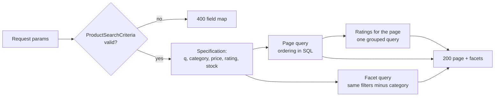

# Catalog and search

The backend owns products, stock, reviews and the wishlist. Every catalog
endpoint requires a bearer token.

## Products

| Method and path | Access | Notes |
| --- | --- | --- |
| `GET /api/v1/products` | authenticated | Bare JSON array; unchanged for older clients and the course suite |
| `GET /api/v1/products/{id}` | authenticated | Returns `ETag: "<version>"`; `If-None-Match` with the current tag → `304` |
| `POST /api/v1/products` | admin | Create |
| `PUT /api/v1/products/{id}` | admin | Optional `If-Match`; a stale version → `412` (lost-update protection) |
| `DELETE /api/v1/products/{id}` | admin | Delete |
| `GET /api/v1/admin/products/export` | admin | RFC 4180 CSV; cells starting with `=`, `+`, `-`, `@`, tab or CR are prefixed with `'` (formula injection) |
| `POST /api/v1/admin/products/import` | admin | Multipart `file`, optional `dryRun=true`; ≤ 1 MB and 1000 rows; all-or-nothing (any row error → `400` with the full report) |
| `GET /api/v1/admin/inventory`, `/{productId}`, `/{productId}/movements`, `POST /{productId}/adjustments` | admin | Stock levels and the movement ledger |

Stock changes are recorded as inventory movements: `INITIAL_STOCK`,
`ADMIN_ADJUSTMENT`, `PURCHASE_RECEIVED` (warehouse receipts) and
`RETURN_RESTOCKED` (resellable returns), among others.

## Product search

`GET /api/v1/products/search` filters, sorts and pages the catalog and returns
facets. All parameters are optional; blank values count as absent.

| Parameter | Meaning |
| --- | --- |
| `q` | Trimmed text, at most 100 characters; case-insensitive substring of name, category or description. `%`, `_` and `\` are literal |
| `category` | Case-insensitive exact category; repeat the parameter or use commas, at most 20 values (any of them matches) |
| `minPrice`, `maxPrice` | Inclusive, ≥ 0, `minPrice` ≤ `maxPrice` |
| `minRating` | 1–5; average of **approved** reviews (unrounded) must be at least this; unrated products are excluded |
| `inStock` | `true` keeps stock > 0; `false` or absent applies no filter |
| `sort` | `relevance` (default with `q`), `newest` (default otherwise), `price_asc`, `price_desc`, `name_asc`, `rating_desc` |
| `page`, `size` | zero-based page (past the end → empty `content`, real totals); size 1–100, default 20 |

Ordering and tie-breakers:

- **relevance** — 4 points for a name match + 2 for category + 1 for
  description, then name, then id. Without `q`, `relevance` behaves like `newest`.
- **newest** — `createdAt` descending, then id descending.
- **price_asc / price_desc** — price, then id ascending.
- **name_asc** — case-insensitive name, then id.
- **rating_desc** — average approved rating (unrated = 0), then review count,
  then name, then id.

```json
{
  "content": [{ "id": 1, "name": "Armchair", "price": 120.00, "stockQuantity": 2,
                "category": "Chairs", "averageRating": 4.5, "reviewCount": 2, "...": "..." }],
  "pageNumber": 0, "pageSize": 20, "totalElements": 1, "totalPages": 1,
  "facets": {
    "categories": [{ "value": "Chairs", "count": 1 }, { "value": "Misc", "count": 3 }],
    "priceRange": { "min": 10.00, "max": 300.00 },
    "inStockCount": 3
  }
}
```

!!! info "Facets ignore the category filter"
    Facets are computed over the products matching **every filter except
    `category`**, so the category facet shows the alternatives to the current
    selection. `priceRange` and `inStockCount` use the same set; facets never
    depend on `page`, `size` or `sort`. `priceRange.min/max` are `null` when
    nothing matches.

Errors: `400` with a field map keyed by parameter name, reporting every
problem at once, e.g.
`{"minPrice":"must not be greater than maxPrice","sort":"must be one of ..."}`;
type errors read `must be a number`, `must be true or false`,
`must be an integer`.



## Reviews and ratings

- `POST /api/v1/products/{id}/reviews` — rating 1–5, title 3–120, body
  10–2000. Allowed only when the user has a `DELIVERED` order containing the
  product (otherwise `403`); one review per user and product (`409`). New
  reviews are `PENDING`.
- `PUT` / `DELETE /api/v1/products/{id}/reviews/mine` — editing puts the review
  back to `PENDING`. `GET .../reviews/mine` returns eligibility plus the review.
- `GET /api/v1/products/{id}/reviews` — approved reviews only, newest first.
- `GET /api/v1/products/{id}/reviews/summary` — average (one decimal, half-up),
  count and the 1–5 distribution over approved reviews.
- Moderation: `GET /api/v1/admin/reviews?status=`,
  `PUT /api/v1/admin/reviews/{id}/moderation` with `APPROVED` or `REJECTED`;
  rejecting requires a note (`400`).

## Wishlist and back-in-stock emails

- `GET /api/v1/wishlist`; `PUT /api/v1/wishlist/{productId}` → `201` created,
  `200` updated; `DELETE` → `204`, `404` when absent; at most 50 products (`409`).
- When stock goes from **0 to a positive** quantity (admin adjustment, product
  edit, cancellation restore, return restock, purchase receipt), every entry
  with `notifyWhenAvailable = true` gets one `BACK_IN_STOCK` email after
  commit — and not again until the product sells out and is replenished.

## Other protocols

The same catalog, cart, order and inventory data is available over GraphQL
(`POST /api/v1/graphql`, GraphiQL at `/api/v1/graphiql`) and native gRPC
(inventory, loopback only). See the
[protocol testing lab](../reference/PROTOCOL_TESTING_LAB.md) and
[gRPC inventory](../reference/GRPC_INVENTORY.md).
