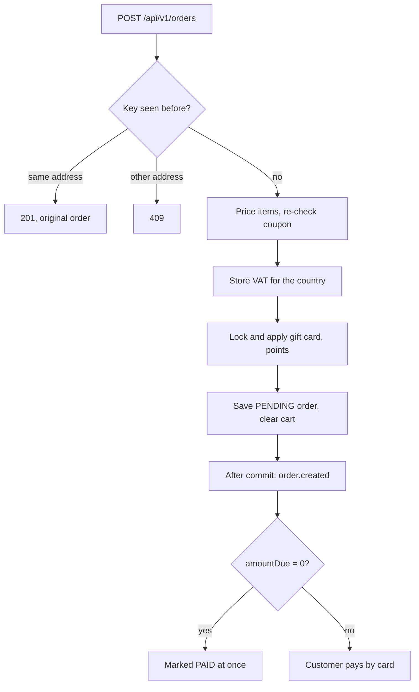

# Checkout, VAT and tenders

`POST /api/v1/orders` turns the current cart into an order. It always answers
with status `PENDING`; payment happens afterwards.

## What happens inside checkout

## Idempotent checkout

- Optional header `Idempotency-Key`, `^[A-Za-z0-9_-]{8,64}$` (otherwise `400`).
- Scoped per user, valid 24 hours.
- Same key + same address → the original order, `201`,
  `Idempotent-Replayed: true`, no second order and no second `order.created`.
- Same key + different address → `409`.
- The frontend sends a key with checkout, so a double click or a retried
  request never creates two orders.

## VAT

Prices are **VAT-inclusive (gross)**: VAT never changes a total, it only shows
how much tax the total contains.

1. The free-text shipping `country` is resolved to ISO 3166-1 alpha-2
   (`CountryResolver`): alpha-2 and alpha-3 codes, English names and variants
   such as `UK`, `Great Britain`, `USA`, `Polska`, `Deutschland`; case, dots and
   extra spaces are ignored; any other two letters are taken as a code.
2. If a rate exists, after coupon pricing:
   `taxAmount = totalAmount − totalAmount / (1 + rate/100)` (half-up to cents)
   and `netAmount = totalAmount − taxAmount`.
3. `OrderDto` gets `taxCountry`, `taxRate`, `taxAmount`, `netAmount`, fixed at
   checkout. Unknown countries omit all four fields.

Rates (table `vat_rates`): the EU-27 standard rates plus GB 20, CH 8.1, NO 25,
US 0 and CA 0. A rate of 0 means VAT is not applicable.

| Method and path | Access | Behaviour |
| --- | --- | --- |
| `GET /api/v1/vat-rates` | authenticated | All rates by code |
| `GET /api/v1/vat-rates/{country}` | authenticated | Code or name; `404` when unknown or without a rate |
| `PUT /api/v1/admin/vat-rates/{countryCode}` | admin | `{countryName, rate}`; rate 0–50, 2 decimals; `UK` stored as `GB`; `201` created / `200` updated |
| `GET /api/v1/cart/tax-preview?country=PL` | authenticated | `{country, rate, taxAmount, netAmount, totalAmount}`; `400` without country, `404` unknown |

!!! example "VAT example"
    Total 123.00 shipped to Poland (23 %): tax = 123.00 − 123.00/1.23 =
    **23.00**, net **100.00**. The same cart shipped to the US: no tax fields.

A later rate change affects only new orders. A refund on a taxed order records
the VAT it contains (`order_refunds.tax_amount`, not exposed).

## Tenders at checkout

- The gift card and the loyalty account are **locked and re-validated**. A
  disabled, expired, empty or deleted card, or too few points, fails checkout
  with `409` (`Applied gift card is no longer valid: <reason>` /
  `Applied loyalty points are no longer available: Insufficient loyalty points`);
  the transaction rolls back and the cart is kept.
- On success the order stores `giftCardCode`, `giftCardAmount`,
  `pointsRedeemed`, `pointsAmount` and the cart selection is cleared.
- `OrderDto` shows those fields plus
  **`amountDue = totalAmount − giftCardAmount − pointsAmount`** only for orders
  that used a tender; they never change after checkout.
- When `amountDue` is 0, a listener marks the order `PAID` right after the
  checkout commits (publishing `ORDER_PAID` and earning points).

## Order fields

| Field | Meaning |
| --- | --- |
| `status` | `PENDING`, `PAID`, `SHIPPED`, `DELIVERED`, `CANCELLED` |
| `fulfilmentState` | Mirror of the warehouse progress, see [Fulfilment](fulfilment.md) |
| `subtotalAmount`, `discountAmount`, `couponCode`, `totalAmount` | `totalAmount = subtotalAmount − discountAmount` |
| `taxCountry`, `taxRate`, `taxAmount`, `netAmount` | Only when VAT applies |
| `giftCardCode`, `giftCardAmount`, `pointsRedeemed`, `pointsAmount`, `amountDue` | Only when a tender was used |
| `refundedAmount` | Only once a refund was booked |

## After checkout

| Action | Endpoint | Rule |
| --- | --- | --- |
| Pay by card | `POST /api/v1/payments` (payment-service) | Order must be `PENDING`; see [Card payments](payments.md) |
| Cancel | `POST /api/v1/orders/{id}/cancel` | Allowed while `fulfilmentState` is `NONE` or `AWAITING_PICK`; `409` from `PICKED` on; `400` for shipped or delivered orders. Restores stock, coupon, gift card and points; queues a card refund when a payment was captured |
| Admin status | `PUT /api/v1/orders/{id}/status` | Legacy admin endpoint; `409` while the order is in the warehouse (`AWAITING_PICK` … `SHIPPED`) |
| Admin list | `GET /api/v1/orders/admin` | All orders |
