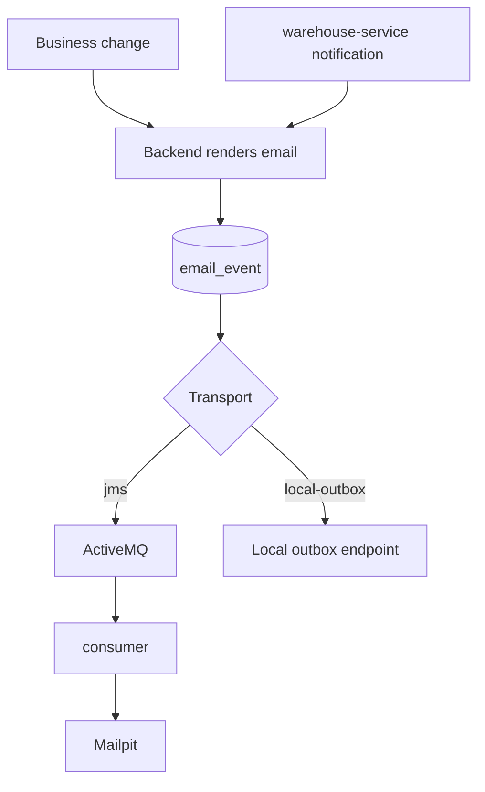

# Emails

The **backend renders every customer email** (subject and body). Other
services only ask for an email by template name and properties; the JMS
consumer only delivers what it receives.

## Pipeline

| Profile | Transport | Where to read the email |
| --- | --- | --- |
| lightweight (`local`) | in-memory local outbox | `GET /api/v1/local/email/outbox` (clear with `DELETE`) |
| full (`docker,demo`) | Artemis → consumer → Mailpit | `http://localhost:8025` |
| production `awesome.byst.re` | Artemis → consumer → Mailpit (private) | users see statuses through `GET /api/v1/users/me/email-events` |
| sandbox `aitesters.byst.re` | local outbox | `GET /api/v1/local/email/outbox` with a token and the configured secondary access key |

## Templates

| Template | Sent when | Properties |
| --- | --- | --- |
| `PASSWORD_RESET_REQUESTED` | Password reset requested | reset link, expiry, username |
| `PASSWORD_RESET_CONFIRMED` | Password changed through reset | — |
| `BACK_IN_STOCK` | Wishlisted product goes 0 → n | product |
| `PAYMENT_RECEIVED` | Card capture marks the order `PAID` | `orderId`, `amount` |
| `PAYMENT_FAILED` | Card payment failed for a `PENDING` order | `orderId`, `failureCode`, `failureMessage?` |
| `LOYALTY_POINTS_EARNED` | Order `PAID` earned points | `points`, `balance`, `orderId?` |
| `GIFT_CARD_ISSUED` | Admin issues a card to a recipient | `code`, `amount` |
| `ORDER_SHIPPED` | warehouse ships | `orderId`, `carrier`, `trackingNumber` |
| `SHIPMENT_OUT_FOR_DELIVERY` | simulated carrier | `orderId`, `carrier`, `trackingNumber` |
| `SHIPMENT_DELIVERY_FAILED` | simulated carrier, failed attempt | `orderId`, `carrier`, `trackingNumber` |
| `ORDER_DELIVERED` | delivery confirmed | `orderId` |
| `RETURN_UPDATED` | return approved, rejected or refunded | `returnId`, `orderId`, `status`, `refundAmount?`, `note?` |
| `GENERIC` | `POST /api/v1/email` and fallback | subject and message |

The consumer (3.6.0) delivers the rendered text unchanged and maps template
names it does not know to `GENERIC`, so new templates need no consumer
release.

## Reliability

- Every email to a known user is recorded in `email_event` with its payload and
  status (`QUEUED`, `SENT_TO_SMTP_SINK`, `FAILED`).
- A send that fails (for example while Artemis is down) is retried by
  `EmailRetryJob` every minute with backoff 1, 2, 4, 8 minutes — five attempts
  in total. A send lost in a restart is retried after 20 minutes.
  `APP_EMAIL_RETRY_ENABLED` and `APP_EMAIL_RETRY_INTERVAL` configure the job.
- warehouse-service notifications carry a `requestId`; the backend sends one
  email per `requestId`, so outbox retries never duplicate an email.
- Emails triggered by domain events are sent **after commit**: a rolled-back
  checkout never emails anybody.

## Sending your own email

`POST /api/v1/email` (authenticated) queues a `GENERIC` email — a simple way
to exercise the JMS → consumer → SMTP path in the full profile. Production
deployment verification publishes a contract message straight to Artemis and
waits for it in Mailpit.
