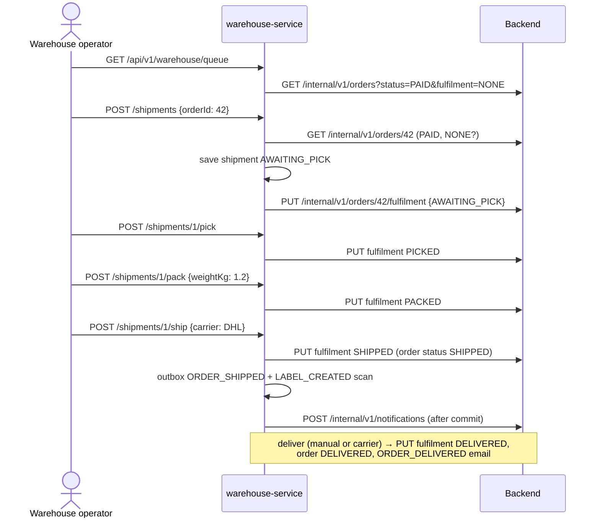
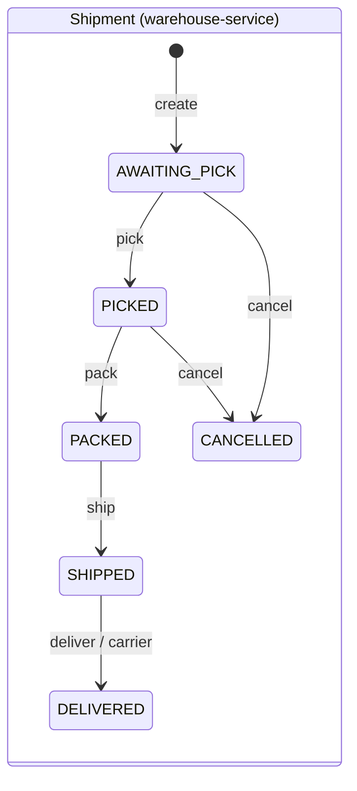

# Warehouse fulfilment

warehouse-service turns **paid** orders into parcels. The backend does not
store shipments; it mirrors the progress in `orders.fulfilment_state`, which
drives the cancellation rules the customer sees.

Endpoints under `/api/v1/warehouse` require `ROLE_WAREHOUSE` or `ROLE_ADMIN`
(demo user `warehouse` / `warehouse`; UI page `/warehouse`).

## Endpoints

| Method and path | Result |
| --- | --- |
| `GET /api/v1/warehouse/queue` | `PAID` orders without a shipment, oldest first |
| `POST /api/v1/warehouse/shipments` `{orderId}` | Create a shipment (`AWAITING_PICK`); the order must be `PAID` and unreleased (`409` otherwise or when one exists) |
| `GET /api/v1/warehouse/shipments?status=` | List |
| `GET /api/v1/warehouse/shipments/{id}` | One shipment (also reconciles a customer cancellation) |
| `GET /api/v1/warehouse/shipments/{id}/pick-list` | Items to pick |
| `POST /api/v1/warehouse/shipments/{id}/pick` | `AWAITING_PICK → PICKED` |
| `POST /api/v1/warehouse/shipments/{id}/pack` `{weightKg}` | `PICKED → PACKED`; weight 0.01–30.00 kg |
| `POST /api/v1/warehouse/shipments/{id}/ship` `{carrier, trackingNumber?}` | `PACKED → SHIPPED`; omit `trackingNumber` for the [simulated carrier](tracking.md) |
| `POST /api/v1/warehouse/shipments/{id}/deliver` | `SHIPPED → DELIVERED` (manual confirmation) |
| `POST /api/v1/warehouse/shipments/{id}/carrier/advance` | Fast-forward a simulated parcel one scan |
| `POST /api/v1/warehouse/shipments/{id}/cancel` | Only in `AWAITING_PICK` or `PICKED`: cancels the order and restores stock |
| `GET /api/v1/orders/{id}/shipment` | Owner or admin: the order's shipment |

Any other transition is `409`.

## Carriers and tracking numbers

| Carrier | Manual tracking number format | Nominal transit (estimate) |
| --- | --- | --- |
| `INPOST` | 24 digits | 1 day |
| `DPD` | 14 digits | 2 days |
| `DHL` | 10 digits | 2 days |
| `UPS` | `1Z` + 16 upper-case letters or digits | 3 days |

A supplied number that does not match its carrier is `400`; a blank string is
also `400`.

## The workflow

## Two state machines, kept in step

Backend `fulfilmentState`:
`NONE → AWAITING_PICK → PICKED → PACKED → SHIPPED → DELIVERED`, plus
`CANCELLED` from `NONE`/`AWAITING_PICK` (customer or admin) or
`AWAITING_PICK`/`PICKED` (warehouse cancel).

| Backend rule | Result |
| --- | --- |
| `PUT fulfilment AWAITING_PICK` | Only for `PAID` orders in `NONE`; repeating it is a no-op `200` |
| Other steps | Next forward step only; skips, backward steps and steps after `CANCELLED` → `409` |
| `SHIPPED` / `DELIVERED` | Also set the order status |
| Customer or admin cancel while `NONE` or `AWAITING_PICK` | Allowed; stock, coupon and tenders restored |
| Customer or admin cancel from `PICKED` on | `409 Order is already being packed and cannot be cancelled` |
| Legacy admin status change while `AWAITING_PICK` … `SHIPPED` | `409` |

## Consistency with the backend

- **Validate locally → call the backend → persist.** A failed backend call
  leaves no local change. Backend `4xx` keep their status and message;
  `5xx`, timeouts and a rejected service token become
  `503 {"message":"Backend unavailable"}`.
- **Lost release response.** On `503` during create, the service reads the
  order again and keeps the shipment if the release reached the backend; an
  order already `AWAITING_PICK` without a shipment can be released again (it
  is adopted).
- **Reconciler (every minute).** Cancels `AWAITING_PICK` shipments whose order
  the customer cancelled (`lastActor = "system"`), and adopts orders the
  backend reports as `AWAITING_PICK` without a shipment if they are older than
  two minutes. Reading a shipment or a refused transition reconciles
  immediately and answers `409 Order was cancelled by the customer`.
- **Notifications** use a transactional outbox with retries; the backend sends
  one email per `requestId`.

Contract: [Warehouse service contract](../reference/WAREHOUSE_SERVICE_CONTRACT.md).
