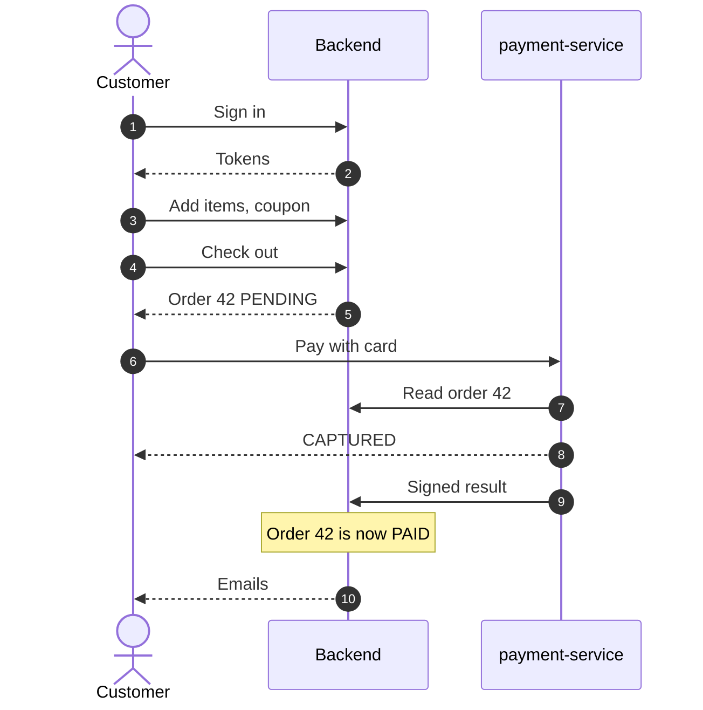
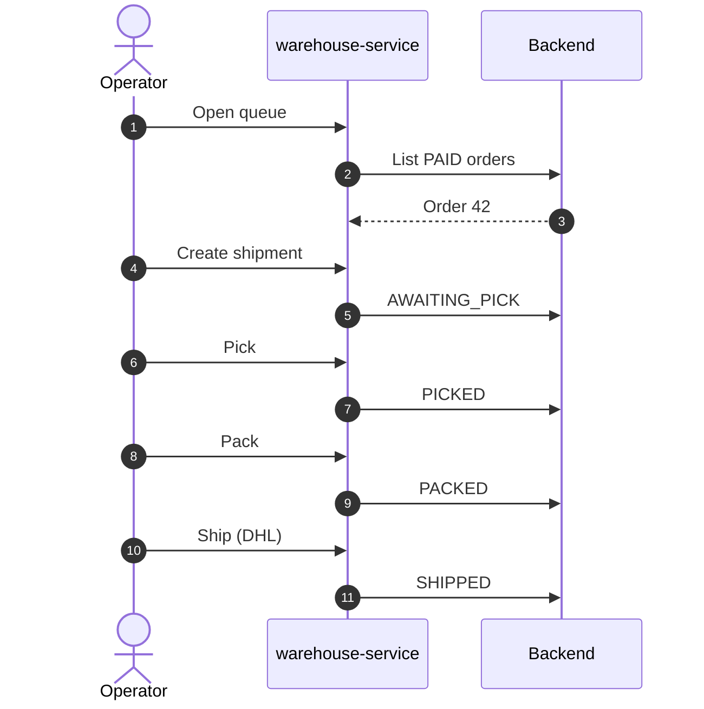
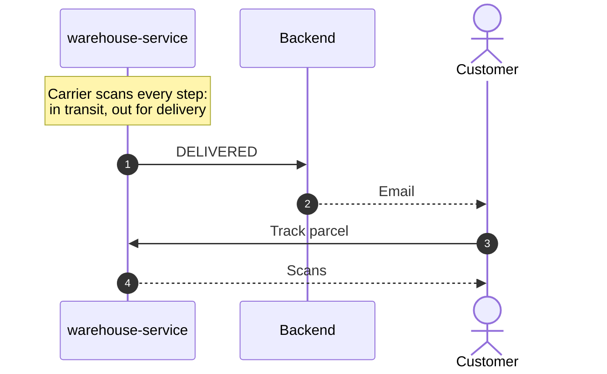

# Business flows

Each page describes one business capability: the rules, the endpoints, and a
diagram of who calls whom. Paths are gateway paths.

| Flow | Owner service | Page |
| --- | --- | --- |
| Sign-up, sign-in, refresh, MFA, password reset, SSO | backend | [Accounts, MFA and SSO](accounts.md) |
| Catalog, product search, facets, reviews, wishlist | backend | [Catalog and search](catalog-search.md) |
| Cart, coupons, gift cards, loyalty points | backend | [Cart, coupons, gift cards, loyalty](cart.md) |
| Checkout, VAT, tenders, `amountDue`, idempotency | backend | [Checkout, VAT and tenders](checkout.md) |
| Card payments, 3-D Secure, settlement, voids, refunds | payment-service + backend | [Card payments](payments.md) |
| Queue → pick → pack → ship → deliver | warehouse-service + backend | [Warehouse fulfilment](fulfilment.md) |
| Simulated carrier, public tracking | warehouse-service | [Carrier tracking](tracking.md) |
| Returns (RMA), refunds and their split | warehouse-service + backend + payment-service | [Returns and refunds](returns-refunds.md) |
| Suppliers, purchase orders, reorder suggestions | warehouse-service | [Purchasing and suppliers](purchasing.md) |
| Customer emails | backend + consumer | [Emails](emails.md) |
| Signed HTTP callbacks for order events | backend | [User webhooks](webhooks.md) |
| Display currencies | backend + frontend | [Currencies](currencies.md) |
| Order, payment, shipment, return state machines | all | [State machines](state-machines.md) |

## The order journey

The happy path of one order across all services: a card that is captured
immediately and a parcel handed to the simulated carrier. It is split into
three stages.

### 1. Buy and pay

Endpoints: `POST /api/v1/users/signin`, `POST /api/v1/cart/items`,
`PUT /api/v1/cart/coupon`, `POST /api/v1/orders`, `POST /api/v1/payments`;
internally `GET /internal/v1/orders/42` and
`POST /internal/v1/orders/42/payment`. Details: [Checkout](checkout.md),
[Card payments](payments.md).

### 2. Warehouse

Endpoints: `GET /api/v1/warehouse/queue`, `POST /api/v1/warehouse/shipments`,
`POST /api/v1/warehouse/shipments/{id}/pick|pack|ship`; internally
`PUT /internal/v1/orders/42/fulfilment`. Details:
[Warehouse fulfilment](fulfilment.md).

### 3. Delivery

Endpoints: `GET /api/v1/orders/42/shipment/tracking` (or the public
`GET /api/v1/tracking/{number}`). Details: [Carrier tracking](tracking.md).

After delivery the customer may [review the product](catalog-search.md#reviews-and-ratings)
and, within 30 days, [request a return](returns-refunds.md). Every status change
above also triggers the customer's [webhooks](webhooks.md).

## Domain events

The backend publishes a domain event inside the transaction that changes an
order; listeners run **after commit**. Emails, loyalty points, card refunds
and user webhooks all hang off these events.

| Event | Wire name | Published when |
| --- | --- | --- |
| `ORDER_CREATED` | `order.created` | Checkout creates an order (not on an idempotent replay) |
| `ORDER_PAID` | `order.paid` | Admin status change to `PAID`, a captured card payment, or tenders covering the whole total |
| `ORDER_CANCELLED` | `order.cancelled` | Any cancellation: customer, admin or warehouse |
| `ORDER_SHIPPED` | `shipment.shipped` | Admin status change to `SHIPPED` or fulfilment reaching `SHIPPED` |
| `ORDER_DELIVERED` | `shipment.delivered` | Admin status change to `DELIVERED` or fulfilment reaching `DELIVERED` |
| `REFUND_BOOKED` | `refund.booked` | A refund is booked for a return |
| `PAYMENT_FAILED` | `payment.failed` | payment-service reports a failed payment for a `PENDING` order |

Every event's `data` contains `orderId`, `status` and `totalAmount`; refunds
add `amount` and `requestId`, payments add `paymentId` (and `failureCode` on
failure). Repeating the current status, replays and rejected changes publish
nothing.
