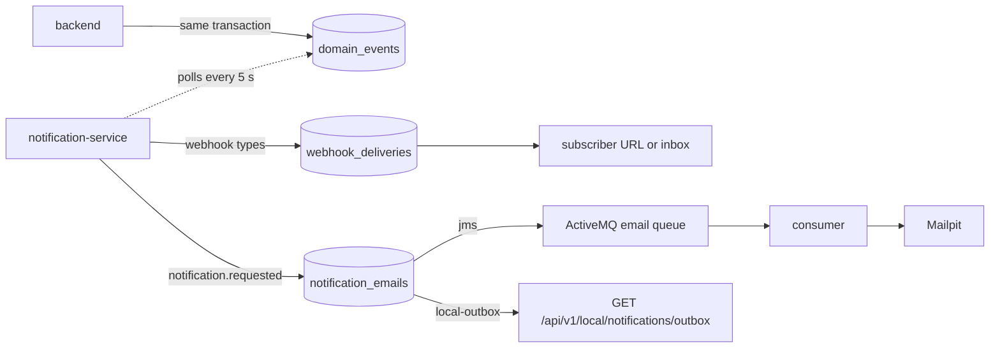

# Notifications

**notification-service** (port 4005, from backend 3.21.0) reacts to commerce
events: it sends user webhooks and the customer's commerce emails. It never
receives a call from the backend; it reads the backend's
[event feed](../reference/EVENT_FEED.md) every 5 seconds.

| What | Endpoint | Notes |
| --- | --- | --- |
| Webhooks and inboxes | `/api/v1/webhooks`, `/api/v1/webhook-inboxes`, `GET /api/v1/admin/webhooks` | Same API as backend 3.20.1; see [User webhooks](webhooks.md) |
| My commerce emails | `GET /api/v1/notifications/emails?page&size` | Newest first, recipient masked; admins may pass `username` |
| Local outbox | `GET /api/v1/local/notifications/outbox` | Lightweight profile and the aitesters sandbox (key-protected there) |
| OpenAPI | `/notification/v3/api-docs` | |

Timing: an event becomes visible in the feed after a 3 s settle delay, so a
delivery or an email leaves 5–8 s after the change. When the backend is down
(`scripts/chaos backend-down notification`) nothing new is read; when a
receiver or the broker is down, deliveries and emails wait in the service's
outboxes (`notification_outbox_pending` in Prometheus) and are retried.

On its first start notification-service imports the backend's existing
subscriptions and inboxes (ids and secrets kept), so moving to 3.21.0 does not
break subscribers. Details: [notification-service contract](../reference/NOTIFICATION_SERVICE_CONTRACT.md),
[ADR 5](../reference/ARCHITECTURE_DECISIONS.md#adr-5-notifications-move-out-of-the-backend).

## Test ideas

- Subscribe an inbox to `order.paid`, pay an order and compare the delivery's
  `X-Request-Id` with the payment request's id.
- Pay an order and find `PAYMENT_RECEIVED` in `GET /api/v1/notifications/emails`;
  another user must not see it.
- Stop the event flow with `scripts/chaos partition-notification`, change
  orders, heal, and check nothing was lost or duplicated.
