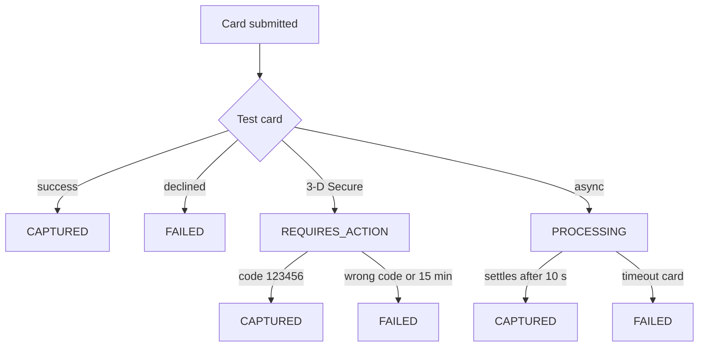
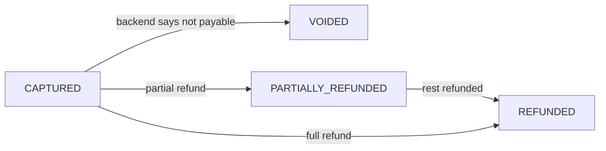
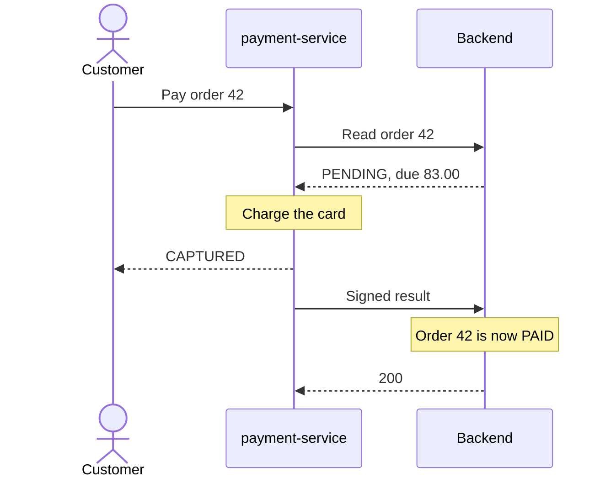
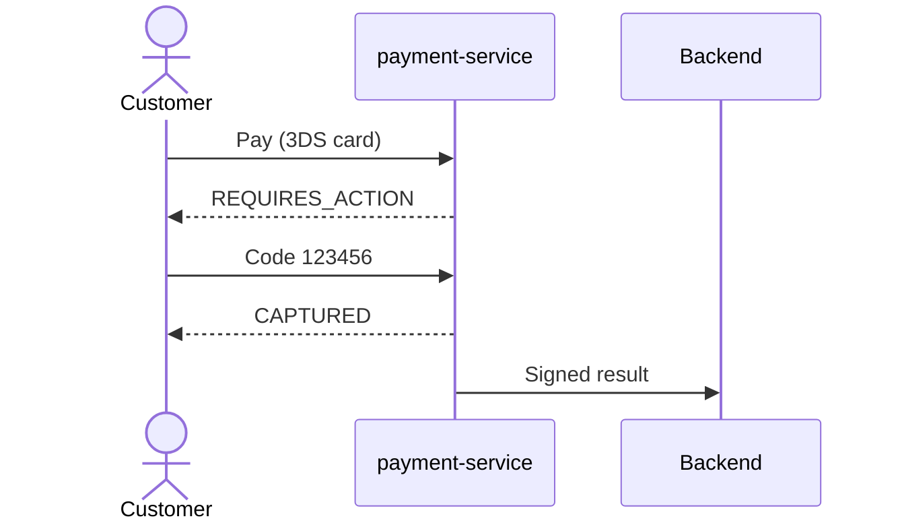
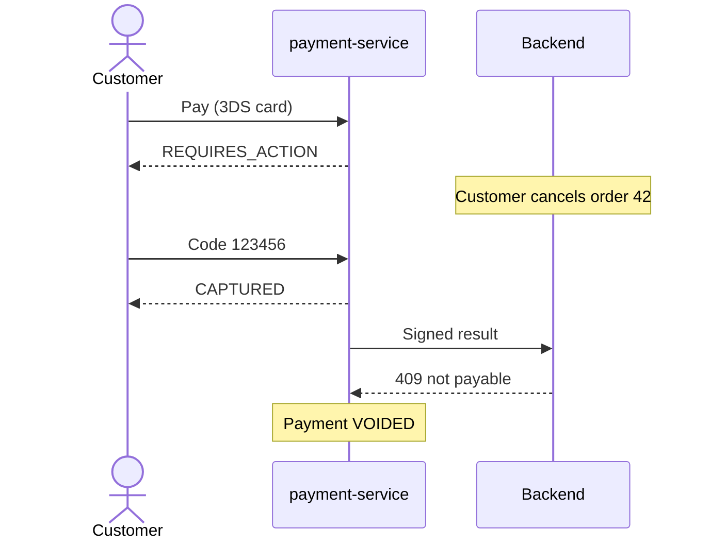

# Card payments

payment-service (port 4004) is a **fake card provider** with deterministic
test cards. It decides whether a payment succeeds and tells the backend, which
owns the order status. Public order bodies never contain card data.

## Endpoints

All public endpoints need an access token with `ROLE_CLIENT` or `ROLE_ADMIN`.
Clients see only their own orders and payments.

| Method and path | Result |
| --- | --- |
| `POST /api/v1/payments` + `Idempotency-Key` | `{orderId, card:{number, expiryMonth, expiryYear, cvc, holderName}}` → `201 PaymentDto`; replay `200` + `Idempotent-Replayed: true`; `400` validation, Luhn, expired card or bad key; `403` not your order; `404` order; `409` not payable or key reused with another body; `503` backend down |
| `POST /api/v1/payments/{id}/3ds` `{code}` | `123456` captures, anything else fails with `THREE_DS_FAILED`; `409` when not `REQUIRES_ACTION` |
| `GET /api/v1/payments/{id}` | `200` / `403` / `404` |
| `GET /api/v1/orders/{orderId}/payments` | Payments of the order, newest first |
| `GET /api/v1/admin/payments?status&page&size` | Admin, newest first, size 1–100 |

`PaymentDto`: `id` (UUID), `orderId`, `status`, `amount`, `currency` (USD),
`cardBrand`, `cardLast4`, `failureCode`, `failureMessage`, `nextAction`
(`{type: THREE_DS_CHALLENGE, hint}` while `REQUIRES_ACTION`, else `null`),
`refundedAmount`, `createdAt`, `updatedAt`.

The amount charged is the order's **`amountDue`** (total minus gift card and
points), read from the backend at payment time.

## Test cards

Spaces and dashes are ignored; the expiry must not be before the current
month; the number must pass the Luhn check (otherwise `400`).

| Number | Outcome |
| --- | --- |
| `4242 4242 4242 4242` | `CAPTURED` immediately (VISA) |
| `5555 5555 5555 4444` | `CAPTURED` immediately (MASTERCARD) |
| `4000 0000 0000 0002` | `FAILED` `CARD_DECLINED` |
| `4000 0000 0000 9995` | `FAILED` `INSUFFICIENT_FUNDS` |
| `4000 0000 0000 3220` | `REQUIRES_ACTION` — 3-D Secure, code `123456` |
| `4000 0000 0000 0077` | `PROCESSING`, settles to `CAPTURED` after the settlement delay (10 s) |
| `4000 0000 0000 0119` | `PROCESSING`, then `FAILED` `PROVIDER_TIMEOUT` after the same delay |
| `4000 0000 0000 0259` | `CAPTURED`; the result is delivered to the backend **twice** with the same `requestId` |
| any other Luhn-valid number | `CAPTURED` (brand from the prefix: VISA, MASTERCARD, AMEX, OTHER) |

## Payment lifecycle

After a capture:

An order is **payable** when the backend reports it `PENDING` and it has no
local payment in `REQUIRES_ACTION`, `PROCESSING`, `CAPTURED`,
`PARTIALLY_REFUNDED` or `REFUNDED`. Failed and voided payments do not block a
new attempt. Payment creation per order is serialised with a row lock
(`order_payment_locks`), so two concurrent submissions can never both become
the active payment.

## Synchronous capture

The frontend's `/orders/:id/pay` page submits the card with a fresh
`Idempotency-Key`, then polls the payment while it is `PROCESSING` and shows
the 3-D Secure form while it is `REQUIRES_ACTION`.

## 3-D Secure

A challenge not answered within `payment.three-ds-timeout` (15 minutes) fails
with `THREE_DS_EXPIRED` — expired by the settlement job, by a new payment
attempt for the same order, or by a late answer (which then gets `409`).

## Asynchronous settlement and provider timeout

Cards `…0077` and `…0119` return `PROCESSING`. A settlement job (every 2 s)
finalises payments older than `payment.settlement-delay` (`PT10S`): `…0077`
becomes `CAPTURED`, `…0119` becomes `FAILED` with `PROVIDER_TIMEOUT`. The
result reaches the backend through the same signed outbox; the order stays
`PENDING` until then, and a failed result leaves it `PENDING` so the customer
can try another card.

## How the backend handles a result

| Situation | Backend answer |
| --- | --- |
| Missing or wrong service token | `401 Invalid service token` |
| Bad, stale (> 5 min) or missing signature | `401 Invalid payment signature` |
| Invalid fields; `FAILED` without `failureCode` | `400` |
| Unknown order | `404` |
| Repeated `requestId`, same order, payment and status | `200` with the first answer, no side effects |
| Repeated `requestId` with anything else | `409` |
| `CAPTURED` for `PENDING`, amount = `amountDue` | `200 PAID`; `ORDER_PAID`, email `PAYMENT_RECEIVED` |
| `CAPTURED` with another amount | `422`, order unchanged |
| `CAPTURED` again by the payment that already paid (new `requestId`) | `200` current status |
| `CAPTURED` for a cancelled order, or one paid by another payment or an admin | `409 Order is not payable` → payment-service **voids** it |
| `FAILED` | `200` unchanged status; for `PENDING` orders `PAYMENT_FAILED` event and email |

### Duplicate notification (`…0259`)

The result is delivered twice with the same `requestId`. The second delivery
gets the stored first answer and causes no second email, event or loyalty
credit — a ready-made idempotency exercise.

### Void

## Refunds to the card

Refunds are initiated by the backend, never by the customer directly:

- **Return refunds** — when warehouse-service books a refund, the backend
  splits it **card first** (see [Returns and refunds](returns-refunds.md#refund-split)).
- **Cancellation of a paid order** — cancelling an order with a captured
  payment queues a refund of the captured amount minus earlier card refunds
  (`requestId = UUID.nameUUIDFromBytes("cancel:" + orderId)`, reason
  `Order cancelled`).

The backend delivers both from `payment_refund_outbox` to
`POST /internal/v1/payments/refunds` `{requestId, orderId, amount, reason}`:

| payment-service answer | Outbox row |
| --- | --- |
| `200 {refundId, paymentId, amount, status}` | `SENT` |
| `404` — no captured payment | `SKIPPED` |
| `409` exceeds refundable, `400`, `422` | `FAILED`, not retried |
| `5xx`, timeout, connection error | retried 30 s → 30 min, `FAILED` after 10 attempts |

payment-service moves the payment to `PARTIALLY_REFUNDED` or `REFUNDED` and is
idempotent per `requestId`.

## Configuration

| Variable | Default | Meaning |
| --- | --- | --- |
| `PAYMENT_SETTLEMENT_DELAY` | `PT10S` | Delay for `PROCESSING` cards |
| `PAYMENT_THREE_DS_TIMEOUT` | `PT15M` | Unanswered challenge expiry |
| `PAYMENT_SETTLEMENT_INTERVAL` | `PT2S` | Settlement job period |
| `PAYMENT_NOTIFICATIONS_RETRY_INTERVAL` | `PT30S` | Result outbox retry period |
| `PAYMENT_SERVICE_TOKEN`, `PAYMENT_WEBHOOK_SECRET` | required in `docker` | Shared with the backend |
| `PAYMENT_REFUNDS_DELIVERY_INTERVAL` (backend) | `PT15S` | Refund outbox period |

Contract: [Payment service contract](../reference/PAYMENT_SERVICE_CONTRACT.md).
