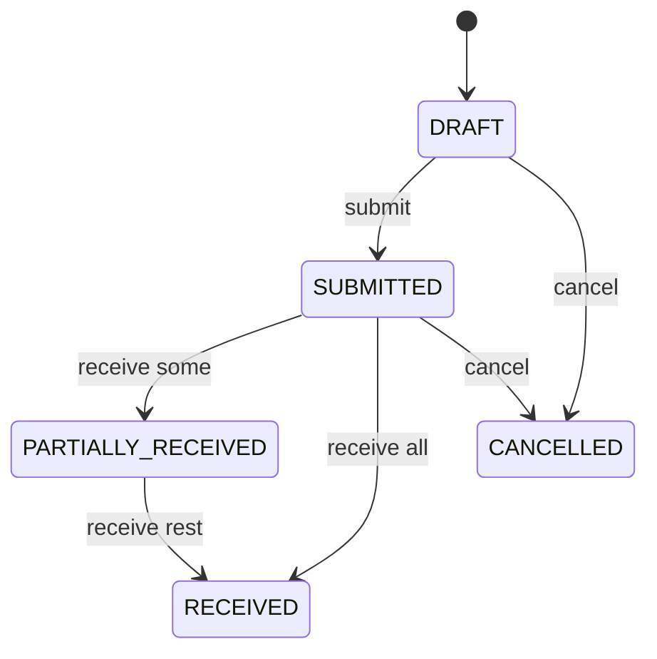
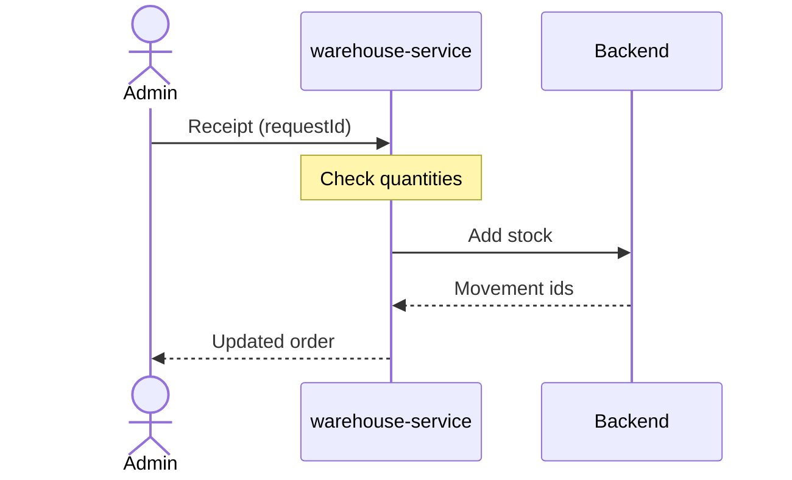

# Purchasing and suppliers

warehouse-service lets an admin buy stock from suppliers. Receiving goods
raises stock in the backend through the internal receipts API. UI page:
`/admin/purchasing`. All endpoints require `ROLE_ADMIN`.

## Endpoints

| Method and path | Result |
| --- | --- |
| `GET` / `POST /api/v1/admin/suppliers` | List / create suppliers (name, email, lead time in days) |
| `GET /api/v1/admin/purchase-orders`, `GET .../{id}` | List / read |
| `POST /api/v1/admin/purchase-orders` | Create a `DRAFT` with lines (product snapshots) |
| `PUT /api/v1/admin/purchase-orders/{id}` | Replace lines; `DRAFT` only |
| `POST /api/v1/admin/purchase-orders/{id}/submit` | Needs at least one line; sets `expectedAt = submittedAt + supplier lead time` |
| `POST /api/v1/admin/purchase-orders/{id}/cancel` | `DRAFT` or `SUBMITTED` only |
| `POST /api/v1/admin/purchase-orders/{id}/receipts` | `{requestId, lines:[{productId, quantity}]}` |
| `GET /api/v1/admin/inventory/reorder-suggestions?lowStockThreshold=5` | Products to reorder |

## Purchase order lifecycle



## Receipts

- Only `SUBMITTED` and `PARTIALLY_RECEIVED` orders accept receipts.
- Receiving more than is outstanding for a line is `409`.
- A repeated `requestId` with the same lines replays the previous result; the
  same `requestId` with different lines is `409`.
- Stock rises in the backend with `PURCHASE_RECEIVED` movements
  (`POST /internal/v1/inventory/receipts`, itself idempotent per request id). A
  0 → n change triggers back-in-stock emails for wishlists.



## Reorder suggestions

For every product, `projected = stock + incoming`, where *incoming* is the
outstanding quantity on `SUBMITTED` and `PARTIALLY_RECEIVED` purchase orders.
A product is suggested when `projected ≤ lowStockThreshold`, with

```text
suggestedQuantity = 4 × lowStockThreshold − projected
```

sorted by projected quantity, then product id. `lowStockThreshold` defaults to
5 and must be at least 1.

!!! example
    Threshold 5, stock 1, 2 units incoming → projected 3 ≤ 5 → suggest
    4 × 5 − 3 = **17** units.

Demo suppliers (lightweight and full): **Nordic Electronics**
(orders@nordic-electronics.test, 7 days) and **Baltic Gadgets**
(purchasing@baltic-gadgets.test, 14 days).
