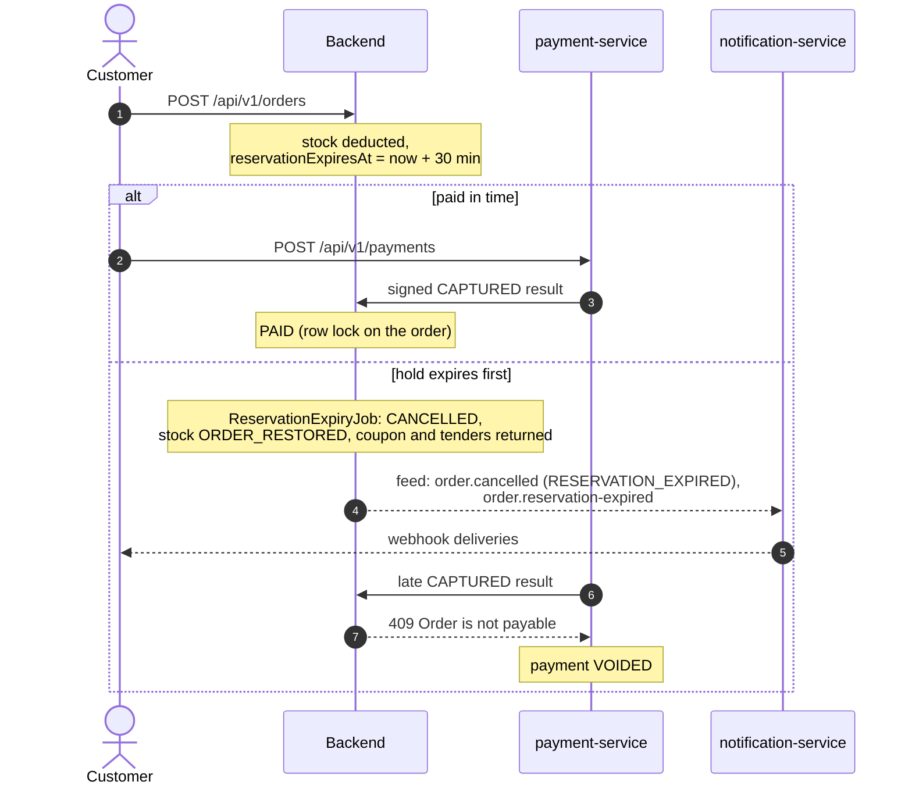

# Stock reservations

From backend 3.21.0 the stock an order takes is a **hold with a time limit**.
Stock is still deducted when the order is created (`ORDER_DEDUCTED`), exactly
as the l20 course expects; what is new is that an unpaid order gives it back.

| Item | Value |
| --- | --- |
| Order field | `reservationExpiresAt` (ISO-8601 UTC, milliseconds) on every order representation, including GraphQL; omitted for older orders and when reservations are disabled |
| Time to live | `ORDERS_RESERVATION_TTL`, default `PT30M`; `ORDERS_RESERVATION_ENABLED=false` turns it off |
| Expiry job | `ReservationExpiryJob` every 15 s, batches of 50, `FOR UPDATE SKIP LOCKED` |
| Admin shortcut | `POST /api/v1/admin/orders/{id}/expire-reservation`: `200` with the cancelled order, `404` unknown, `409` not `PENDING` |
| Events | `order.cancelled` with `reason = "RESERVATION_EXPIRED"` and `order.reservation-expired` `{orderId, expiredAt, totalAmount}`, in the expiry transaction |
| Frontend (3.15.0) | "Reserved until HH:MM" and a countdown (`data-testid="reservation-countdown"`); at zero the page shows "Reservation expired" (`reservation-expired`) |

## The reservation saga

There is no distributed transaction: each step commits locally, the order's
row lock decides the race and the compensations (stock restore, void) run
where the data lives. payment-service also refuses a new payment with `409
{"message":"Order reservation expired"}` when the order snapshot's
`reservationExpiresAt` has passed. See the
[reservations saga note](../reference/ARCHITECTURE_DECISIONS.md#reservations-saga-note).

## Test ideas

- Create an order and check `reservationExpiresAt` is about 30 minutes after
  `createdAt`, identical in `POST`, `GET`, the list and the admin view.
- Expire it as admin: the order is `CANCELLED`, stock and coupon usage return,
  a webhook inbox subscribed to `order.reservation-expired` receives it within
  about ten seconds, and a second call answers `409`.
- In the [fault-injection lab](../operations/fault-injection.md) start the
  stack with `ORDERS_RESERVATION_TTL=PT2M PAYMENT_SETTLEMENT_DELAY=PT3M`, pay
  with the slow card `4000 0000 0000 0077` and watch the late capture get voided.
