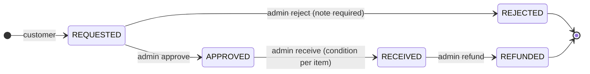

# Returns and refunds

Returns (RMA) live in warehouse-service; the money side lives in the backend
and payment-service. A refund always starts as a **booked refund** on the
order in the backend and is then **split** across the tenders the customer
used.

## Return lifecycle



## Endpoints

| Method and path | Access | Rules |
| --- | --- | --- |
| `POST /api/v1/orders/{orderId}/returns` | owner | Order `DELIVERED`, at most **30 days** after delivery; each quantity ≤ ordered quantity minus quantities in other non-rejected returns; reason `DAMAGED`, `WRONG_ITEM`, `NOT_AS_DESCRIBED` or `NO_LONGER_NEEDED` |
| `GET /api/v1/returns`, `GET /api/v1/returns/{id}` | owner | Own returns |
| `GET /api/v1/admin/returns?status=`, `GET /api/v1/admin/returns/{id}` | admin | All returns |
| `POST /api/v1/admin/returns/{id}/approve` | admin | `REQUESTED → APPROVED` |
| `POST /api/v1/admin/returns/{id}/reject` | admin | Note required |
| `POST /api/v1/admin/returns/{id}/receive` | admin | Condition `RESELLABLE` or `DAMAGED` for every item; resellable items are restocked |
| `POST /api/v1/admin/returns/{id}/refund` | admin | Books the refund in the backend, then `REFUNDED` |

Return requests for the same order are serialised with a row lock
(`order_locks`), so two parallel requests cannot over-return an item. Approve,
reject and refund send a `RETURN_UPDATED` email.

## Refund amount

Coupons are returned **proportionally**:

```text
refund = Σ(unit price × returned quantity) × totalAmount / subtotalAmount   (half-up, 2 decimals)
```

!!! example
    Order subtotal 200.00, coupon 10 % → total 180.00. Returning one item of
    50.00 refunds 50.00 × 180/200 = **45.00**.

The backend refuses refunds that would exceed the order total (`409`). A refund
that brings the order to its full total releases the coupon redemption.

## End-to-end refund

```mermaid
sequenceDiagram
    actor A as Admin
    participant W as warehouse-service
    participant B as Backend
    participant P as payment-service
    A->>W: POST /api/v1/admin/returns/7/receive
    W->>B: POST /internal/v1/inventory/receipts (RETURN_RESTOCKED, requestId from "return-7")
    A->>W: POST /api/v1/admin/returns/7/refund
    W->>B: POST /internal/v1/orders/42/refunds {requestId from "refund-7", amount: 45.00}
    B->>B: refundedAmount += 45.00, REFUND_BOOKED
    B->>B: CardFirstRefundSplitter (same transaction)
    B->>B: card leg → payment_refund_outbox; rest → gift card, then points
    B-->>W: 200 order
    W->>W: return REFUNDED, outbox RETURN_UPDATED
    B->>P: POST /internal/v1/payments/refunds {requestId, orderId, amount, reason}
    P-->>B: 200 {refundId, status: PARTIALLY_REFUNDED}
    Note over B: webhook refund.booked; points earned revoked pro rata
```

## Refund split

`CardFirstRefundSplitter` divides each booked refund:

1. **Card** — up to the captured amount minus card refunds already sent or
   queued. Orders without a captured payment (paid by an admin, or fully by
   tenders) get no card leg.
2. **Gift card** (`GiftCardRefundLegHandler`) — up to what the order paid with
   its gift card; the balance is restored (`RESTORED` ledger row).
3. **Loyalty points** (`LoyaltyPointsRefundLegHandler`) — up to the value of the
   redeemed points.
4. Anything beyond that is not sent anywhere.

Each leg is idempotent per refund `requestId`. Independently, points the order
**earned** are revoked in proportion to the refunded share of the total
(rounded down, never below zero).

!!! example "Split example"
    Total 108.00 paid with gift card 25.00, points 20.00 (2000 points) and
    card 63.00. A refund of 80.00 goes **63.00 to the card**, **17.00 to the gift
    card**, nothing to points. Earned points are revoked for 80/108 of the
    order.

## Cancellation refunds

Cancelling an order (customer, admin or warehouse) restores the gift card and
points in full, revokes earned points and — when a card payment was captured —
queues a card refund of the captured amount minus earlier card refunds, with
`requestId = UUID.nameUUIDFromBytes("cancel:" + orderId)` and reason
`Order cancelled`. See [Card payments](payments.md#refunds-to-the-card) for how
the refund outbox reacts to each answer.
