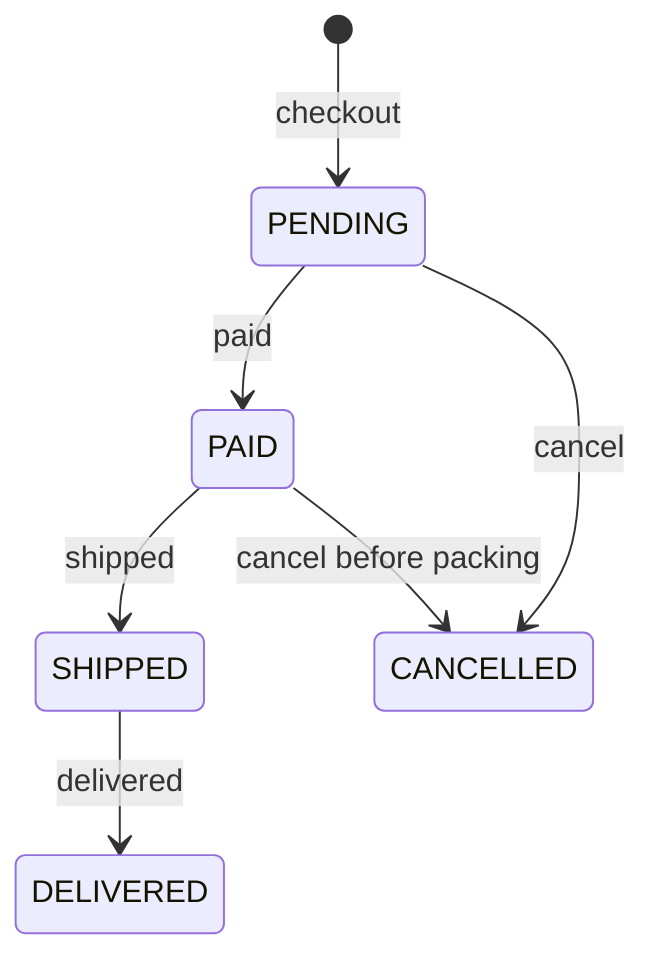
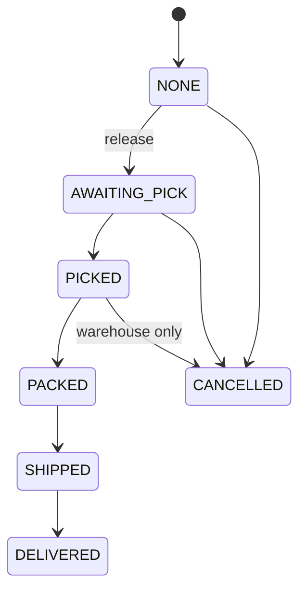
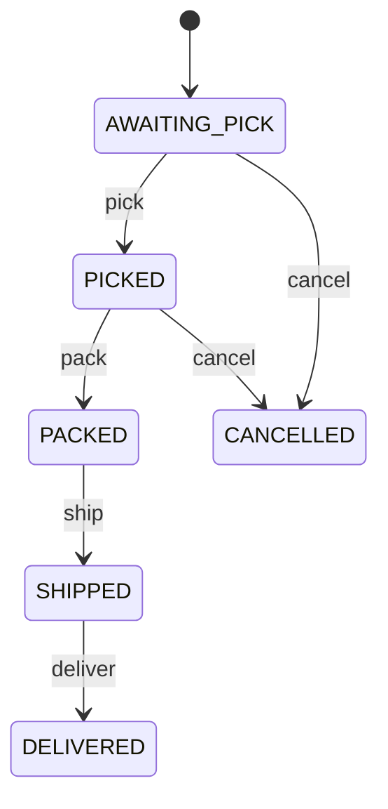
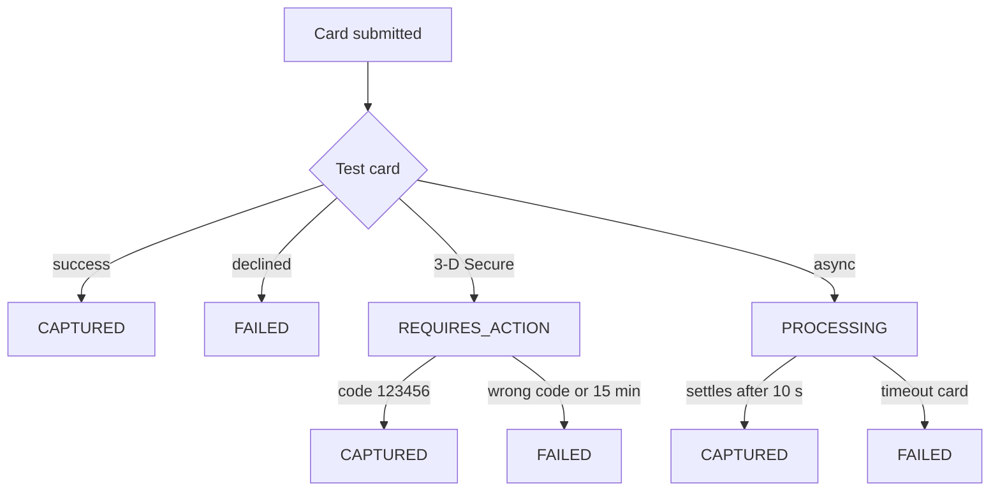
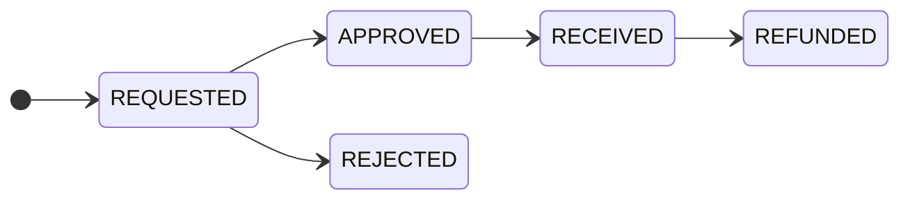
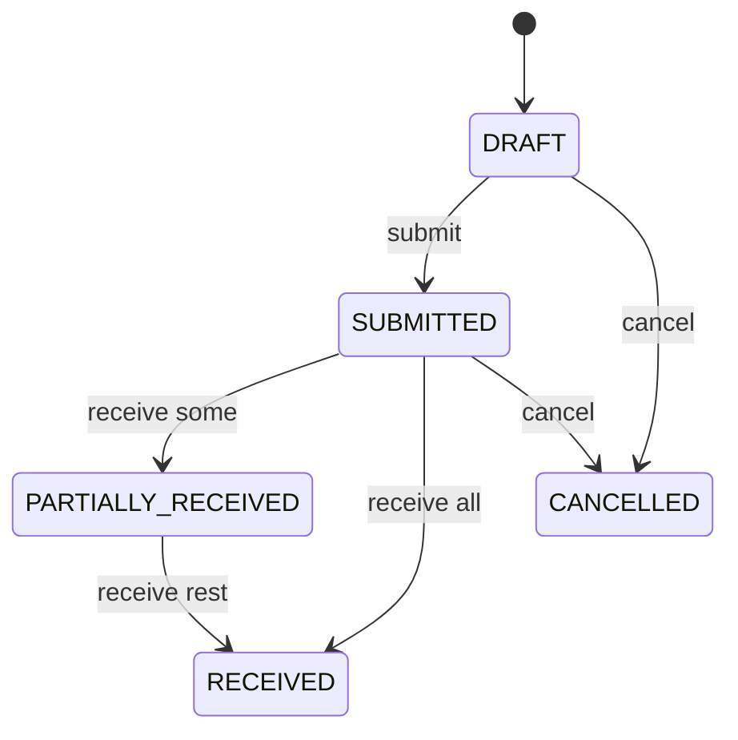

# State machines

All lifecycle diagrams in one place. Each links to the page with the rules.

## Order status (backend)

`OrderStatus` values are fixed for compatibility: `PENDING`, `PAID`,
`SHIPPED`, `DELIVERED`, `CANCELLED`.

A failed card payment leaves the order `PENDING`. Refunds do not change the
status; they add `refundedAmount`. See [Checkout](checkout.md#after-checkout).

## Fulfilment state (backend mirror)

See [Warehouse fulfilment](fulfilment.md).

## Shipment (warehouse-service)

## Tracking scans (simulated carrier)

`LABEL_CREATED → IN_TRANSIT (hub) → IN_TRANSIT (depot) → OUT_FOR_DELIVERY →
[DELIVERY_FAILED → OUT_FOR_DELIVERY] → DELIVERED`. See
[Carrier tracking](tracking.md).

## Payment (payment-service)

After a capture: `CAPTURED → VOIDED` (backend says the order is not payable),
`CAPTURED → PARTIALLY_REFUNDED → REFUNDED`, or `CAPTURED → REFUNDED`.
See [Card payments](payments.md).

## Return (warehouse-service)

See [Returns and refunds](returns-refunds.md).

## Purchase order (warehouse-service)

See [Purchasing and suppliers](purchasing.md).

## Review, gift card, webhook delivery

| Object | States |
| --- | --- |
| Review | `PENDING` → `APPROVED` or `REJECTED`; editing returns it to `PENDING` |
| Gift card (effective) | `ACTIVE`, `REDEEMED` (balance 0), `EXPIRED`, `DISABLED` |
| Webhook delivery | `PENDING` → `DELIVERED` or `FAILED` |
| Webhook subscription | active ↔ disabled (20 consecutive failures, or `PUT active:false`) |
