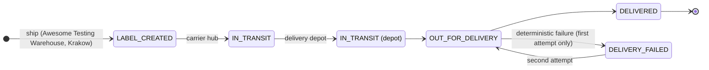

# Carrier tracking

warehouse-service 1.2.0 simulates a parcel carrier so that a shipped order
keeps moving on its own and customers can follow it.

## Manual vs simulated

| `POST /api/v1/warehouse/shipments/{id}/ship` body | Behaviour |
| --- | --- |
| `{carrier, trackingNumber}` | **Manual** flow: the number must match the carrier format; the parcel stays `SHIPPED` until someone calls `deliver` |
| `{carrier}` (no or `null` `trackingNumber`) | **Simulated** carrier: a tracking number in the carrier's format is generated, `simulated = true`, and the scheduler moves it |
| `{carrier, trackingNumber: ""}` | `400` |

Every shipped parcel records scans in `tracking_events`: `LABEL_CREATED` at
hand-over and `DELIVERED` on a manual delivery confirmation.

## Simulated route

`CarrierSimulator` runs every `warehouse.carrier.step-interval` and advances
each simulated `SHIPPED` parcel whose latest scan is at least one interval old
by **one scan**:



| Setting | Default | Lightweight / full (`demo` profile) |
| --- | --- | --- |
| `WAREHOUSE_CARRIER_ENABLED` | `true` | `true` |
| `WAREHOUSE_CARRIER_STEP_INTERVAL` | `PT2M` | `PT30S` |

So a simulated parcel is delivered about 8 minutes after shipping in
production and about 2 minutes locally (10 and 2.5 minutes when the delivery
attempt fails once).

### Deterministic failure

If `abs(trackingNumber.hashCode()) % 5 == 0` (Java `String.hashCode`), the
first `OUT_FOR_DELIVERY` is followed by `DELIVERY_FAILED` ("the recipient was
not available"), and the next step goes `OUT_FOR_DELIVERY` again ("second
attempt"). Roughly one parcel in five takes this path, and always the same
ones — a stable fixture for negative-path tests.

### Locations

Scan texts are deterministic. Hubs: InPost Sorting Centre, Pruszkow; DPD Hub,
Strykow; DHL Hub, Leipzig; UPS Air Hub, Cologne. The delivery city is derived
from the tracking number (Warsaw, Krakow, Gdansk, Wroclaw, Poznan or Lodz).

### Side effects of each scan

| Scan | Effect |
| --- | --- |
| `OUT_FOR_DELIVERY` | outbox email `SHIPMENT_OUT_FOR_DELIVERY` (`orderId`, `carrier`, `trackingNumber`) |
| `DELIVERY_FAILED` | outbox email `SHIPMENT_DELIVERY_FAILED` |
| `DELIVERED` | the regular delivery: backend `PUT fulfilment DELIVERED`, order `DELIVERED`, `ORDER_DELIVERED` email, `lastActor = "carrier"`. If the backend is down the parcel stays `OUT_FOR_DELIVERY` and the run ends |

Each parcel is advanced under a row lock in its own transaction (batches of
100), so a repeated or concurrent run is a no-op.

## Endpoints

| Method and path | Access | Response |
| --- | --- | --- |
| `GET /api/v1/orders/{id}/shipment/tracking` | owner or admin | `TrackingDto`; `404` like `GET .../shipment` |
| `GET /api/v1/tracking/{trackingNumber}` | **public, no token** | Same without `orderId`, owner or address; `404 Tracking number not found` |
| `POST /api/v1/warehouse/shipments/{id}/carrier/advance` | warehouse or admin | One scan now, ignoring the interval; `409` unless simulated and `SHIPPED` |

```json
{
  "shipmentId": 1, "orderId": 42, "carrier": "DHL", "trackingNumber": "1234567890",
  "simulated": true, "currentStatus": "IN_TRANSIT", "estimatedDelivery": "2026-11-10T12:08:00",
  "events": [
    {"status": "LABEL_CREATED", "location": "Awesome Testing Warehouse, Krakow",
     "description": "Shipping label created; the parcel is waiting for DHL pickup", "occurredAt": "2026-11-10T12:00:00"},
    {"status": "IN_TRANSIT", "location": "DHL Hub, Leipzig",
     "description": "Collected from the sender and sorted at the hub", "occurredAt": "2026-11-10T12:02:00"}
  ]
}
```

`estimatedDelivery`: the delivery time once delivered; for a simulated parcel
the latest scan plus one interval per remaining scan; for a manual parcel the
hand-over plus the carrier's nominal transit days; `null` before hand-over.

The frontend shows tracking on the order page and on the public pages
`/track` and `/track/:number`.

!!! tip "Fast-forward in class"
    Trainers call `carrier/advance` repeatedly (as `warehouse` or `admin`) to
    push a parcel through every scan without waiting for the scheduler.
