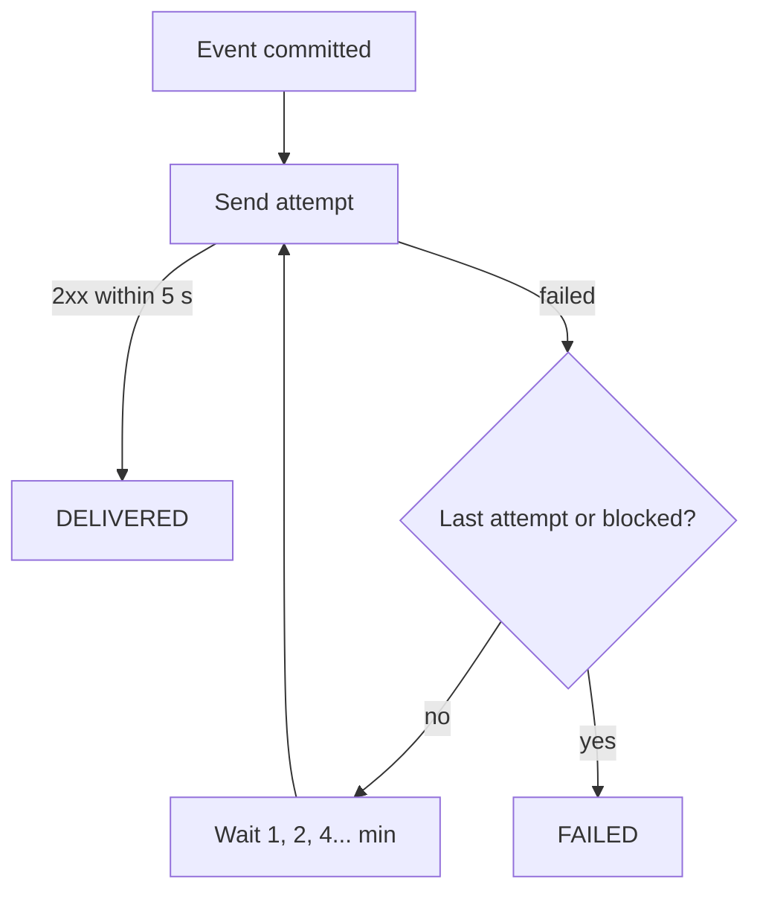

# User webhooks

Any signed-in user can subscribe an HTTP URL to **their own order events**.
Each event becomes a *delivery*: signed with HMAC, retried with backoff and
visible in a delivery log. A built-in **inbox** lets students receive webhooks
without running a server. UI page: `/account/webhooks`; admins see all
subscriptions at `/admin/webhooks`.

## Endpoints

| Method and path | Result |
| --- | --- |
| `GET /api/v1/webhooks/event-types` | `[{name, description}]` |
| `GET /api/v1/webhooks` | Own subscriptions, oldest first |
| `POST /api/v1/webhooks` `{url, events[], description?}` | `201`, includes `secret` (shown once) |
| `GET` / `PUT` / `DELETE /api/v1/webhooks/{id}` | Read / update (`active` re-enables) / delete with its log |
| `POST /api/v1/webhooks/{id}/rotate-secret` | New `secret` |
| `POST /api/v1/webhooks/{id}/test` | `201`; sends `webhook.ping` and waits for the result |
| `GET /api/v1/webhooks/{id}/deliveries?status&page&size` | Delivery log, newest first |
| `GET /api/v1/webhooks/{id}/deliveries/{deliveryId}` | One delivery |
| `POST /api/v1/webhooks/{id}/deliveries/{deliveryId}/redeliver` | `201`; a new delivery of the same event (same event id) |
| `POST /api/v1/webhook-inboxes` | `201 {token, url: "inbox://<token>", createdAt}` |
| `GET /api/v1/webhook-inboxes`, `GET .../{token}/requests`, `DELETE .../{token}` | Inboxes and received requests (newest 50 kept) |
| `GET /api/v1/admin/webhooks?username&page&size` | Admin list |

Errors: `400` invalid body, unknown event type or rejected URL; `403` someone
else's subscription; `404` unknown subscription, delivery or inbox (other
users' inboxes too); `409` more than **5 subscriptions** or **3 inboxes**, or
test/redeliver on a disabled subscription; `429` too many test (10 per 15 min)
or redeliver (20 per 15 min) calls when rate limiting is on.

## Events and payload

Event names: `order.created`, `order.paid`, `order.cancelled`,
`shipment.shipped`, `shipment.delivered`, `refund.booked`, `payment.failed`,
plus `webhook.ping`. Each committed event creates one delivery per **active**
subscription of the order's owner that lists the event.

```json
{"id":"6a1f0f57-0f7c-4bb4-8a43-2f9d8f7e8c11","type":"order.created","createdAt":"2026-11-10T20:40:33.120Z","data":{"orderId":42,"status":"PENDING","totalAmount":40.00}}
```

The body is compact JSON with a fixed field order and sorted `data` keys, so
the same event always produces the same bytes. `id` is the **event** id —
redeliveries keep it, so receivers can deduplicate.

## Signature

```http
POST /your/path HTTP/1.1
Content-Type: application/json
User-Agent: AwesomeTesting-Webhooks/1.0
X-Webhook-Id: <delivery id>
X-Webhook-Event: order.created
X-Webhook-Signature: t=1794346833,v1=5f2b...
```

`v1` = lowercase hex HMAC-SHA256 of `t + "." + rawBody`, keyed with the whole
secret string (including the `whsec_` prefix) as UTF-8:

```python
expected = hmac.new(secret.encode(), f"{t}.{raw_body}".encode(), hashlib.sha256).hexdigest()
ok = hmac.compare_digest(expected, v1) and abs(time.time() - int(t)) < 300
```

Secrets are `whsec_` + 32 random bytes (base64url), stored encrypted and
returned only by create and rotate. Retries after a rotation use the new
secret.

## Delivery, retries and auto-disable



- Success = `2xx` within 5 seconds (connect + response). Redirects are never
  followed (`3xx` is a failure); at most 4 KB of the response is read.
- Every failed attempt increments the subscription's `consecutiveFailures`; a
  success resets it. At **20** the subscription is disabled with a
  `disabledReason` and its pending deliveries end `FAILED`. `PUT` with
  `active: true` re-enables it and resets the counter.
- Deliveries are written in their own transaction after the order commits and
  sent on a small background pool; anything unsent is picked up by the retry
  job (every 30 s). A delivery is claimed before sending, so it is never sent
  twice at once.

## The inbox

`inbox://<token>` targets skip HTTP but are otherwise identical: the same
headers and signature are stored with the body (up to 16 KB), the log shows
status `200`, and the newest 50 requests are kept. A subscription may target
only its owner's inboxes. A deleted inbox makes later deliveries fail with
`Webhook inbox not found`.

## SSRF protection

The site is public, so a webhook must never reach the server's own network.
The same `WebhookUrlPolicy` runs when a subscription is saved (`400` with the
reason) and again **before every delivery** (`FAILED`, `Blocked: <reason>`).

- Only `http` and `https`, no user info, ports 80 and 443 (plus
  `WEBHOOKS_ALLOWED_PORTS`).
- Host names must be fully qualified: `localhost`, `*.localhost`, `*.local`,
  `*.internal` and single-label names such as Docker service names (`backend`,
  `postgres`) are rejected, as are numeric forms like `2130706433`.
- Every resolved address must be public: loopback, private (10/8, 172.16/12,
  192.168/16), link-local (169.254/16 incl. cloud metadata, fe80::/10),
  CGNAT (100.64/10), unspecified, multicast, broadcast, reserved and
  documentation ranges, IPv6 unique-local and site-local, Teredo and IPv4
  embedded in IPv6 (`::ffff:a.b.c.d`, NAT64, 6to4) are rejected.
- The request connects to exactly the vetted addresses and sends the original
  host as `Host` and TLS SNI, so **DNS rebinding** between validation and
  delivery cannot redirect it.

Reference: [Webhooks](../reference/WEBHOOKS.md) (payment signatures and user
webhooks).
