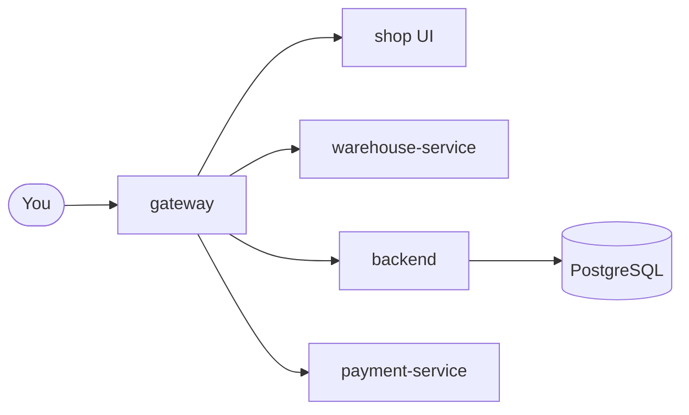

# Awesome LocalStack Wiki

Awesome Testing is a **training e-commerce platform**: a small but realistic shop
whose only purpose is to be tested. Students practise UI, API, contract,
performance, security and AI-assisted testing against it, locally with Docker
Compose or on the public deployments.

This wiki explains how every part works — the services and how they talk to
each other, the business rules behind each feature, and how the stack is run
and deployed — so you can design meaningful tests instead of guessing.

-   :material-sitemap: **[Architecture](architecture/index.md)**

    Services, ports, Compose profiles, gateway routing, authentication and
    service-to-service trust.

-   :material-cart-outline: **[Business flows](flows/index.md)**

    Sign-up to delivery: cart, checkout, payments, fulfilment, tracking,
    returns, emails and webhooks, with sequence and state diagrams.

-   :material-server: **[Operations](operations/index.md)**

    Running each profile locally, API explorers, production deployment with
    Ansible, monitoring, backups and troubleshooting.

-   :material-test-tube: **[For testers](testers/index.md)**

    Interesting test scenarios per feature: boundaries, race conditions,
    idempotency, failure injection and security checks.

## The platform in one picture

The **gateway** sends each path to the right service. The **backend** owns
users, products, carts and orders; **warehouse-service** ships parcels and
handles returns; **payment-service** charges test cards. Both small services
ask the backend for order data and report back to it. Emails, the LLM and
monitoring sit behind the backend; see [Architecture](architecture/index.md).

## Where it runs

| Environment | URL | Notes |
| --- | --- | --- |
| Lightweight profile (local) | `http://localhost:8081/` | Everyday local stack; data resets on recreate |
| Full profile (local) | `http://localhost:8081/` | Adds ActiveMQ, email consumer, Mailpit, a real local LLM; monitoring is an opt-in overlay for either profile |
| Stable public playground | `https://awesome.byst.re/` | Production; no demo users, bootstrap catalog only |
| Disposable sandbox | `https://aitesters.byst.re/` | Separate database, reset every night |
| This wiki | `/docs/` on every gateway above | Built from `docs-site/` in `awesome-localstack` |

!!! tip "New here?"
    Start with [Running locally](operations/running-locally.md), sign in as
    `client` / `client`, then follow the [end-to-end order journey](flows/index.md#the-order-journey).

## Versions documented

This wiki describes the **commerce wave 3** release set: backend 3.15.0,
warehouse-service 1.2.0, payment-service 1.0.0, frontend 3.12.0 and consumer
3.6.0. The Compose files pin the exact images; see
[Releases and image pinning](operations/releases.md) for the current state of
the pins.
