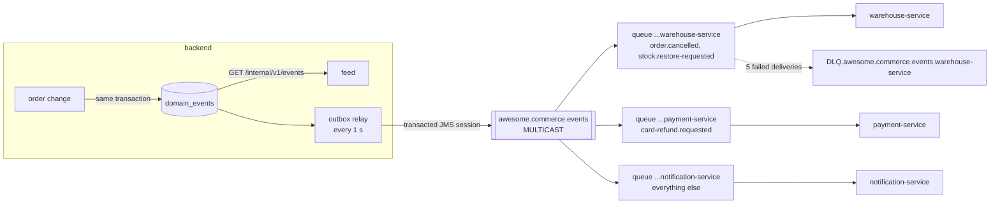

# Event broker

The backend tells warehouse-, payment- and notification-service about commerce
events (an order was cancelled, a refund was requested, an email should go out).
The events can travel two ways, chosen per stack with `EVENTS_TRANSPORT`:

| Transport | How | Where |
| --- | --- | --- |
| `feed` | Each service polls the backend's `GET /internal/v1/events` every 5 seconds from its own cursor | lightweight profile, course compatibility stack |
| `broker` | The backend's outbox relay publishes every event to ActiveMQ Artemis; each service listens on its own queue | full profile, lightweight + `docker-compose.broker.yml`, both production sites |

Same events, same JSON and the same event ids either way. The contract is the
reference page [Event broker transport](../reference/EVENT_BROKER_CONTRACT.md);
the decision and its trade-offs are
[ADR 7](../reference/ARCHITECTURE_DECISIONS.md#adr-7-a-broker-transport-next-to-the-event-feed).

## How an event travels



1. The order change and its event row commit together; nothing is published
   from inside the request.
2. The relay reads unpublished rows in sequence order, sends them in one JMS
   transaction and marks them `published_at`. A crash in between sends them
   again, and the broker's duplicate detection drops the copy.
3. Artemis copies the message into every queue whose filter accepts its `type`.
4. A service handles each message in a transacted session. Success commits the
   database and acknowledges the message; any exception rolls the message back,
   and Artemis redelivers it after 1, 2, 4 and 8 seconds and then moves it to
   the service's dead-letter queue.

## Running it

```bash
docker compose -f lightweight-docker-compose.yml -f docker-compose.broker.yml up -d
scripts/broker stat                 # queues: consumers, waiting messages, dead letters
```

The Artemis console is on `http://127.0.0.1:8161/console` (`admin` / `admin`).
The full profile has the broker already (`docker compose up -d`); there
`EVENTS_TRANSPORT=feed docker compose up -d` switches every service back to the
feed for a comparison.

| Command | Does |
| --- | --- |
| `scripts/broker stat` | Every commerce queue and dead-letter queue with consumers and messages |
| `scripts/broker poison <service>` | Puts one unparsable event on the service's queue |
| `scripts/broker dlq [service]` | Shows what is in the dead-letter queue(s) |
| `scripts/broker redrive <service>` | Moves the dead letters back to the service's queue |
| `scripts/broker purge-dlq <service>` | Deletes the service's dead letters |

## What to watch

| Signal | Where |
| --- | --- |
| Events the backend has not published yet | `events_relay_pending` on the backend's `/actuator/prometheus` |
| Published, skipped (older than 24 h), failed relay runs | `events_relay_published_total`, `events_relay_skipped_total`, `events_relay_failures_total` |
| Messages waiting for a service | `scripts/broker stat` (MESSAGES), the console's queue view |
| Messages that failed five times | `DLQ.<queue>` in `scripts/broker stat` |
| A rollback and its reason | The service's log: `Event message rolled back for redelivery: ...` |
| The publish hop in a trace | Jaeger with the tracing overlay: `publish <type>` (backend) before `process <type>` (the service) |

The broker is not part of any service's health: a service without the broker
stays `UP`, its listener retries every 5 seconds, and the backend's relay backs
off up to 30 seconds while the events wait in `domain_events`.

## Exercises

The fault-injection lab has four broker exercises
([reference](../reference/FAULT_INJECTION_LAB.md#broker-transport)): an event
crossing the broker in about a second (against 5–8 seconds with the feed), a
poison message ending in the dead-letter queue without blocking the queue, a
stopped consumer whose queue fills up and drains, and checkout working while
the backend cannot reach the broker. `scripts/chaos up lightweight broker`
starts the lab with the broker; `broker-down`, `broker-slow` and
`partition-broker` break its links.
