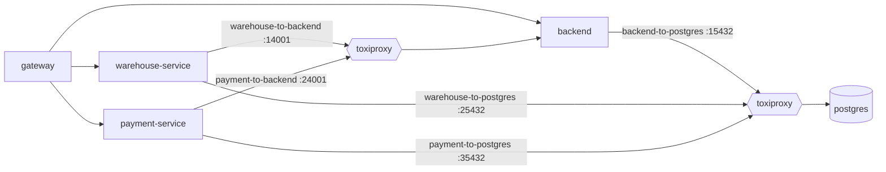

# Fault-injection lab

The fault-injection lab puts [Toxiproxy](https://github.com/Shopify/toxiproxy)
between the services and their dependencies, so you can break one link on
purpose and watch the system cope: a fast 503 instead of a hang, an outbox that
fills up and drains, a feed consumer that resumes from its cursor, a payment
that loses the race against an expiring reservation.

It is a local overlay (`docker-compose.chaos.yml`) for the lightweight and the
full profile, driven by one command, `scripts/chaos` (bash, curl and Docker;
nothing to install). The full guide with every scenario and six guided
exercises is the reference page
[Fault-injection lab](../reference/FAULT_INJECTION_LAB.md).

## Quick start

```bash
scripts/chaos up                     # the running profile (else lightweight) with the lab
scripts/chaos backend-down warehouse # warehouse-service loses the backend
scripts/chaos heal                   # everything back to normal
```

Then `scripts/chaos status` shows what is broken and `scripts/chaos list` what
else you can break. Every command has a `make` twin: `make chaos-up`,
`make chaos SCENARIO=backend-down TARGET=warehouse`, `make chaos-status`,
`make chaos-reset`, `make chaos-down`.

## How it is wired

Only the links between services go through Toxiproxy; the gateway reaches every
service directly, so the browser, Swagger and curl keep working.



notification-service gets `notification-to-backend` (`:34001`) and
`notification-to-postgres` (`:45432`) the same way.
The overlay changes nothing but `BACKEND_BASE_URL` and `SPRING_DATASOURCE_URL`.

## Scenarios

| Scenario | Effect |
| --- | --- |
| `backend-down [target]` | The target gets *connection refused* from the backend |
| `backend-slow [ms] [target]` | Every backend answer to the target is `ms` late (3000) |
| `backend-flaky [percent] [target]` | A share of the target's backend connections is reset or times out (30 %) |
| `bandwidth [KB/s] [target]` | Backend answers to the target trickle (8 KB/s) |
| `postgres-stall [ms] [target]` | The target's database connections stop passing data |
| `postgres-down [target]` | The target's database connections are closed and refused |
| `partition-<service>` | `warehouse`, `payment`, `notification`: the service loses the backend and its database; `backend`: nobody reaches the backend and it loses PostgreSQL; `postgres`: nobody reaches PostgreSQL |

Targets are `warehouse`, `payment`, `notification` (and `backend` for the
`postgres-*` scenarios); without one the scenario hits all of them.

## Guided exercises

The [reference guide](../reference/FAULT_INJECTION_LAB.md#guided-exercises)
walks through, with exact commands and the expected observations:

1. warehouse-service answering 503 when it loses the backend, slow and flaky
   variants;
2. a payment (and warehouse, notification) outbox backlog growing and draining,
   with the `<service>_outbox_pending` gauges and SQL on the outbox tables;
3. the event-feed consumer resuming from its stored cursor after a partition
   (`event_cursors`);
4. a slow payment against an expiring order reservation: 409 on capture,
   payment `VOIDED`;
5. a stalled PostgreSQL: request timeouts and HikariCP errors;
6. finding all of it with `X-Request-Id`.

## Combining overlays

```bash
scripts/chaos up lightweight tracing monitoring   # Jaeger and Grafana as well
```

Traces show a late span under `backend-slow` and an error span under
`backend-down` (see [Tracing a request](tracing.md#jaeger-traces)); Grafana
shows the latency and the outbox gauges.

`scripts/verify-chaos-overlay.sh` checks every overlay combination with
`docker compose config` and runs all scenarios against the published images.
