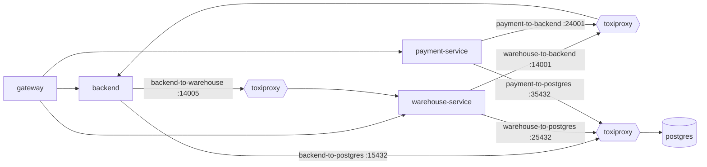

# Fault-injection lab

The fault-injection lab puts [Toxiproxy](https://github.com/Shopify/toxiproxy)
between the services and their dependencies, so you can break one link on
purpose and watch the system cope: a fast 503 instead of a hang, an outbox that
fills up and drains, a feed consumer that resumes from its cursor, a payment
that loses the race against an expiring reservation.

It is a local overlay (`docker-compose.chaos.yml`) for the lightweight and the
full profile, driven by one command, `scripts/chaos` (bash, curl and Docker;
nothing to install). The full guide with every scenario and nine guided
exercises is the reference page
[Fault-injection lab](../reference/FAULT_INJECTION_LAB.md).

## Quick start

```bash
scripts/chaos up                     # the running profile (else lightweight) with the lab
scripts/chaos backend-down warehouse # warehouse-service loses the backend
scripts/chaos heal                   # everything back to normal
```

Then `scripts/chaos status` shows what is broken and `scripts/chaos list` what
else you can break. Every command has a `make` twin: `make chaos-up`,
`make chaos SCENARIO=backend-down TARGET=warehouse`, `make chaos-status`,
`make chaos-reset`, `make chaos-down`.

## How it is wired

Only the links between services go through Toxiproxy; the gateway reaches every
service directly, so the browser, Swagger and curl keep working.



notification-service gets `notification-to-backend` (`:34001`) and
`notification-to-postgres` (`:45432`) the same way. `backend-to-warehouse`
carries the backend's stock commands to warehouse-service, the stock owner
from backend 3.22.0 and warehouse-service 1.6.0 (older backends never use it).
The overlay changes nothing but `BACKEND_BASE_URL`, `WAREHOUSE_URL` and
`SPRING_DATASOURCE_URL`.

## Scenarios

| Scenario | Effect |
| --- | --- |
| `backend-down [target]` | The target gets *connection refused* from the backend |
| `backend-slow [ms] [target]` | Every backend answer to the target is `ms` late (3000) |
| `backend-flaky [percent] [target]` | A share of the target's backend connections is reset or times out (30 %) |
| `bandwidth [KB/s] [target]` | Backend answers to the target trickle (8 KB/s) |
| `postgres-stall [ms] [target]` | The target's database connections stop passing data |
| `postgres-down [target]` | The target's database connections are closed and refused |
| `warehouse-down` | The backend gets *connection refused* from warehouse-service: checkout and admin stock adjust answer `503 Inventory service unavailable`, reads and the cart keep working (backend 3.22.0+) |
| `warehouse-slow [ms]` | Every warehouse-service answer to the backend is `ms` late (3000); from 5000 the backend's 5 s read timeout turns it into the 503 |
| `partition-<service>` | `warehouse`, `payment`, `notification`: the service loses the backend and its database (and the backend loses warehouse-service); `backend`: nobody reaches the backend and it loses PostgreSQL and warehouse-service; `postgres`: nobody reaches PostgreSQL |

Targets are `warehouse`, `payment`, `notification` (and `backend` for the
`postgres-*` scenarios); without one the scenario hits all of them. The
`warehouse-*` scenarios take no target: only the backend calls warehouse-service.

## Guided exercises

The [reference guide](../reference/FAULT_INJECTION_LAB.md#guided-exercises)
walks through, with exact commands and the expected observations:

1. warehouse-service answering 503 when it loses the backend, slow and flaky
   variants;
2. a payment (and warehouse, notification) outbox backlog growing and draining,
   with the `<service>_outbox_pending` gauges and SQL on the outbox tables;
3. the event-feed consumer resuming from its stored cursor after a partition
   (`event_cursors`);
4. a slow payment against an expiring order reservation: 409 on capture,
   payment `VOIDED`;
5. a stalled PostgreSQL: request timeouts and HikariCP errors;
6. finding all of it with `X-Request-Id`;
7. checkout without the stock owner (`warehouse-down`): checkout and admin
   adjust answer 503, reads and the cart keep working, and checkout works again
   after `heal`; with `warehouse-slow 7000` a lost answer leaves an orphaned
   reservation that the reaper releases, so the stock comes back;
8. the stock projection catching up (`backend-down warehouse`): a purchase
   receipt grows `stock_outbox_pending`, the projection lags the ledger, and
   both agree again after `heal`;
9. a slow order save against the reaper: a row lock on the cart stalls the
   order past the reservation timeout, and (backend 3.22.2+) the reservation
   still ends `CONFIRMED` instead of releasing the stock of a saved order.

Exercises 7 and 9 wait for warehouse-service's reservation reaper (2 minutes by
default). Shorten it when you start the lab:
`WAREHOUSE_RESERVATION_CONFIRM_TIMEOUT=PT20S WAREHOUSE_RESERVATION_REAPER_INTERVAL=PT5S scripts/chaos up`.

## Combining overlays

```bash
scripts/chaos up lightweight tracing monitoring   # Jaeger and Grafana as well
```

Traces show a late span under `backend-slow` and an error span under
`backend-down` (see [Tracing a request](tracing.md#jaeger-traces)); Grafana
shows the latency and the outbox gauges.

`scripts/verify-chaos-overlay.sh` checks every overlay combination with
`docker compose config` and runs all scenarios against the published images
(exercises 7 and 8 only with backend 3.22.0 or later, exercise 9 from 3.22.2).
