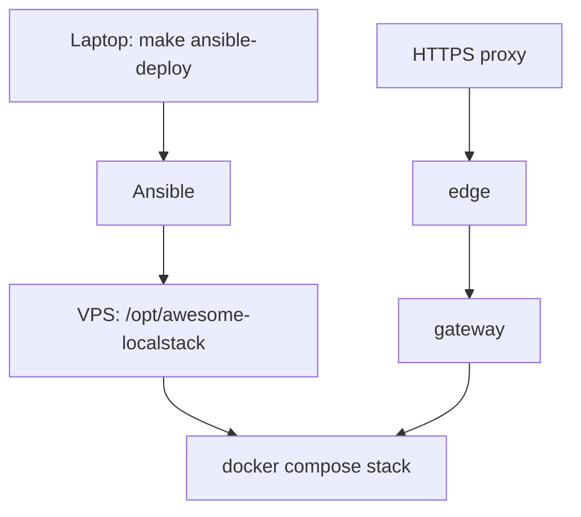

# Operations

| Task | Page |
| --- | --- |
| Start a profile, find URLs and demo users | [Running locally](running-locally.md) |
| Explore the APIs (Swagger UI, OpenAPI, GraphiQL, gRPC) | [API explorers](api-explorers.md) |
| Deploy to the VPS with Ansible, Vault keys, verification | [Production deployment](production.md) |
| Release train (`scripts/release-train.py`), image pinning by digest | [Releases and image pinning](releases.md) |
| Prometheus, Alertmanager, probes, host watchdog, local Grafana overlay | [Monitoring and alerts](monitoring.md) |
| Find every log line of one request (`X-Request-Id`, `traceparent`), Jaeger traces | [Tracing a request](tracing.md) |
| Break links between services on purpose (Toxiproxy, `scripts/chaos`) | [Fault-injection lab](fault-injection.md) |
| Encrypted PostgreSQL backups and restore checks | [Backups](backups.md) |
| Common failures and their fixes | [Troubleshooting](troubleshooting.md) |
| How this wiki is built and served | [This documentation site](docs-site.md) |

