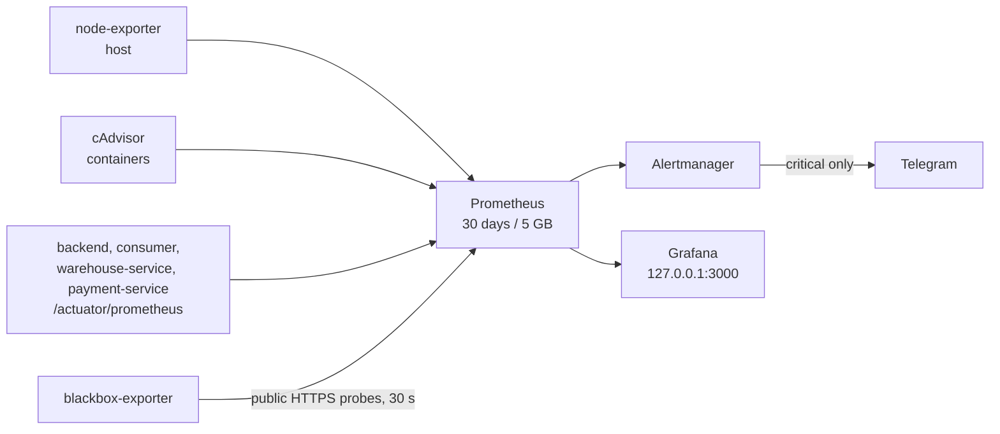

# Monitoring and alerts

## Production pipeline

| Prometheus job | Target |
| --- | --- |
| `spring_backend_micrometer` | backend |
| `spring_consumer_micrometer` | consumer |
| `spring_warehouse_micrometer` | warehouse-service |
| `spring_payment_micrometer` | payment-service |
| `node`, `cadvisor`, `alertmanager`, `blackbox` | infrastructure |
| `public_https` | `https://awesome.byst.re/login`, `/v3/api-docs`, `/warehouse/v3/api-docs`, `/payment/v3/api-docs` (DNS, TLS, status, latency) |

Dashboards: **Production Resources** and **Production Availability &
Safeguards** (`make ansible-tunnel-grafana`, then `http://localhost:3000`).

## Alert rules

| Group | Alerts |
| --- | --- |
| Host | `HostAvailableMemoryLow/Critical` (< 15 % / < 8 %), `HostAbsoluteAvailableMemoryLow/Critical` (< 600 / 300 MiB), `HostCpuSaturated`, `HostMemoryPressureWaiting(Critical)`, `HostMemoryFullStalls(Critical)`, `HostKernelOOMKill`, `HostSwapUsageHigh/Critical`, `HostSwapThrashing`, `HostRootDiskSpaceLow/Critical`, `HostRootInodesLow/Critical` |
| Containers | `ContainerMemoryNearLimit`, `ContainerMemoryLimitCritical`, `ContainerOOMEvent`, `CriticalContainerMissing` (backend, consumer, warehouse-service, payment-service, gateway, edge, postgres, activemq) |
| JVM / native | `JVMHeapUsageHigh/Critical`, `JVMGCOverheadHigh/Critical` |
| Pipeline | `PrometheusTargetDown(Critical)`, `PrometheusRuleEvaluationFailures`, `AlertmanagerNotificationFailures` |
| Public edge | `PublicEndpointProbeFailed(Critical)`, `PublicEndpointLatencyHigh` (> 2 s), `PublicEndpointTLSExpiringSoon/Critical` (< 21 / 7 days) |

Only sustained **critical** alerts reach Telegram (no resolved messages,
24-hour repeat); warnings stay on the dashboards. Deployments silence the
warning-level probe and target-down alerts for at most 15 minutes.

The docs wiki is not scraped and has no alert: it is static content, and
`CriticalContainerMissing` is reserved for services the shop needs.

The public probes run on the VPS itself, so they cannot detect the loss of the
whole VPS; an off-server heartbeat is needed for that.

## Local monitoring (full profile)

Prometheus `http://localhost:9090` scrapes the backend, consumer,
warehouse-service and payment-service; Grafana `http://localhost:3000`
(`admin` / `grafana`) ships Spring and k6 dashboards backed by Prometheus and
InfluxDB.

Details and the reasoning behind each threshold:
[Production monitoring plan](../reference/PRODUCTION_MONITORING_PLAN.md).
