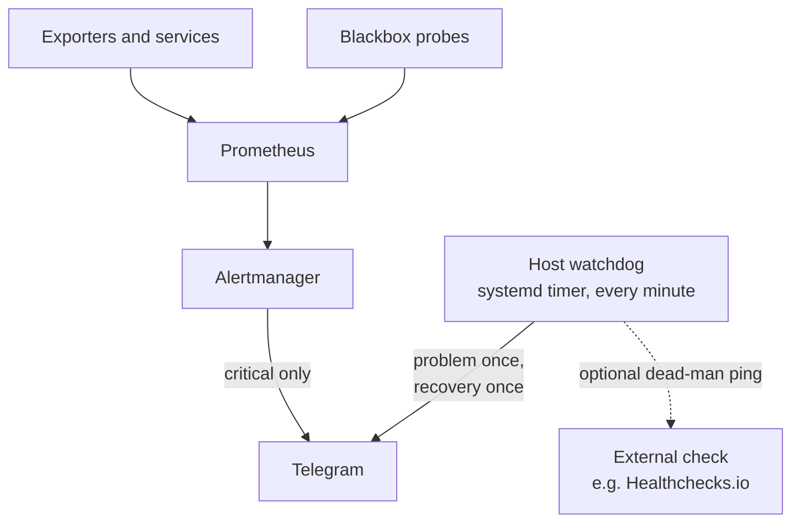

# Monitoring and alerts

## Production pipeline



Production runs no Grafana (lean monitoring phase A). Prometheus, Alertmanager,
cAdvisor, Node Exporter and Blackbox Exporter still run alongside the new host
watchdog (phase B) during a 1-2 week parallel run; removing them is the
planned phase C.

| Prometheus job | Target |
| --- | --- |
| `spring_backend_micrometer` | backend |
| `spring_consumer_micrometer` | consumer |
| `spring_warehouse_micrometer` | warehouse-service |
| `spring_payment_micrometer` | payment-service |
| `node`, `cadvisor`, `alertmanager`, `blackbox` | infrastructure |
| `public_https` | `https://awesome.byst.re/login`, `/v3/api-docs`, `/warehouse/v3/api-docs`, `/payment/v3/api-docs`, `https://aitesters.byst.re/login`, `/v3/api-docs` (DNS, TLS, status, latency) |

PromQL and firing alerts: `make ansible-tunnel-prometheus`, then
`http://localhost:9090`.

## Alert rules

| Group | Alerts |
| --- | --- |
| Host | `HostAvailableMemoryLow/Critical` (< 15 % / < 8 %), `HostAbsoluteAvailableMemoryLow/Critical` (< 600 / 300 MiB), `HostCpuSaturated`, `HostMemoryPressureWaiting(Critical)`, `HostMemoryFullStalls(Critical)`, `HostKernelOOMKill`, `HostSwapUsageHigh/Critical`, `HostSwapThrashing`, `HostRootDiskSpaceLow/Critical`, `HostRootInodesLow/Critical` |
| Containers | `ContainerMemoryNearLimit`, `ContainerMemoryLimitCritical`, `ContainerOOMEvent`, `CriticalContainerMissing` (backend, consumer, warehouse-service, payment-service, gateway, edge, postgres, activemq) |
| JVM / native | `JVMHeapUsageHigh/Critical`, `JVMGCOverheadHigh/Critical` |
| Pipeline | `PrometheusTargetDown(Critical)`, `PrometheusRuleEvaluationFailures`, `AlertmanagerNotificationFailures` |
| Public edge | `PublicEndpointProbeFailed(Critical)`, `PublicEndpointLatencyHigh` (> 2 s), `PublicEndpointTLSExpiringSoon/Critical` (< 21 / 7 days) |

Only sustained **critical** alerts reach Telegram (no resolved messages,
24-hour repeat); warnings stay in the Prometheus and Alertmanager APIs.
Deployments silence the warning-level probe and target-down alerts for at most
15 minutes.

The docs wiki is not scraped and has no alert: it is static content, and
`CriticalContainerMissing` is reserved for services the shop needs.

## Host watchdog

`awesome-watchdog.timer` runs `/usr/local/sbin/awesome-watchdog` every minute
(no resident process) and sends to the same Telegram bot and chat as
Alertmanager:

| Check | Reported after |
| --- | --- |
| a container of `docker-compose.server.yml` missing, exited or restarting | 2 runs |
| a container `unhealthy` (Docker healthcheck) | 3 runs |
| a container restarted within 10 minutes; a one-shot exited non-zero | 1 run |
| consumer `/actuator/health` (probed through the gateway; the distroless image has no healthcheck) | 2 runs |
| OOM kill: Docker `oom` event, VPS-root or container cgroup `memory.events` | immediately |
| disk 85 % / 90 %, inodes 92 % | 1 run |
| `MemAvailable` below 300 MiB | 10 runs |
| newest backup older than 26 h, restore check older than 8 days | 1 run |
| backup or restore-check unit failed (`OnFailure=`) | immediately |

Each problem is reported once (`PROBLEM:`) and its recovery once
(`RESOLVED:`). Deployments pause only the container checks for at most 15
minutes. With `watchdog_healthcheck_url` set, every run pings an external
dead-man check, which alerts when the VPS or the watchdog stops; the owner
still has to create that check.

## Local monitoring (opt-in overlay)

`docker-compose.monitoring.yml` adds Prometheus (`9090`), Grafana (`3000`,
`admin` / `grafana`), InfluxDB (`8086`), cAdvisor and Node Exporter to either
local profile, for k6 performance-testing trainings:

```bash
docker compose -f lightweight-docker-compose.yml -f docker-compose.monitoring.yml up -d
docker compose -f docker-compose.yml -f docker-compose.monitoring.yml up -d   # or ./run-docker-compose.sh
```

Grafana provisions the **k6 Load Testing Results**, **Spring Boot 3.x
Statistics**, **Spring Boot Http (3.x)** and **Container Resources**
dashboards. Prometheus finds the application services through Docker DNS, so
every target of the chosen profile is `UP` and absent services have no target.
`GRAFANA_PORT`, `PROMETHEUS_PORT` and `INFLUXDB_PORT` move the host ports.

Details and the reasoning behind each threshold:
[Production monitoring plan](../reference/PRODUCTION_MONITORING_PLAN.md).
