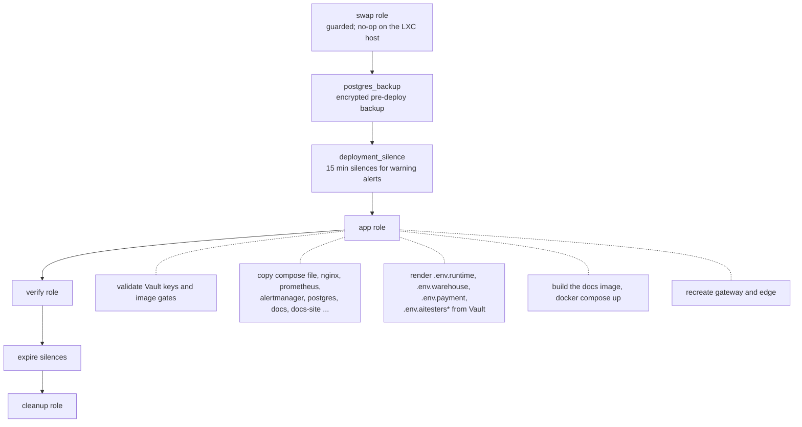

# Production deployment

Production runs the `docker-compose.server.yml` stack on one VPS (1 vCPU,
about 4.25 GiB RAM, no swap) in `/opt/awesome-localstack`, serving
`awesome.byst.re` (stable) and `aitesters.byst.re` (nightly-reset sandbox).
Everything is done with Ansible from a laptop; nothing is edited by hand on
the server.

## Commands

| Command | Effect |
| --- | --- |
| `make ansible-deploy` | Converge the stack and run verification |
| `make ansible-deploy-backend-upgrade` | Pull the reviewed backend, stop both backends, quiesced encrypted backup, then deploy (for migrations or ciphertext changes) |
| `make ansible-verify` | Only the health checks |
| `make ansible-cleanup` | Checksum- and retention-guarded container and image cleanup |
| `make ansible-reset-demo-state` | **Destructive**: delete the PostgreSQL volume and Mailpit state, redeploy |
| `make ansible-reset-aitesters-state` | Recreate the sandbox database, backend, warehouse-service and payment-service |
| `make ansible-ssh`, `make ansible-tunnel-grafana`, `make ansible-tunnel-mailpit` | Shell and SSH tunnels (Grafana `:3000`, Mailpit `:8025`) |
| `make ansible-edit-vault` | Edit the encrypted Vault |

## What `deploy.yml` does

A deploy that leaves the gateway returning `502` is a **failed** deploy:
verification is part of the playbook, not a follow-up.

## Secrets (Ansible Vault)

| Key | Used by |
| --- | --- |
| `postgres_password` | PostgreSQL superuser, backend datasource |
| `jwt_signing_key`, `aitesters_jwt_signing_key` | RS256 signing keys (distinct; base64 PKCS#8) |
| `warehouse_service_token`, `aitesters_warehouse_service_token` | warehouse → backend internal API |
| `warehouse_postgres_password`, `aitesters_warehouse_postgres_password` | `warehouse` database roles |
| `payment_service_token`, `aitesters_payment_service_token` | payment ↔ backend internal APIs |
| `payment_webhook_secret`, `aitesters_payment_webhook_secret` | payment result HMAC |
| `payment_postgres_password`, `aitesters_payment_postgres_password` | `payment` database roles |
| `aitesters_postgres_password` | sandbox PostgreSQL |
| `app_mfa_encryption_password`, `app_mfa_encryption_salt` | TOTP secret and webhook secret encryption |
| `app_bootstrap_admin_*` | the production admin account |
| `artemis_username`, `artemis_password` | broker account |
| `grafana_admin_password`, `alertmanager_telegram_bot_token`, `alertmanager_telegram_chat_id` | monitoring |
| `backup_encryption_passphrase`, `backup_remote_target` | backups |
| `local_email_outbox_access_key` | sandbox outbox secondary key |
| `production_ssh_*` | connection |

The `app` role refuses to deploy when a required key is missing, too short or
reused where it must be distinct (for example the two signing keys). Each
service receives only its own secrets: warehouse-service gets
`.env.warehouse` (service token, database password), payment-service gets
`.env.payment` (service token, webhook secret, database password).

## Image gates

- Every remotely pulled image is pinned as `tag@sha256:<digest>`.
- The app role stops if `docker-compose.server.yml` does not pin a **published**
  warehouse-service or payment-service image (the server cannot build GraalVM
  native images).
- The only locally built image on the server is the small `docs` wiki
  (`awesome-localstack/docs:local`), built from the deployed `docs-site/`
  directory; see [This documentation site](docs-site.md).

## Verification (`verify` role)

After every deploy and on `make ansible-verify`:

- every Compose service is running and one-shots exited `0`;
- every running container uses exactly the image its Compose reference
  resolves to;
- the `warehouse` and `payment` roles cannot read backend tables;
- PostgreSQL accepts the Vault password;
- a JMS contract email travels Artemis → consumer → Mailpit;
- direct routes (`http://warehouse-service:4003/...`, `http://payment-service:4004/...`,
  `http://docs/docs/`) answer from inside the gateway container;
- Prometheus targets are healthy, rules and Alertmanager are loaded,
  dashboards are provisioned, public HTTPS probes succeed;
- native-image heaps are bounded;
- gateway routes answer as expected on both hosts, for example `/login` 200,
  `/v3/api-docs` 200, `/warehouse/v3/api-docs` 200, `/payment/v3/api-docs` 200,
  `/docs/` 200, `/api/v1/tracking/VERIFY-UNKNOWN-TRACKING` 404,
  `/internal/v1/orders/1` 404, `/mailpit/` 404;
- the bootstrap admin can sign in and the catalog is present; the sandbox
  admin can sign in, traffic diagnostics and the outbox access key work;
- GraphQL and native gRPC surfaces respond.

More: [Ansible](../reference/ANSIBLE.md), [SSH server](../reference/SSH_SERVER.md),
[SSH tunnelling](../reference/SSH_TUNNELLING.md),
[Production edge proxy](../reference/PRODUCTION_EDGE_PROXY.md).
