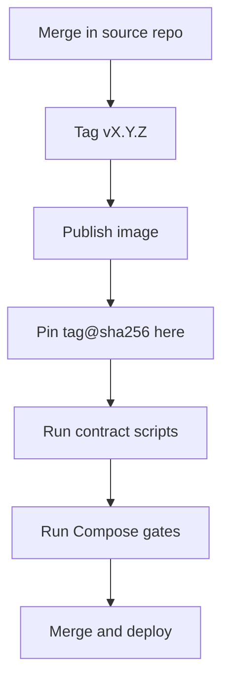

# Releases and image pinning

## Who publishes what

| Source repository | Docker Hub image | Release gate in that repository |
| --- | --- | --- |
| `test-secure-backend` | `slawekradzyminski/backend` | Maven verification, integration tests, Docker smoke |
| `vite-react-frontend` | `slawekradzyminski/frontend` | Unit tests, production build, browser tests, Docker smoke |
| `warehouse-service` | `slawekradzyminski/warehouse-service` | Maven tests, GraalVM native build, container smoke |
| `payment-service` | `slawekradzyminski/payment-service` | Maven tests, GraalVM native build, container smoke |
| `jms-email-consumer` | `slawekradzyminski/consumer` | Maven tests, Artemis → Mailpit integration smoke |
| `ollama-mock` | `slawekradzyminski/ollama-mock` | API contract tests, container smoke |

Images are also published to GHCR under the repository name; Compose deploys
from Docker Hub. A semantic-version tag `vX.Y.Z` runs the release gates and
publishes `linux/amd64` + `linux/arm64` with SBOM and provenance, and prints
the manifest digest.

## Release sequence



### Release train

`scripts/release-train.py` runs the sequence for backend, warehouse-service,
payment-service and frontend (`--with-consumer` adds the consumer). Each step
recomputes the release set from GitHub and the pinned Compose files, so it can
be rerun after a fix; `--dry-run` performs only reads and prints every action.

```bash
python3 scripts/release-train.py --dry-run plan   # versions, tags, pins, actions
python3 scripts/release-train.py tag              # only when the head's CI is green
python3 scripts/release-train.py wait             # fails fast with the run URL
python3 scripts/release-train.py pin              # digests, Compose files, compatibility set, release stub
python3 scripts/release-train.py verify --compat  # Compose config, contract scripts, course suite
python3 scripts/release-train.py pr --merge       # PR, CI, squash-merge
python3 scripts/release-train.py deploy --yes     # merged main, clean, Vault links present
```

`deploy` first runs the local preflight (`release-train.py preflight`: server
Compose config and the strict docs image build), then picks
`make ansible-deploy-backend-upgrade` when the backend version
changed (quiesce, backup, migrate), otherwise `make ansible-deploy`. Every
step, its checks and its refusals:
[Container releases — Release sequence](../reference/CONTAINER_RELEASES.md#release-sequence).

Multi-repository releases publish in dependency order — backend first (both
services call its internal API and poll its event feed; the backend calls
neither), then warehouse-service and payment-service, then the frontend — and
pin everything in one `awesome-localstack` change. New
Vault keys go in before the deploy; backend migrations use
`make ansible-deploy-backend-upgrade`, followed by the course suite (`l20`).

## Contract scripts

| Script | Guarantees |
| --- | --- |
| `scripts/verify-image-pins.py` | Every remotely pulled image in every profile, CI workflow, the root `Dockerfile`, `docs-site/Dockerfile` and the restore tooling is pinned by digest; locally built `:local` images are exempt |
| `scripts/verify-release-images.py` | The six first-party images form one compatibility set across profiles; the sandbox reuses the same images; env-file isolation; no backend sets `PAYMENT_BASE_URL` (removed in backend 3.16.0); gateway upstreams per host; required gateway locations in every server block (payments, tracking, `/internal/`, `/docs/`); the docs service is built locally with a bounded memory limit. `--remote` also checks both architectures exist |
| `scripts/verify-java-security.py` | The frozen Java certificate blocklist is mounted in every JVM container |
| `scripts/verify-deployment-silence.py`, `verify-backend-upgrade.py`, `verify-postgres-restore.py` | Ansible ordering and safety properties: preparation (docs build, pulls, Compose validation) before the quiesce, rescue restart of the stopped backends |
| `scripts/verify-asset-mirror.py` | Runs the deploy's asset mirror against a fixture git repository: files the repository tracked and deleted are pruned; untracked manual files, rendered secrets and `app_dir` runtime files are kept (CI job `verifyAnsible`, with `ansible-playbook --syntax-check` of every playbook) |
| `scripts/verify-edge-proxy.sh` | The edge only trusts forwarded headers from the provider range |
| `scripts/verify-correlation-ids.py` | Every gateway server block validates or generates `X-Request-Id` and `traceparent`, passes them from every proxied location, returns `X-Request-Id` and logs JSON; the server's Spring services log ECS JSON. `--routing` proves it against stub upstreams ([Tracing a request](tracing.md)) |
| `scripts/test_release_train.py` | Unit tests of the release train: version parsing, pin replacement, release-section rendering, deploy target, deploy preflight |

The current pins and the release history are in
[Container releases](../reference/CONTAINER_RELEASES.md#current-compatibility-set).

