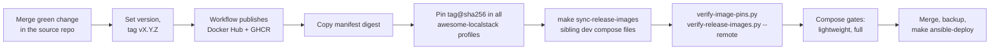

# Releases and image pinning

## Who publishes what

| Source repository | Docker Hub image | Release gate in that repository |
| --- | --- | --- |
| `test-secure-backend` | `slawekradzyminski/backend` | Maven verification, integration tests, Docker smoke |
| `vite-react-frontend` | `slawekradzyminski/frontend` | Unit tests, production build, browser tests, Docker smoke |
| `warehouse-service` | `slawekradzyminski/warehouse-service` | Maven tests, GraalVM native build, container smoke |
| `payment-service` | `slawekradzyminski/payment-service` | Maven tests, GraalVM native build, container smoke |
| `jms-email-consumer` | `slawekradzyminski/consumer` | Maven tests, Artemis → Mailpit integration smoke |
| `ollama-mock` | `slawekradzyminski/ollama-mock` | API contract tests, container smoke |

Images are also published to GHCR under the repository name; Compose deploys
from Docker Hub. A semantic-version tag `vX.Y.Z` runs the release gates and
publishes `linux/amd64` + `linux/arm64` with SBOM and provenance, and prints
the manifest digest.

## Release sequence

Multi-repository releases publish in dependency order — backend first (both
services call its internal API), then warehouse-service and payment-service,
then the frontend — and pin everything in one `awesome-localstack` change. New
Vault keys go in before the deploy; backend migrations use
`make ansible-deploy-backend-upgrade`, followed by the course suite (`l20`).

## Contract scripts

| Script | Guarantees |
| --- | --- |
| `scripts/verify-image-pins.py` | Every remotely pulled image in every profile, CI workflow, the root `Dockerfile`, `docs-site/Dockerfile` and the restore tooling is pinned by digest; locally built `:local` images are exempt |
| `scripts/verify-release-images.py` | The six first-party images form one compatibility set across profiles; the sandbox reuses the same images; env-file isolation; gateway upstreams per host; required gateway locations in every server block (payments, tracking, `/internal/`, `/docs/`); the docs service is built locally with a bounded memory limit. `--remote` also checks both architectures exist |
| `scripts/verify-java-security.py` | The frozen Java certificate blocklist is mounted in every JVM container |
| `scripts/verify-deployment-silence.py`, `verify-backend-upgrade.py`, `verify-postgres-restore.py` | Ansible ordering and safety properties |
| `scripts/verify-edge-proxy.sh` | The edge only trusts forwarded headers from the provider range |

The current pins and the release history are in
[Container releases](../reference/CONTAINER_RELEASES.md#current-compatibility-set).

!!! warning "Placeholder digest"
    Until payment-service 1.0.0 is published, `docker-compose.server.yml`
    carries `@sha256:PENDING_PAYMENT_SERVICE_DIGEST`. Both contract scripts and
    the Ansible image gate fail loudly on it on purpose.
