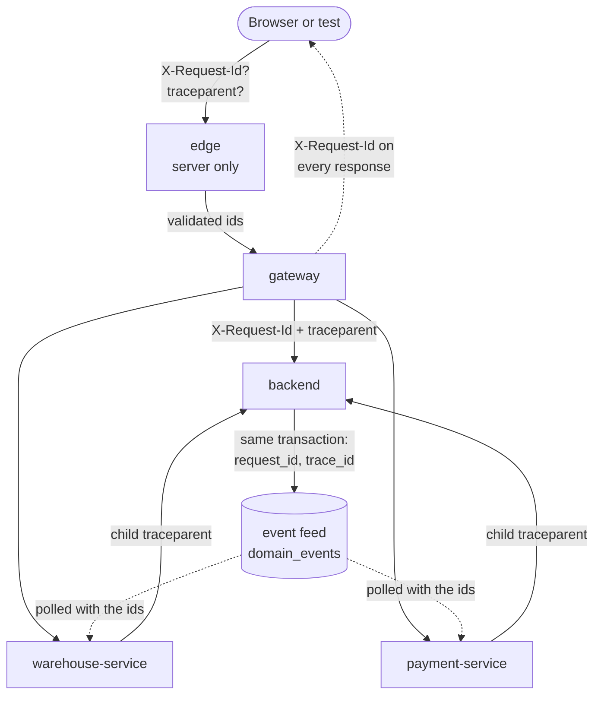

# Tracing a request

Every request gets two correlation ids at the edge of the platform. They are
logged by every hop and travel with the work through service calls, the event
feed and the outboxes, so one id finds everything that happened because of one
click or one API call.

| Header | Format | Purpose |
| --- | --- | --- |
| `X-Request-Id` | 1–128 characters of `A-Z a-z 0-9 . _ -` | The id people search for. Returned to the client on every response. |
| `traceparent` | W3C: `00-<32 hex trace id>-<16 hex parent id>-<2 hex flags>`, neither id all zeros | The trace id groups all hops; each hop gets a new parent (span) id. |

## Where the ids come from

The gateway (and on the server the edge in front of it) **keeps a valid
incoming value and replaces anything else**:

- `X-Request-Id`: a valid incoming value is kept, otherwise nginx's
  `$request_id` (32 random hex characters) is used;
- `traceparent`: a valid incoming value is kept, otherwise
  `00-<$request_id>-<last 16 hex of $request_id>-01` is generated. An
  uppercase, all-zero, wrong-version or malformed value counts as invalid.

So a test can send its own `X-Request-Id: checkout-test-17` and search for
exactly that; a browser that sends nothing gets a generated id, visible in the
response headers (developer tools → Network).



## How the ids flow

1. **Gateway.** Validates or generates both ids, passes them to every upstream
   (backend, warehouse-service, payment-service, frontend, docs), adds
   `X-Request-Id` to the response (replacing an upstream copy, so the client
   sees it once) and writes one JSON access-log line with both ids.
2. **Spring services** (backend 3.17.0, warehouse-service 1.4.0,
   payment-service 1.2.0). A `CorrelationFilter` validates the ids again, puts
   `requestId`, `traceId` and a new `spanId` into the logging context (MDC)
   and echoes `X-Request-Id`. On the server, logs are ECS JSON
   (`LOGGING_STRUCTURED_FORMAT_CONSOLE=ecs`), so these are JSON fields; locally
   they appear as `[traceId,requestId]` in the readable log line.
3. **Service calls.** warehouse-service and payment-service send the same
   `X-Request-Id` and a child `traceparent` (same trace id, new parent id)
   when they call the backend's internal API.
4. **Event feed.** The backend stores `request_id` and `trace_id` with each
   domain event, written in the transaction of the request that caused it,
   and logs one INFO line per event (`Recorded order.cancelled #42 for order 7`)
   under that request's ids, so the backend side shows up in the same search.
   A consumer handling the event (a card refund, a cancelled shipment) logs
   with those ids, so a refund processed seconds later by payment-service
   carries the id of the cancel request.
5. **Outboxes.** Emails, webhooks, warehouse notifications and payment results
   store the ids when they are enqueued and log them on delivery; webhook
   deliveries also send `X-Request-Id` (the delivery id stays in
   `X-Webhook-Id`). Work started by a scheduler without a request (a carrier
   step, a retention job) has no request id.

## Find everything about one request

Take the id from the response header (`X-Request-Id`) or from a gateway log
line, then search all containers of the stack.

On the server (`make ansible-ssh`) search each container's own log. This takes
about a second; `docker compose -p awesome-server logs` reads every container
through Compose and can take minutes on this host, so avoid it here.

```bash
trace_logs() {  # usage: trace_logs <request id or trace id> [since, default 2h]
  for c in $(docker ps --filter label=com.docker.compose.project=awesome-server --format '{{.Names}}'); do
    docker logs --since "${2:-2h}" "$c" 2>&1 | grep -F "$1" | sed "s/^/${c#awesome-server-} | /"
  done
}
ID=checkout-test-17
trace_logs "$ID"
```

The same as a time-ordered table (container, time, level or HTTP status,
message), one row per JSON line:

```bash
trace_logs "$ID" \
  | jq -rR '
      capture("^(?<svc>[^ ]+) [|] (?<line>.*)$") as $m
      | ($m.line | fromjson? // {message: $m.line}) as $e
      | [$m.svc,
         ($e.time // $e["@timestamp"] // ""),
         ($e["log.level"] // $e.log.level? // $e.status // "" | tostring),
         ($e.message // "\($e.method) \($e.uri) -> \($e.upstream) \($e.status) in \($e.request_time)s")]
      | @tsv' \
  | sort -t "$(printf '\t')" -k2,2
```

For a cancelled card-paid order this prints the edge and gateway lines, the
backend's `Recorded order.cancelled` and `Recorded card-refund.requested`, the
payment-service refund a few seconds later and the warehouse feed handler, all
under the cancel request's id.

To follow work beyond the request (an event handled later by another
service), search for the **trace id** instead: it is the `trace_id` field of
the gateway line, or the `traceId` field of a service line.

```bash
TRACE=$(trace_logs "$ID" | grep '^gateway-1 | ' | sed 's/^[^|]*| //' | jq -r .trace_id | head -1)
trace_logs "$TRACE"
```

The `aitesters.byst.re` sandbox runs in the same project: its services are the
`aitesters-*` rows of the same output.

Locally, use the profile's project instead (`awesome-light`,
`awesome-full-native`):

```bash
curl -si http://localhost:8081/api/v1/products -H 'X-Request-Id: local-check-1' | grep -i x-request-id
docker compose -p awesome-light logs --no-color | grep -F local-check-1
```

Local Spring logs stay human-readable, so the `jq` filter shows only the
gateway's JSON lines; the `grep` finds everything.

## Jaeger traces

Logs answer "what happened"; a trace also answers "where did the time go". The
tracing overlay adds [Jaeger](https://www.jaegertracing.io/) (all-in-one v2,
in-memory storage) and turns OpenTelemetry export on in the Spring services.

!!! warning "Image versions"
    Spans are exported from **backend 3.21.0, warehouse-service 1.5.0,
    payment-service 1.3.0** (and notification-service 1.0.0) on. Older images
    ignore the `TRACING_*` variables: Jaeger starts, but stays empty.

| Variable (set by the overlay) | Value |
| --- | --- |
| `TRACING_ENABLED` | `true` (default in the images: `false`, no export, no sampling) |
| `TRACING_OTLP_ENDPOINT` | `http://jaeger:4318/v1/traces` (OTLP over HTTP, inside the Compose network only) |
| `TRACING_SAMPLING_PROBABILITY` | `1.0`: every request is traced |

### Start and stop

```bash
make tracing-up        # Jaeger on the running profile (else lightweight); keeps the chaos and monitoring overlays
make tracing-down      # tracing off, Jaeger removed
```

`make tracing-up PROFILE=full` picks the profile, `scripts/tracing up|down`
is the same without make, and `scripts/chaos up lightweight tracing` starts the
[fault-injection lab](fault-injection.md) and Jaeger together. By hand:

```bash
docker compose -f lightweight-docker-compose.yml -f docker-compose.tracing.yml up -d
docker compose -f docker-compose.yml -f docker-compose.chaos.yml \
  -f docker-compose.monitoring.yml -f docker-compose.tracing.yml up -d
```

The UI is `http://127.0.0.1:16686` (loopback only; `JAEGER_UI_PORT` moves it).
Jaeger keeps the last 20,000 traces in memory (container limit 256 MiB); they
are gone when it restarts. The backend restarts with the overlay and gets a new
signing key, so sign in again.

### Find a trace

The trace id is the middle part of `traceparent` and the `trace_id` field of
the gateway log line; the services use the incoming `traceparent` as the
parent of their first span, so Jaeger shows the same id.

1. **Bring your own id.** Send a `traceparent` and open the trace directly:

    ```bash
    TRACE=$(openssl rand -hex 16)
    curl -s -o /dev/null http://localhost:8081/api/v1/products \
      -H "Authorization: Bearer $TOKEN" \
      -H "traceparent: 00-$TRACE-$(openssl rand -hex 8)-01" -H 'X-Request-Id: jaeger-demo-1'
    open "http://127.0.0.1:16686/trace/$TRACE"          # xdg-open on Linux
    ```

2. **From an `X-Request-Id`.** Look the trace id up in the gateway log, then
   paste it into the search box at the top of the Jaeger UI (or use
   `/trace/<id>` as above):

    ```bash
    docker compose -p awesome-light logs --no-color gateway | grep -F jaeger-demo-1 \
      | sed 's/^[^{]*//' | jq -r .trace_id
    ```

3. **By service.** *Search* → *Service* `backend` (or `warehouse-service`,
   `payment-service`) → *Operation*, optionally *Min Duration* `1s` to find slow
   requests, *Find Traces*.

The query API (Jaeger v2, OTLP JSON) answers the same: `curl -s http://127.0.0.1:16686/api/v3/traces/$TRACE | jq '[.result.resourceSpans[].scopeSpans[].spans[]] | length'` (404 while the trace is unknown); `curl -s http://127.0.0.1:16686/api/v3/services` lists the services that sent spans.

### Example: cancel → refund

Cancelling a card-paid order is one HTTP request, but its work finishes seconds
later in other services through the [event feed](../reference/EVENT_FEED.md).
With tracing on, all of it is one trace:

1. Pay an order with `4242 4242 4242 4242` (it becomes `PAID`).
2. Cancel it with your own trace id:

    ```bash
    TRACE=$(openssl rand -hex 16)
    curl -s -X POST http://localhost:8081/api/v1/orders/$ORDER/cancel \
      -H "Authorization: Bearer $TOKEN" -H "traceparent: 00-$TRACE-$(openssl rand -hex 8)-01"
    ```

3. Wait about ten seconds (the consumers poll every 5 s) and open
   `http://127.0.0.1:16686/trace/$TRACE`.

Expected shape (span names can differ slightly between releases):

```text
backend            POST /api/v1/orders/{id}/cancel        server span; parent = the gateway's traceparent
├─ backend         SQL / JPA work of the cancel           with the event rows written in the same transaction
├─ payment-service process card-refund.requested          CONSUMER span, starts seconds later (feed poll)
│  └─ payment-service  refund booking, outbox dispatch     a span per dispatched outbox row
└─ warehouse-service process order.cancelled              CONSUMER span; cancels an AWAITING_PICK shipment
```

The consumer spans hang under the cancel because every feed event carries the
`traceId` and `spanId` of the request that recorded it (`domain_events.trace_id`
and `span_id`); outbox dispatchers continue the trace from the stored
`traceparent`. The gap between the cancel span and the consumer spans is the
feed polling delay. Jaeger may mark the root as having a missing parent: the
parent is the gateway, which logs but does not export spans.

With the [fault-injection lab](fault-injection.md) running, `scripts/chaos
backend-slow 3000 payment` makes the payment-service spans that call the
backend 3 s long, and `backend-down` turns them into error spans.

## Gateway access log fields

| Field | Meaning |
| --- | --- |
| `time` | ISO 8601 time the request finished |
| `request_id`, `trace_id`, `traceparent` | The ids after validation, exactly as sent upstream |
| `host`, `remote_addr`, `method`, `uri`, `user_agent` | The request (`uri` is the path without the query string, so tokens in query parameters are not logged) |
| `status`, `bytes_sent`, `request_time` | The response and total time in seconds |
| `upstream`, `upstream_status` | Address and status of the upstream; `-` or empty when nginx answered itself (a `404` for `/internal/`) |
| `upstream_connect_time`, `upstream_header_time`, `upstream_response_time` | Upstream timings in seconds; slow `upstream_header_time` with fast connect means the service, not the network |

On the server, both the edge and the gateway log a line for each request, with
the same ids. The gateway does not log `/images/` and `/branding/`.

## Guarantees

`scripts/verify-correlation-ids.py` (CI job `verifyCorrelationIds`) checks
that every server block of every gateway configuration logs JSON, returns
`X-Request-Id` and passes both headers from every proxied location, and that
the server's Spring services enable ECS logging. With `--routing` it starts
the pinned nginx with stub upstreams and proves that ids are generated,
preserved when valid, replaced when invalid, passed to every upstream and
echoed back once, through the edge as well.
