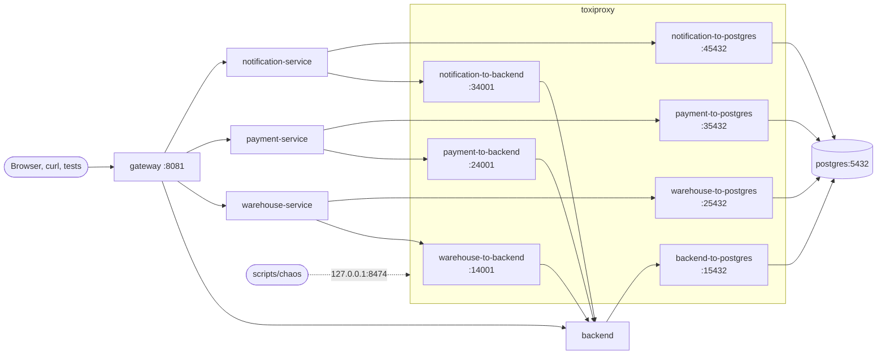

# Fault-injection lab

Break the network between the services on purpose and watch how the system
copes: a 503 instead of a hang, an outbox that fills up and drains, a feed
consumer that picks up where it stopped, a payment that loses a race against an
expiring reservation. Everything runs locally on top of the lightweight or the
full profile, with one command line tool and no extra installs.

| Item | Value |
| --- | --- |
| Overlay | `docker-compose.chaos.yml` |
| Proxy definitions | `chaos/toxiproxy.json` |
| Command line | `scripts/chaos` (bash, curl and Docker; macOS and Linux) or the `make chaos-*` targets |
| Toxiproxy API | `http://127.0.0.1:8474` (loopback only; `TOXIPROXY_PORT` moves it) |
| Memory | Toxiproxy needs about 10 MiB (limit 32 MiB) |
| Check | `scripts/verify-chaos-overlay.sh` |

## What Toxiproxy is

[Toxiproxy](https://github.com/Shopify/toxiproxy) is a TCP proxy made for
testing. Every service connection that the lab cares about goes through it, and
an HTTP API changes that connection while traffic flows:

- **disable a proxy**: open connections are closed and new ones are refused,
  like a service that is down or a cable that is unplugged;
- **add a toxic**: a fault on the data that passes through, for example
  `latency` (every answer arrives later), `bandwidth` (KB/s limit), `timeout`
  (data stops; the connection hangs or closes after a delay) or `reset_peer`
  (TCP reset). A toxic can hit only a share of the connections (`toxicity`).

The services do not know about it. The overlay only changes two settings:
`BACKEND_BASE_URL` (how warehouse-, payment- and notification-service reach the
backend) and `SPRING_DATASOURCE_URL` (how each service reaches PostgreSQL). The
gateway keeps talking to every service directly, so your browser, Swagger and
curl always reach the services; only the links *between* them break.

## Topology

One proxy per link, so a scenario can break one service's view without touching
the others. warehouse-service can lose the backend while payment-service still
reaches it.



| Proxy | Listens (inside the network) | Upstream | Used by |
| --- | --- | --- | --- |
| `warehouse-to-backend` | `toxiproxy:14001` | `backend:4001` | warehouse-service `BACKEND_BASE_URL` |
| `payment-to-backend` | `toxiproxy:24001` | `backend:4001` | payment-service `BACKEND_BASE_URL` |
| `notification-to-backend` | `toxiproxy:34001` | `backend:4001` | notification-service `BACKEND_BASE_URL` |
| `backend-to-postgres` | `toxiproxy:15432` | `postgres:5432` | backend `SPRING_DATASOURCE_URL` |
| `warehouse-to-postgres` | `toxiproxy:25432` | `postgres:5432` | warehouse-service `SPRING_DATASOURCE_URL` |
| `payment-to-postgres` | `toxiproxy:35432` | `postgres:5432` | payment-service `SPRING_DATASOURCE_URL` |
| `notification-to-postgres` | `toxiproxy:45432` | `postgres:5432` | notification-service `SPRING_DATASOURCE_URL` |

**notification-service.** Both base profiles run notification-service
(1.0.0), so `docker-compose.chaos.yml` re-points it like the other services and
the `notification` target works in every scenario.

## Quick start

```bash
scripts/chaos up                     # 1. the lightweight profile with the lab (make chaos-up)
scripts/chaos backend-down warehouse # 2. warehouse-service loses the backend
scripts/chaos heal                   # 3. everything back to normal
```

`scripts/chaos up` starts the profile that already runs (otherwise the
lightweight one) with the overlay, waits until the services are healthy and
prints the proxy table. A running stack is not lost: Compose restarts only the
services whose settings change (backend, warehouse-service, payment-service),
and PostgreSQL is not one of them, so even the lightweight profile's in-memory
data survives. The backend restart gives it a new signing key: sign in again
(the frontend does it by itself with its refresh token).

Look at what is broken at any time:

```text
$ scripts/chaos status
Toxiproxy 2.13.0 on http://127.0.0.1:8474
PROXY                      LISTEN            UPSTREAM        STATE     FAULTS
backend-to-postgres        toxiproxy:15432   postgres:5432   up        -
notification-to-backend    toxiproxy:34001   backend:4001    up        -
notification-to-postgres   toxiproxy:45432   postgres:5432   up        -
payment-to-backend         toxiproxy:24001   backend:4001    up        backend-slow: latency latency=5000 jitter=0
payment-to-postgres        toxiproxy:35432   postgres:5432   up        -
warehouse-to-backend       toxiproxy:14001   backend:4001    DISABLED  -
warehouse-to-postgres      toxiproxy:25432   postgres:5432   up        -
2 fault(s) active. Remove them with: scripts/chaos heal
```

## Commands

| `scripts/chaos …` | `make …` | Does |
| --- | --- | --- |
| `up [full\|lightweight] [tracing] [monitoring]` | `make chaos-up [PROFILE=full] [WITH="tracing monitoring"]` | Starts the profile with the lab and waits for it. Overlays that already run (tracing, monitoring) are kept |
| `down` | `make chaos-down` | Stops the whole stack that runs the lab (`down --remove-orphans`; named volumes of the full profile are kept) |
| `list` | `make chaos-list` | Scenarios with one-line descriptions |
| `status` | `make chaos-status` | Proxies and active faults |
| `reset` or `heal` | `make chaos-reset` (or `chaos-heal`) | Enables every proxy and removes every toxic |
| `<scenario> [value] [target]` | `make chaos SCENARIO=<scenario> [VALUE=<n>] [TARGET=<service>]` | Applies a scenario; value and target may come in any order |
| `help` | | Usage |

Scenarios add to each other: `backend-slow payment` and then `postgres-down
warehouse` leaves both active. Running a scenario again replaces its own toxic
(`backend-slow 500` after `backend-slow 5000` leaves 500 ms). `heal` removes
everything.

To leave the lab but keep the stack, start the profile without the overlay:

```bash
docker compose -f lightweight-docker-compose.yml up -d --remove-orphans
```

The services are recreated with their direct URLs and `--remove-orphans`
removes Toxiproxy. (With the monitoring or tracing overlay running, list its
file too, or `--remove-orphans` removes it as well.)

### Error messages

| Message | Meaning and fix |
| --- | --- |
| `no stack is running` | Start one: `scripts/chaos up` |
| `the stack runs without the fault-injection lab` | A profile runs, but without the overlay. `scripts/chaos up` adds it |
| `Toxiproxy runs but does not answer on http://127.0.0.1:8474` | The lab was started with another `TOXIPROXY_PORT`; use the same value |
| `Docker is not running` | Start Docker Desktop or the daemon |
| `unknown target 'x'` / `unknown command or scenario 'x'` | See `scripts/chaos list` |
| `Bind for 127.0.0.1:8474 failed: port is already allocated` (from `up`) | Something else uses 8474: `TOXIPROXY_PORT=18474 scripts/chaos up`, and keep that variable for the other commands |

## Scenarios

Targets: `warehouse`, `payment`, `notification` (the `-service` suffix is
optional), `backend` for the `postgres-*` scenarios, or nothing for all of
them.

| Scenario | Toxiproxy change | What you observe |
| --- | --- | --- |
| `backend-down [target]` | disables `<target>-to-backend` | Calls from the target to the backend fail at once with *connection refused*. warehouse-service answers `503 {"message":"Backend unavailable"}` on endpoints that need the backend; event-feed polling and outbox delivery pause |
| `backend-slow [ms] [target]` | `latency` toxic (default 3000 ms) on the answers of `<target>-to-backend` | Every backend call of the target takes `ms` longer. Beyond the client read timeout (warehouse-service: 10 s) the call fails and becomes a 503 |
| `backend-flaky [percent] [target]` | `reset_peer` and `timeout` (5 s) toxics, each on half of the given share of connections (default 30 %) | Some calls fail at once (connection reset), some after 5 s, the rest work. Retries and outboxes earn their keep. Pooled keep-alive connections keep their fate until they are replaced, so the effect is per connection, not per request |
| `bandwidth [KB/s] [target]` | `bandwidth` toxic (default 8 KB/s) on the answers of `<target>-to-backend` | Small answers are fine, big ones (an order list, the JWKS on a cold start) crawl |
| `postgres-stall [ms] [target]` | `timeout` toxics on both directions of `<target>-to-postgres` | Database connections stop passing data. Without `ms` they hang until `heal`; with `ms` they close after `ms`. Requests that need the database hang and fail after HikariCP's 30 s connection timeout; `/actuator/health` stops answering |
| `postgres-down [target]` | disables `<target>-to-postgres` | Pooled connections are closed, new ones refused. Requests that need the database fail at once (warehouse-service: `500` in a few milliseconds); health turns DOWN |
| `partition-<service>` | disables every proxy to and from the service | `partition-warehouse`, `partition-payment`, `partition-notification`: the service loses the backend and its database. `partition-backend`: no service reaches the backend and the backend loses PostgreSQL. `partition-postgres`: nobody reaches PostgreSQL |

The gateway is never behind Toxiproxy, so the backend's own API keeps working
under `backend-down` (a customer can still place and cancel orders).
`partition-backend` and the `postgres-*` scenarios on the backend are the ones
that break the storefront.

## Where to look

| Question | How |
| --- | --- |
| What is broken? | `scripts/chaos status` |
| What did one request do? | Send your own `X-Request-Id` and search every log for it (see [Find everything with X-Request-Id](#exercise-6-find-everything-with-x-request-id)) |
| A service's own log | `docker compose -p awesome-light logs -f warehouse-service` (full profile: `-p awesome-full-native`) |
| Is a service healthy? | `docker compose -p awesome-light ps`, or `docker compose -p awesome-light exec gateway curl -s http://warehouse-service:4003/actuator/health` |
| Database rows | `docker compose -p awesome-light exec postgres psql -U postgres -d testdb` (schemas `public` = backend, `warehouse`, `payment`, `notification`) |
| Metrics | `docker compose -p awesome-light exec gateway curl -s http://payment-service:4004/actuator/prometheus \| grep outbox`, or Grafana/Prometheus with `scripts/chaos up monitoring` |
| Traces | `scripts/chaos up tracing`, then Jaeger on `http://127.0.0.1:16686` ([Tracing a request](../docs-site/docs/operations/tracing.md)) |

The examples below use the lightweight profile (`-p awesome-light`), the demo
accounts (`admin` / `LocalDemoAdmin123!`, `warehouse` / `warehouse`, `client` /
`client`) and `jq`. Get tokens once:

```bash
B=http://localhost:8081
login() { curl -s $B/api/v1/users/signin -H 'Content-Type: application/json' \
  -d "{\"username\":\"$1\",\"password\":\"$2\"}" | jq -r .token; }
A=$(login admin 'LocalDemoAdmin123!'); W=$(login warehouse warehouse); C=$(login client client)
psql() { docker compose -p awesome-light exec -T postgres psql -U postgres -d testdb -c "$1"; }
```

Order helpers used by several exercises:

```bash
new_order() {  # creates a PENDING order for the client and prints its id
  pid=$(curl -s "$B/api/v1/products/search?inStock=true&sort=price_asc&size=1" -H "Authorization: Bearer $C" | jq '.content[0].id')
  curl -s $B/api/v1/cart/items -H "Authorization: Bearer $C" -H 'Content-Type: application/json' \
    -d "{\"productId\":$pid,\"quantity\":1}" >/dev/null
  curl -s $B/api/v1/orders -H "Authorization: Bearer $C" -H 'Content-Type: application/json' \
    -d '{"street":"Main 1","city":"Warszawa","state":"M","zipCode":"00-001","country":"Poland"}' | jq .id
}
pay() {  # pay <orderId> <card number>
  curl -s $B/api/v1/payments -H "Authorization: Bearer $C" -H 'Content-Type: application/json' \
    -H "X-Request-Id: pay-$1" -H "Idempotency-Key: pay-$1-$RANDOM" \
    -d "{\"orderId\":$1,\"card\":{\"number\":\"$2\",\"expiryMonth\":12,\"expiryYear\":2031,\"cvc\":\"123\",\"holderName\":\"Lab Student\"}}" | jq
}
```

Card numbers: `4242 4242 4242 4242` captures at once, `4000 0000 0000 0077`
stays `PROCESSING` and settles after `PAYMENT_SETTLEMENT_DELAY` (10 s by
default).

## Guided exercises

Each exercise ends with `scripts/chaos heal`. If something looks stuck, run
`scripts/chaos status` first.

### Exercise 1: warehouse answers 503 when it loses the backend

warehouse-service asks the backend for orders and mirrors every fulfilment step
to it. Without the backend it must fail fast and clearly, not hang.

1. Check the normal answer:

    ```bash
    curl -s -o /dev/null -w '%{http_code}\n' $B/api/v1/warehouse/queue -H "Authorization: Bearer $W"   # 200
    ```

    This first call also matters: warehouse-service verifies your token with
    the backend's public key, which it fetches from the backend once and caches.
    Without that call (for example right after `scripts/chaos up`, which
    restarts the backend with a new key) even authentication needs the backend:
    under `backend-down` you would get the 503 for the key fetch and then
    `401 {"message":"Invalid or expired token"}` until `heal`. A second lesson in
    hidden dependencies.

2. Cut warehouse-service off: `scripts/chaos backend-down warehouse`.
3. Repeat the call with your own request id:

    ```bash
    curl -s -w ' %{http_code} in %{time_total}s\n' $B/api/v1/warehouse/queue \
      -H "Authorization: Bearer $W" -H 'X-Request-Id: lab-ex1'
    ```

    **Expected:** `{"message":"Backend unavailable"} 503` in a few
    milliseconds (connection refused, no waiting). Releasing (`POST
    /api/v1/warehouse/shipments {"orderId":…}`) and picking (`POST
    /api/v1/warehouse/shipments/{id}/pick`) of a paid order answer the same 503,
    and the shipment does not change.
4. The rest still works: `new_order` places an order (the backend itself is
   fine), and `GET /api/v1/payments/...` answers (payment-service still reaches
   the backend).
5. Find the cause in the warehouse log:

    ```bash
    docker compose -p awesome-light logs warehouse-service | grep -F lab-ex1
    ```

    **Expected:** an ERROR line `Backend internal API is unreachable: I/O
    error on GET request for "http://toxiproxy:14001/internal/v1/…"` under
    `[<trace id>,lab-ex1]`. The gateway's JSON line for `lab-ex1` shows
    `"status":503` with an `upstream_response_time` of a few milliseconds: the
    service failed fast, nothing waited.
6. Make it slow instead of down: `scripts/chaos heal`, then `scripts/chaos
   backend-slow 4000 warehouse`. The queue now answers 200 after about 4 s.
   With `backend-slow 12000 warehouse` it answers 503 after about 10 s: the
   warehouse client's read timeout (`backend.read-timeout: 10s`) turned the
   slowness into a failure.
7. `scripts/chaos heal`. The next call answers 200 at once.

Variant: `scripts/chaos backend-flaky 50 warehouse` and call the queue ten
times. Some calls answer 200, some 503 at once, some 503 after 5 s.

### Exercise 2: an outbox backlog grows and drains

Services never call another service inside the user's request when they do not
have to. They write the message into an **outbox table** in their own database,
in the same transaction as their state change, and a dispatcher sends it later,
retrying until the receiver accepts it. While a link is down the outbox grows;
after `heal` it drains by itself.

| Service | Outbox table | Pending rows | Gauge (`/actuator/prometheus`) |
| --- | --- | --- | --- |
| payment-service | `payment.payment_outbox` (payment results for the backend) | `sent_at IS NULL` | `payment_outbox_pending` (payment-service 1.3.0+) |
| warehouse-service | `warehouse.notification_outbox` (customer notifications for the backend) | `sent_at IS NULL` | `warehouse_outbox_pending` (warehouse-service 1.5.0+) |
| notification-service | `notification.notification_emails` (status `QUEUED`) and its webhook deliveries (status `PENDING`) | see the SQL below | `notification_outbox_pending` (notification-service 1.0.0+) |

**payment-service (works with today's images):**

1. Place an order and pay with the slow card: `O=$(new_order); pay $O 4000000000000077`.
   **Expected:** `"status": "PROCESSING"`.
2. Within 10 s: `scripts/chaos backend-down payment`.
3. Wait 15 s. The simulated provider settles the payment, but the result cannot
   reach the backend:

    ```bash
    psql "select id, order_id, attempts, next_attempt_at, sent_at, left(last_error, 60) as last_error
            from payment.payment_outbox order by id desc limit 5"
    docker compose -p awesome-light exec gateway curl -s http://payment-service:4004/actuator/prometheus | grep outbox_pending
    curl -s $B/api/v1/orders/$O -H "Authorization: Bearer $C" | jq .status
    ```

    **Expected:** a row with `sent_at` empty, `attempts` growing every 30 s and
    `0 Backend unavailable` in `last_error` (no HTTP status: the connection
    failed); `payment_outbox_pending 1.0` (1.3.0+); the order is still `PENDING`
    although the card was charged. The payment-service log shows `Could not
    deliver payment result … for order <id> (will retry): 0 Backend
    unavailable` under the payment request's id (`pay-<order id>`).
4. `scripts/chaos heal`. **Expected:** within 30 s (the retry interval) `sent_at`
   is set, the gauge drops to 0 and the order becomes `PAID`.

**warehouse-service** (not part of the automated check; the steps follow the
same pattern): release and ship a paid order (`POST
/api/v1/warehouse/shipments`, then `/pick`, `/pack {"weightKg":1.2}` and `/ship
{"carrier":"DHL"}`) with `backend-down warehouse` applied **after** the ship
call returned, then advance the simulated carrier (`POST
/api/v1/warehouse/shipments/{id}/carrier/advance`): the "shipped" and
"delivered" customer notifications queue up in

```sql
select id, template, attempts, sent_at, left(last_error, 60) from warehouse.notification_outbox
 where sent_at is null order by id;
```

and drain after `heal`.

**notification-service (1.0.0+):** `scripts/chaos backend-down notification`
stops it from reading the event feed, so nothing new is queued; `scripts/chaos
partition-notification` also stops it from recording deliveries. To build a
delivery backlog, point a webhook at a dead URL or slow the email transport and
read

```sql
select status, count(*) from notification.notification_emails group by status;
select status, count(*) from notification.webhook_deliveries group by status;
```

### Exercise 3: the event-feed consumer resumes from its cursor

warehouse-service and payment-service learn about cancellations from the
backend's [event feed](EVENT_FEED.md). Each keeps a **cursor**: the sequence of
the last event it handled, stored in its own database. After an outage it asks
for "everything after my cursor", so nothing is lost and nothing is handled
twice.

1. Prepare a paid order with a released shipment:

    ```bash
    O=$(new_order); pay $O 4242424242424242
    curl -s $B/api/v1/warehouse/shipments -H "Authorization: Bearer $W" \
      -H 'Content-Type: application/json' -d "{\"orderId\":$O}" | jq '{id, status}'   # AWAITING_PICK
    psql "select * from warehouse.event_cursors"
    ```

    Note `last_sequence` of the `warehouse-service` row.
2. Partition the warehouse: `scripts/chaos partition-warehouse`.
3. The customer cancels the order (the backend is still reachable):

    ```bash
    curl -s -X POST $B/api/v1/orders/$O/cancel -H "Authorization: Bearer $C" -H 'X-Request-Id: lab-ex3' | jq .status   # CANCELLED
    ```

4. The backend recorded the event; the warehouse has not seen it:

    ```bash
    psql "select sequence, type, order_id, request_id from domain_events order by sequence desc limit 3"
    psql "select id, status from warehouse.shipments where order_id = $O"   # AWAITING_PICK
    psql "select * from warehouse.event_cursors"                            # unchanged
    psql "select * from payment.event_cursors"                              # moved: payment-service refunded
    ```

    The warehouse log shows the poller failing every 5 s.
5. `scripts/chaos heal`. Within about 10 s:

    ```bash
    psql "select id, status, last_actor from warehouse.shipments where order_id = $O"   # CANCELLED, system
    psql "select * from warehouse.event_cursors"                                        # last_sequence moved on
    ```

    The consumer read every event after its stored cursor, cancelled the
    shipment once (`warehouse.processed_events` holds the event id) and moved the
    cursor.

Try `scripts/chaos partition-payment` the same way: cancel a card-paid order
and watch `GET /api/v1/payments/{id}` stay `CAPTURED` until `heal`, then become
`REFUNDED`.

### Exercise 4: a slow payment against an expiring reservation

Needs backend 3.21.0 and payment-service 1.3.0. From backend 3.21.0 a new order
holds its stock only until `reservationExpiresAt`; then the backend cancels it
(`order.cancelled` with reason `RESERVATION_EXPIRED`). A payment result that
arrives after that is answered **409** and payment-service **voids** the payment.

1. Start the lab with a short reservation:

    ```bash
    ORDERS_RESERVATION_TTL=PT2M scripts/chaos up
    ```

2. Place an order and note its deadline: `O=$(new_order)`, then
   `curl -s $B/api/v1/orders/$O -H "Authorization: Bearer $C" | jq '{status, reservationExpiresAt}'`.
3. Pay with the slow card and cut payment-service off before it settles:

    ```bash
    pay $O 4000000000000077            # PROCESSING
    scripts/chaos backend-down payment
    ```

4. Let the reservation run out. Wait two minutes, or expire it now as admin:

    ```bash
    curl -s -X POST $B/api/v1/admin/orders/$O/expire-reservation -H "Authorization: Bearer $A" | jq .status   # CANCELLED
    ```

    The payment has settled at the provider meanwhile and its result waits in
    `payment.payment_outbox` (Exercise 2).
5. `scripts/chaos heal`. Within 30 s the outbox delivers the result, the
   backend answers 409 because the order is no longer `PENDING`, and
   payment-service voids the payment:

    ```bash
    docker compose -p awesome-light logs payment-service | grep -F pay-$O    # the 409 for this order
    psql "select order_id, attempts, sent_at, last_error from payment.payment_outbox order by id desc limit 1"
    curl -s $B/api/v1/orders/$O/payments -H "Authorization: Bearer $C" | jq '.[0].status'   # VOIDED
    curl -s $B/api/v1/orders/$O -H "Authorization: Bearer $C" | jq .status                  # CANCELLED
    ```

    **Expected:** the log line `Backend refused payment result … for order <id>:
    Order is not payable; voiding the capture`, the outbox row sent with
    `last_error` `409 Order is not payable`, the payment `VOIDED`. The order
    stays cancelled and its stock is back (`ORDER_RESTORED`); the customer is not
    charged for a cancelled order.

**With today's images** (backend 3.20.1, payment-service 1.2.1) the same race
works with a customer cancel instead of the expiry: skip step 1 and step 4's
expire call, and cancel the order in step 4 with `curl -s -X POST
$B/api/v1/orders/$O/cancel -H "Authorization: Bearer $C"`. Everything else,
including the `409 Order is not payable` and `VOIDED`, is identical (`scripts/verify-chaos-overlay.sh`
checks this variant).

Without Toxiproxy the same race appears with a slow provider:
`ORDERS_RESERVATION_TTL=PT2M PAYMENT_SETTLEMENT_DELAY=PT3M scripts/chaos up`,
pay with `4000 0000 0000 0077` and wait three minutes. A new payment for an
already expired order is refused up front with `409 {"message":"Order
reservation expired"}`.

### Exercise 5: PostgreSQL stalls

A stalled database is worse than a dead one: nothing fails, everything waits.

1. `scripts/chaos postgres-stall warehouse`.
2. Call an endpoint that needs the warehouse database and time it:

    ```bash
    curl -s -w ' %{http_code} in %{time_total}s\n' $B/api/v1/warehouse/shipments \
      -H "Authorization: Bearer $W" -H 'X-Request-Id: lab-ex5'
    ```

    **Expected:** `500 Internal Server Error` after about 30 s. HikariCP finds
    its pooled connections dead, cannot open a new one through the stalled link
    and gives up after its `connectionTimeout` (30 s).
3. Read the warehouse log:

    ```bash
    docker compose -p awesome-light logs --since 2m warehouse-service | grep -E 'Hikari|lab-ex5'
    ```

    **Expected:** `HikariPool-1 - Failed to validate connection … (This
    connection has been closed.)` and `HikariPool-1 - Connection is not
    available, request timed out after 30003ms (total=0, active=0, idle=0,
    waiting=3)` under `lab-ex5`: the pool is empty and three requests queue for
    it. The health endpoint stops answering, so after three failed checks
    `docker compose -p awesome-light ps` shows the service `unhealthy`.
4. `scripts/chaos heal`. HikariCP opens new connections on the next request;
   the service answers normally within a second or two.
5. Compare with `scripts/chaos postgres-down warehouse`: the same call answers
   `500` in a few milliseconds. A refused connection fails fast, a stalled one
   costs every caller 30 s. `scripts/chaos postgres-stall 5000 warehouse` stalls
   connections and closes them after 5 s.
6. `scripts/chaos postgres-stall backend` does the same to the backend:
   `GET /api/v1/products` hangs until the gateway gives up with
   `504 Gateway Time-out` after 60 s, and the storefront hangs with it. After
   `heal` the backend answers at once.

### Exercise 6: find everything with X-Request-Id

Every request gets an `X-Request-Id` at the gateway, and every hop logs it
(see [Tracing a request](../docs-site/docs/operations/tracing.md)). Send your own
id to make it easy to find:

```bash
curl -s -o /dev/null -D - $B/api/v1/warehouse/queue -H "Authorization: Bearer $W" \
  -H 'X-Request-Id: lab-find-me' | grep -i x-request-id
docker compose -p awesome-light logs --no-color | grep -F lab-find-me
```

**Expected:** the response echoes `X-Request-Id: lab-find-me`; the logs show the
gateway access-log line (JSON with `status`, `upstream_response_time` and the
`trace_id`), the warehouse-service lines and, when the backend was reached, the
backend lines with the same id. Under a fault
the gateway line shows how long the upstream took, and the service line shows
the error. Work done later because of the request (a refund from the event
feed, an outbox delivery) is logged with the same id, so `grep` finds it too.
With the tracing overlay the same `trace_id` opens the whole call tree in
Jaeger.

## With tracing and monitoring

The overlays combine:

```bash
scripts/chaos up lightweight tracing monitoring
# or: make chaos-up WITH="tracing monitoring"
```

- Jaeger (`http://127.0.0.1:16686`) shows a delayed span under
  `backend-slow` and an error span under `backend-down` (backend 3.21.0,
  warehouse-service 1.5.0, payment-service 1.3.0 and later).
- Grafana (`http://localhost:3000`) shows request rates and latencies; the
  outbox gauges show the backlog of Exercise 2.

## The Toxiproxy API by hand

`scripts/chaos` is a thin wrapper. The same with curl:

```bash
T=http://127.0.0.1:8474
curl -s $T/proxies | jq 'map_values({listen, upstream, enabled, toxics})'
curl -s -X PATCH $T/proxies/warehouse-to-backend -d '{"enabled":false}'          # backend-down warehouse
curl -s -X POST $T/proxies/payment-to-backend/toxics \
  -d '{"name":"slow","type":"latency","stream":"downstream","toxicity":1,"attributes":{"latency":3000}}'
curl -s -X DELETE $T/proxies/payment-to-backend/toxics/slow
curl -s -X POST $T/reset                                                          # heal
```

Every toxic type and its attributes:
[Toxiproxy README](https://github.com/Shopify/toxiproxy#toxics). The API is
unauthenticated and published on `127.0.0.1` only; do not publish it further.

## How the lab is verified

`scripts/verify-chaos-overlay.sh` checks `docker compose config --quiet` for every
combination of the full and lightweight profiles with the chaos, tracing and
monitoring overlays, then starts lightweight + chaos with the published images
in its own Compose project and ports (so it runs beside your stack), runs every
scenario with an assertion a student could make with curl (the warehouse 503,
a delayed or failing link, a database health check going DOWN, the feed cursor
standing still during a partition, the payment outbox growing and draining),
heals and checks recovery, adds and removes the tracing overlay and tears the
stack down with `scripts/chaos down`.
