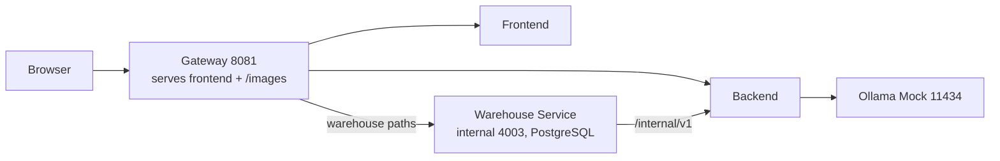
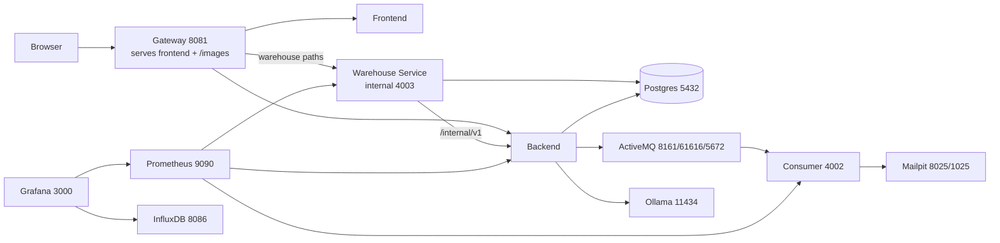
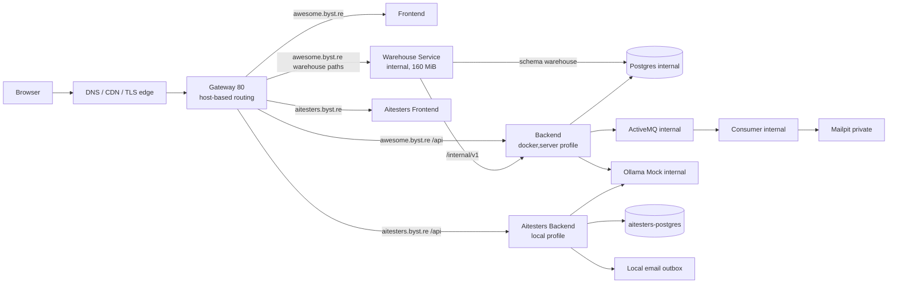

# Profile URL Guide

This file documents what each main Docker profile actually publishes on the host, and which URLs you should use first.

Each profile now uses its own fixed Compose project name:

- full: `awesome-full-native`
- lightweight: `awesome-light`
- server: `awesome-server`
- ci: `awesome-ci`

That keeps profile switching from producing normal orphan warnings just because the profiles declare different services.

Profiles still cannot share the same host ports at the same time. For example, `full` and `lightweight` both use `8081` and `11434`.

## Core Rule

For the application itself, prefer the gateway URL:

- full local: `http://localhost:8081`
- lightweight local: `http://localhost:8081`
- server: `https://awesome.byst.re`

That gateway is the intended public surface for:

- frontend pages
- backend API under `/api/v1/...`
- warehouse-service API under its `/api/v1/...` paths (see
  [Warehouse-service routes](#warehouse-service-routes))
- Swagger UI under `/swagger-ui/...`, with a definition dropdown for the backend
  (JSON and YAML) and "Warehouse service"
- OpenAPI under `/v3/api-docs` (backend) and `/warehouse/v3/api-docs`
  (warehouse-service)
- actuator under `/actuator/...`
- traffic WebSocket under `/api/v1/ws-traffic`
- static images under `/images/...`

## Mermaid Diagrams

### Lightweight



### Full



### Server



## Full Profile

Compose file:

- `docker-compose.yml`

Start command:

```bash
docker compose -f docker-compose.yml up -d
```

This compose path intentionally runs the backend with `docker,demo`, so the local PostgreSQL-backed stack includes seeded demo users, products, and sample orders.

Stop command:

```bash
docker compose -f docker-compose.yml down
```

Recommended app URLs:

- frontend: `http://localhost:8081/login`
- Swagger UI: `http://localhost:8081/swagger-ui/index.html` (definitions: backend JSON, backend YAML and "Warehouse service")
- OpenAPI JSON: `http://localhost:8081/v3/api-docs`
- warehouse-service OpenAPI JSON: `http://localhost:8081/warehouse/v3/api-docs`
- sign in API: `http://localhost:8081/api/v1/users/signin`
- Keycloak issuer: `http://localhost:8082/realms/awesome-testing`
- Keycloak discovery: `http://localhost:8082/realms/awesome-testing/.well-known/openid-configuration`
- Keycloak Admin Console: `http://localhost:8082/admin/`
- images through gateway: `http://localhost:8081/images/iphone.png`

Published host ports:

| Service | Host URL / Port | Notes |
| --- | --- | --- |
| Gateway | `http://localhost:8081` | Main app entrypoint |
| Postgres | `localhost:5432` | Direct DB access |
| Prometheus | `http://localhost:9090/graph` | Monitoring UI |
| Grafana | `http://localhost:3000/login` | Login `admin/grafana` |
| ActiveMQ console | `http://localhost:8161` | Admin console |
| ActiveMQ JMS | `localhost:61616` | Broker port |
| ActiveMQ AMQP | `localhost:5672` | AMQP port |
| Mailpit UI | `http://localhost:8025/` | Dev inbox UI |
| Mailpit SMTP | `localhost:1025` | SMTP sink |
| Consumer metrics | `http://localhost:4002/actuator/prometheus` | Direct metrics |
| InfluxDB | `localhost:8086` | K6 / time-series |
| Ollama | `http://localhost:11434/api/tags` | Raw model API |
| Keycloak | `http://localhost:8082` | Local SSO identity provider |
What is internal only:

- backend raw port `4001`
- warehouse-service raw port `4003`
- frontend raw port `80`

## Lightweight Profile

Compose file:

- `lightweight-docker-compose.yml`

Start command:

```bash
docker compose -f lightweight-docker-compose.yml up -d
```

Stop command:

```bash
docker compose -f lightweight-docker-compose.yml down
```

Recommended app URLs:

- frontend: `http://localhost:8081/login`
- Swagger UI: `http://localhost:8081/swagger-ui/index.html` (definitions: backend JSON, backend YAML and "Warehouse service")
- OpenAPI JSON: `http://localhost:8081/v3/api-docs`
- warehouse-service OpenAPI JSON: `http://localhost:8081/warehouse/v3/api-docs`
- sign in API: `http://localhost:8081/api/v1/users/signin`
- Keycloak issuer: `http://localhost:8082/realms/awesome-testing`
- Keycloak discovery: `http://localhost:8082/realms/awesome-testing/.well-known/openid-configuration`
- Keycloak Admin Console: `http://localhost:8082/admin/`
- images through gateway: `http://localhost:8081/images/iphone.png`

Published host ports:

| Service | Host URL / Port | Notes |
| --- | --- | --- |
| Gateway | `http://localhost:8081` | Main app entrypoint |
| Ollama mock | `http://localhost:11434` | Mocked LLM API |
| Keycloak | `http://localhost:8082` | Local SSO identity provider |
What is not included:

- Postgres
- ActiveMQ
- Mailpit
- consumer
- Prometheus
- Grafana
- InfluxDB

## Local Login Credentials

Application password-login users:

| Role | Username | Password |
| --- | --- | --- |
| Admin | `admin` | `LocalDemoAdmin123!` |
| Client | `client` | `client` |
| Client | `client2` | `client2` |
| Client | `client3` | `client3` |

Keycloak SSO users:

| Role | Username | Password |
| --- | --- | --- |
| Client | `sso-e2e-client` | `SsoClient123!` |
| Admin | `sso-admin` | `SsoAdmin123!` |

Keycloak Admin Console:

| Username | Password |
| --- | --- |
| `admin` | `admin` |

For the full SSO flow and the difference between password login and SSO, see [SSO_FLOW.md](SSO_FLOW.md).

What is internal only:

- backend raw port `4001`
- warehouse-service raw port `4003`
- frontend raw port `80`

## Server Profile

Compose file:

- `docker-compose.server.yml`

Deployment command:

```bash
make ansible-deploy
```

Direct server stop command on the VPS:

```bash
docker compose -f docker-compose.server.yml down
```

Recommended public URLs:

Stable public playground:

- frontend: `https://awesome.byst.re/login`
- Swagger UI: `https://awesome.byst.re/swagger-ui/index.html` (definitions: backend JSON, backend YAML and "Warehouse service")
- OpenAPI JSON: `https://awesome.byst.re/v3/api-docs`
- warehouse-service OpenAPI JSON: `https://awesome.byst.re/warehouse/v3/api-docs`
- sign in API: `https://awesome.byst.re/api/v1/users/signin`
- authenticated email events: `https://awesome.byst.re/api/v1/users/me/email-events`
- images through gateway: `https://awesome.byst.re/images/iphone.png`

Disposable API/UI testing sandbox:

- frontend: `https://aitesters.byst.re/login`
- Swagger UI: `https://aitesters.byst.re/swagger-ui/index.html` (definitions: backend JSON, backend YAML and "Warehouse service")
- OpenAPI JSON: `https://aitesters.byst.re/v3/api-docs`
- sign in API: `https://aitesters.byst.re/api/v1/users/signin`
- local email outbox: `https://aitesters.byst.re/api/v1/local/email/outbox`
- images through gateway: `https://aitesters.byst.re/images/iphone.png`

Rate-limit capacities are intentionally increased for repeated parallel course
and regression-suite runs. Policy windows remain unchanged from the backend
defaults.

| Policy | `awesome.byst.re` | `aitesters.byst.re` |
| --- | ---: | ---: |
| Signup per IP | 2,000 | 2,000 |
| Sign-in per IP | 4,000 | 4,000 |
| Sign-in per username | 2,000 | 2,000 |
| Sign-in per IP and username | 1,000 | 1,000 |
| MFA per IP | 600 | 600 |
| MFA per challenge | 80 | 80 |
| MFA per user | 300 | 300 |
| Password-forgot per IP | 2,000 | 100 |
| Password-forgot per identifier | 600 | 30 |
| Password-reset per IP | 2,000 | 100 |
| Refresh per IP | 12,000 | 600 |
| Email per user | 6,000 | 300 |
| QR per user | 12,000 | 600 |
| Ollama per user | 4,000 | 200 |
| Ollama per IP | 4,000 | 200 |

Hostname notes:

- `awesome.byst.re` is the stable production-like playground.
- `aitesters.byst.re` is a disposable sandbox for admin and mutation-heavy tests.
- `aitesters.awesome.byst.re` is accepted as an nginx alias, but it is not the recommended public URL because the current wildcard TLS certificate covers `*.byst.re`, not nested names such as `*.awesome.byst.re`.

Published host ports:

| Service | Host URL / Port | Notes |
| --- | --- | --- |
| Gateway | `80/tcp` | Public app entrypoint, usually behind public hostname |

Not published on the host:

- Postgres `5432`
- Grafana `3000`
- Mailpit UI `8025`
- Mailpit SMTP `1025`
- ActiveMQ console `8161`
- ActiveMQ JMS `61616`
- consumer `4002`
- backend `4001`
- warehouse-service `4003`
- Prometheus `9090`
- Alertmanager `9093`
- Blackbox Exporter `9115`
- Node Exporter `9100`
- cAdvisor `8080`
- frontend `80`
- aitesters-backend `4001`
- aitesters-frontend `80`
- ollama-mock `11434`

Special behavior:

- Swagger and OpenAPI are intentionally public as part of the demo surface
- `https://awesome.byst.re/mailpit/api/v1/messages` is blocked with `404`
- `https://awesome.byst.re/mailpit/` is blocked with `404`
- Mailpit remains available only through SSH tunnelling to remote `127.0.0.1:8025`
- `aitesters.byst.re` runs the current backend image with the Spring `aitesters` profile
- its frontend is the same current frontend image used by `awesome.byst.re`
- `aitesters.byst.re` uses its own `aitesters-postgres` (Flyway migrations, like production) and seeded local demo users, including the demo admin; the daily reset starts it from a fresh volume
- `aitesters.byst.re` exposes local/test helpers such as `/api/v1/local/email/outbox` by design
- `aitesters.byst.re` is reset daily by the `aitesters-reset.timer` systemd timer
- Node Exporter and cAdvisor provide private host and container metrics to Prometheus
- Blackbox Exporter probes the public login, backend OpenAPI and
  warehouse-service OpenAPI URLs every 30 seconds through public DNS and
  validated TLS
- warehouse fulfilment, returns and purchasing exist only on `awesome.byst.re`;
  `aitesters.byst.re` has no warehouse-service, so those paths fall through to
  the sandbox backend there
- `/internal/` returns `404` on every host; the backend internal API is reachable
  only from warehouse-service on the Compose network
- Prometheus stores metrics in a named volume with 30-day and 5 GB retention ceilings
- Alertmanager stores silences and notification state in a named volume and
  sends grouped notifications to a Vault-configured Telegram chat; a firing
  critical alert suppresses the warning that shares its `alert_family` label
- Grafana provisions the private `Production Resources` and
  `Production Availability & Safeguards` dashboards from the repository
- Blackbox checks, alert delivery, and dashboards are server-profile-only;
  the full and lightweight local profiles are unchanged

## Gateway Route Map

### Local Gateway

`nginx/conf.d/lightweight-app-gateway.conf` (used by the lightweight and full
profiles) handles:

- `/api/v1/ws-traffic` -> backend
- [warehouse-service routes](#warehouse-service-routes) -> warehouse-service
- `/internal/` -> `404`
- `/api/v1/` -> backend
- `/swagger-ui/` -> backend
- `/v3/api-docs` -> backend
- `/actuator/` -> backend
- `/images/` -> gateway static files
- `/` -> frontend

### Server Gateway

`nginx/conf.d/app-gateway.conf` handles:

For `awesome.byst.re`:

- `/api/v1/ws-traffic` -> backend
- [warehouse-service routes](#warehouse-service-routes) -> warehouse-service
- `/internal/` -> `404`
- `/api/v1/` -> backend
- `/swagger-ui/` -> backend
- `/v3/api-docs` -> backend
- `/actuator/` -> backend
- `/images/` -> gateway static files
- `/mailpit`, `/mailpit/`, and `/mailpit/api/` -> `404`
- `/` -> frontend

For `aitesters.byst.re`:

- `/api/v1/ws-traffic` -> aitesters-backend
- `/internal/` -> `404`
- `/api/v1/` -> aitesters-backend
- `/swagger-ui/` -> aitesters-backend
- `/v3/api-docs` -> aitesters-backend
- `/actuator/` -> aitesters-backend
- `/images/` -> gateway static files
- `/` -> aitesters-frontend

### Warehouse-service routes

Both application gateways send these paths to `warehouse-service:4003`. They
take precedence over the generic `/api/v1/` backend route:

| Gateway location | Example |
| --- | --- |
| `/api/v1/warehouse/` | `/api/v1/warehouse/queue` |
| `= /api/v1/returns`, `/api/v1/returns/` | `/api/v1/returns/7` |
| `= /api/v1/admin/returns`, `/api/v1/admin/returns/` | `/api/v1/admin/returns/3/approve` |
| `= /api/v1/admin/suppliers`, `/api/v1/admin/suppliers/` | `/api/v1/admin/suppliers/2` |
| `= /api/v1/admin/purchase-orders`, `/api/v1/admin/purchase-orders/` | `/api/v1/admin/purchase-orders/9/receipts` |
| `= /api/v1/admin/inventory/reorder-suggestions` | exact path only |
| `~ ^/api/v1/orders/\d+/(shipment\|returns)$` | `/api/v1/orders/42/shipment` |
| `^~ /warehouse/v3/api-docs` | rewritten to warehouse-service `/v3/api-docs` |

`/warehouse` and `/warehouse/...` (other than the OpenAPI path) remain frontend
routes. The gateway addresses warehouse-service through Docker DNS at request
time, so it starts and keeps serving the backend when warehouse-service is
absent; warehouse paths then return `502`.

## Verification Commands

Full local:

```bash
curl -i http://localhost:8081/login
curl -i http://localhost:8081/v3/api-docs
curl -i http://localhost:8081/warehouse/v3/api-docs
curl -i http://localhost:8081/internal/v1/orders/1
curl -i http://localhost:8081/images/iphone.png
curl -i http://localhost:8025/
docker compose exec warehouse-service bash -c 'exec 3<>/dev/tcp/127.0.0.1/4003; printf "GET /actuator/health HTTP/1.0\r\n\r\n" >&3; cat <&3'
```

The internal URL must return `404`; the other gateway URLs return `200`.

Lightweight local:

```bash
curl -i http://localhost:8081/login
curl -i http://localhost:8081/v3/api-docs
curl -i http://localhost:8081/images/iphone.png
curl -i -X POST http://localhost:11434/api/generate \
  -H 'Content-Type: application/json' \
  -d '{"model":"qwen3.5:2b","prompt":"Provide a motivational quote","stream":false}'
```

Student-oriented lightweight smoke test:

```bash
docker compose -f lightweight-docker-compose.yml up -d
docker compose -f lightweight-docker-compose.yml ps
curl -i http://localhost:8081/login
curl -i http://localhost:8081/v3/api-docs
curl -i http://localhost:8081/images/iphone.png
curl -i -X POST http://localhost:11434/api/generate \
  -H 'Content-Type: application/json' \
  -d '{"model":"qwen3.5:2b","prompt":"Provide a motivational quote","stream":false}'
```

Expected:

- all services are `Up`
- `login` returns `200`
- `v3/api-docs` returns `200`
- image request returns `200`
- mock LLM generate request returns `200`

Server:

```bash
curl -i https://awesome.byst.re/login
curl -i https://awesome.byst.re/v3/api-docs
curl -i https://awesome.byst.re/warehouse/v3/api-docs
curl -i https://awesome.byst.re/internal/v1/orders/1
curl -i https://awesome.byst.re/images/iphone.png
curl -i https://awesome.byst.re/mailpit/api/v1/messages
curl -i https://aitesters.byst.re/login
curl -i https://aitesters.byst.re/v3/api-docs
curl -i https://aitesters.byst.re/warehouse/v3/api-docs
curl -i https://aitesters.byst.re/images/iphone.png
curl -i https://aitesters.byst.re/api/v1/local/email/outbox
```

Expected:

- `awesome.byst.re/login` returns `200`
- `awesome.byst.re/v3/api-docs` returns `200`
- `awesome.byst.re/warehouse/v3/api-docs` returns `200`
- `awesome.byst.re/internal/v1/orders/1` returns `404`
- `awesome.byst.re/images/iphone.png` returns `200`
- `awesome.byst.re/mailpit/api/v1/messages` returns `404`
- `aitesters.byst.re/login` returns `200`
- `aitesters.byst.re/v3/api-docs` returns `200`
- `aitesters.byst.re/images/iphone.png` returns `200`
- `aitesters.byst.re/warehouse/v3/api-docs` returns `200`
- `aitesters.byst.re/api/v1/local/email/outbox` returns `401` without a token (an admin JWT and the `X-Local-Outbox-Key` header are required)

Internal-only checks on the VPS:

```bash
cd /opt/awesome-localstack
docker compose -f docker-compose.server.yml exec gateway curl -i http://backend:4001/actuator/health
docker compose -f docker-compose.server.yml exec gateway curl -i http://consumer:4002/actuator/prometheus
docker compose -f docker-compose.server.yml exec gateway curl -i http://warehouse-service:4003/actuator/health
docker compose -f docker-compose.server.yml exec gateway curl -i http://warehouse-service:4003/v3/api-docs
docker compose -f docker-compose.server.yml exec gateway curl -i http://node-exporter:9100/metrics
docker compose -f docker-compose.server.yml exec gateway curl -i http://cadvisor:8080/metrics
docker compose -f docker-compose.server.yml exec gateway curl -i http://prometheus:9090/-/ready
docker compose -f docker-compose.server.yml exec gateway curl -i http://alertmanager:9093/-/ready
docker compose -f docker-compose.server.yml exec gateway curl -i http://blackbox-exporter:9115/-/healthy
docker compose -f docker-compose.server.yml exec gateway curl -i http://localhost/images/iphone.png
docker compose -f docker-compose.server.yml exec gateway curl -i http://activemq:8161
```

## GraphiQL

The backend serves GraphiQL at `/api/v1/graphiql` on the same origin as the
app, for example `http://localhost:8081/api/v1/graphiql`; the `/api/v1/` gateway
route covers this URL. Enter a bearer access token in the editor's Headers tab for schema
exploration and queries. Swagger remains the REST API explorer.

See the backend's GraphiQL
[usage](https://github.com/slawekradzyminski/test-secure-backend/blob/master/docs/GRAPHQL.md#use-graphiql).

## Native gRPC

`docker-compose.grpc.yml` publishes the backend's gRPC listener on host loopback
`127.0.0.1:9091`. It preserves the selected base application's
profiles; GraphQL and GraphiQL remain available over the existing HTTP gateway.
Prometheus keeps 9090. Native gRPC has no public nginx route, health requires an
administrator JWT, and server reflection is disabled. See [gRPC setup](GRPC_INVENTORY.md).

The frontend's Traffic Monitor also shows protocol summaries. Supply its displayed session ID in GraphiQL headers or native gRPC
metadata. See the [protocol lab](PROTOCOL_TESTING_LAB.md).

The **server profile** publishes native gRPC on two loopback-only host ports: `127.0.0.1:9091` for the stable backend and `127.0.0.1:9092` for the
aitesters sandbox. Reach them through an [SSH tunnel](GRPC_INVENTORY.md#server-deployment-and-ssh-access).
There is no public gRPC nginx route. Full and lightweight profiles retain the
optional override described above.
