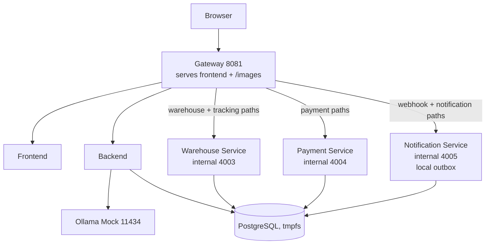
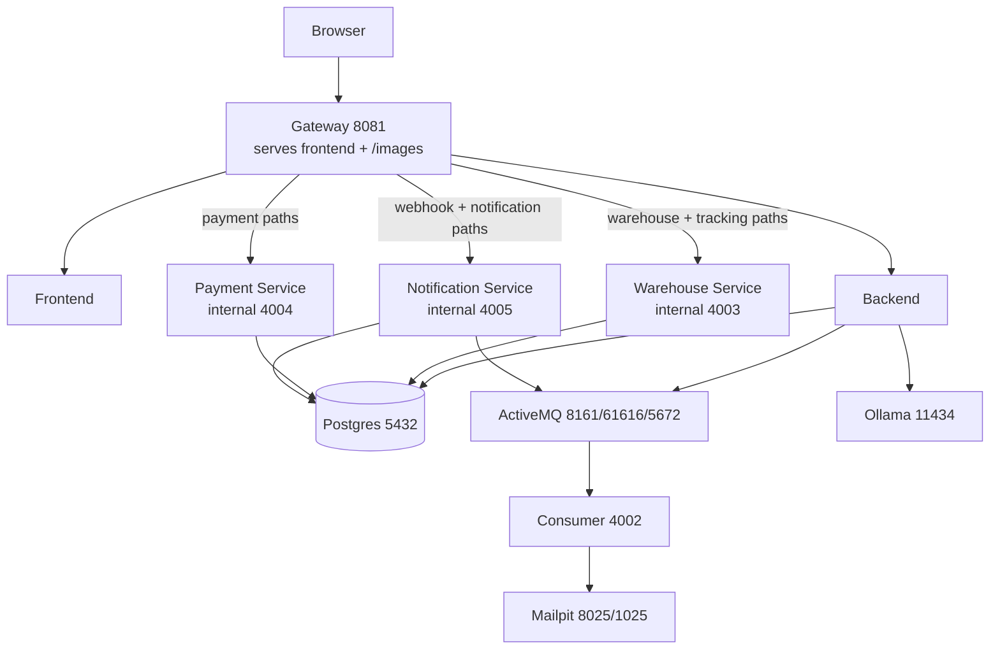
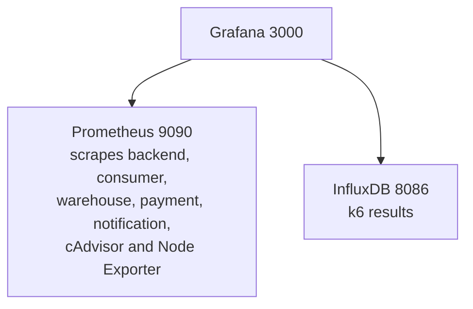
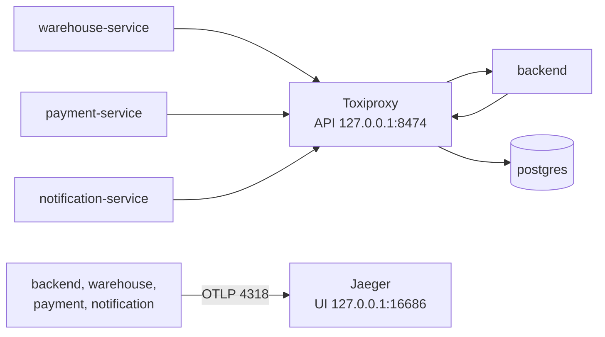
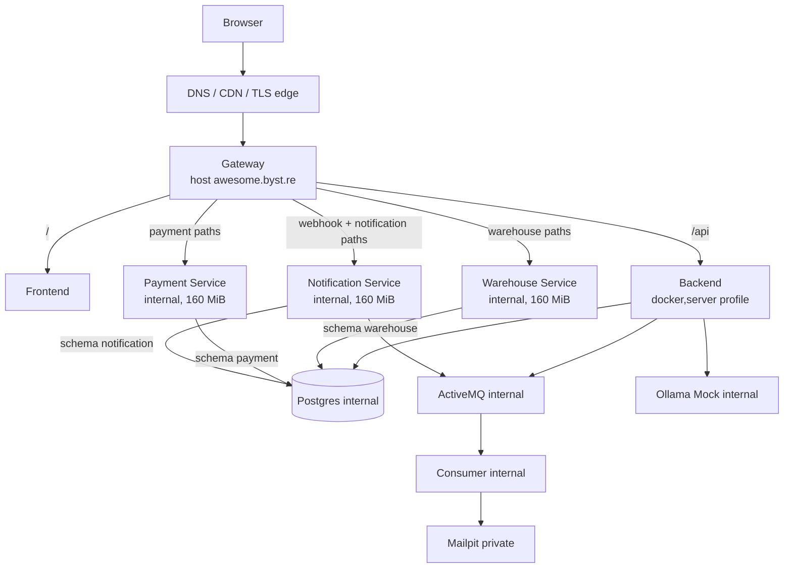
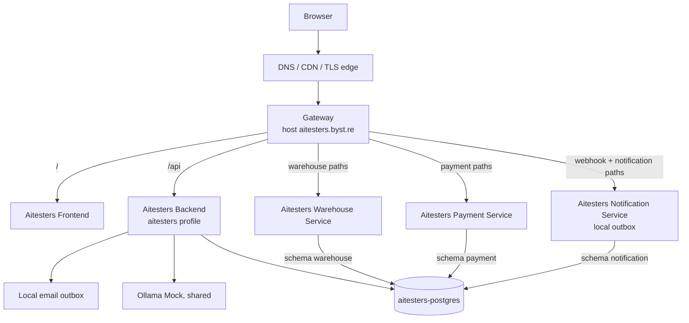

# Profile URL Guide

This file documents what each main Docker profile actually publishes on the host, and which URLs you should use first.

Each profile now uses its own fixed Compose project name:

- full: `awesome-full-native`
- lightweight: `awesome-light`
- server: `awesome-server`
- ci: `awesome-ci`

That keeps profile switching from producing normal orphan warnings just because the profiles declare different services.

Profiles still cannot share the same host ports at the same time. For example, `full` and `lightweight` both use `8081` and `11434`.

## Core Rule

For the application itself, prefer the gateway URL:

- full local: `http://localhost:8081`
- lightweight local: `http://localhost:8081`
- server: `https://awesome.byst.re`

That gateway is the intended public surface for:

- frontend pages
- backend API under `/api/v1/...`
- warehouse-service API under its `/api/v1/...` paths, including shipment
  tracking (see [Warehouse-service routes](#warehouse-service-routes))
- payment-service API under its `/api/v1/...` paths (see
  [Payment-service routes](#payment-service-routes))
- notification-service API (user webhooks, webhook inboxes, commerce email log,
  local notification outbox; see
  [Notification-service routes](#notification-service-routes))
- Swagger UI under `/swagger-ui/...`, with a definition dropdown for the backend
  (JSON and YAML), "Warehouse service" and "Payment service"
- OpenAPI under `/v3/api-docs` (backend), `/warehouse/v3/api-docs`
  (warehouse-service), `/payment/v3/api-docs` (payment-service) and
  `/notification/v3/api-docs` (notification-service)
- actuator under `/actuator/...`
- traffic WebSocket under `/api/v1/ws-traffic`
- static images under `/images/...`

## Mermaid Diagrams

In every profile warehouse-, payment- and notification-service also call the
backend's `/internal/v1` API; those calls are left out of the diagrams to keep
them readable.

### Lightweight



### Full



Opt-in monitoring overlay (`-f docker-compose.monitoring.yml`, with the full
or the lightweight profile; `./run-docker-compose.sh` adds it to the full
profile):



Opt-in fault-injection lab (`-f docker-compose.chaos.yml` or `scripts/chaos up`,
either local profile; see [FAULT_INJECTION_LAB.md](FAULT_INJECTION_LAB.md)) and
tracing overlay (`-f docker-compose.tracing.yml` or `make tracing-up`):



### Server

`awesome.byst.re`:



`aitesters.byst.re` (same gateway, separate sandbox services):



## Full Profile

Compose file:

- `docker-compose.yml`

Start command:

```bash
docker compose -f docker-compose.yml up -d
```

This compose path intentionally runs the backend with `docker,demo`, so the local PostgreSQL-backed stack includes seeded demo users, products, and sample orders.

Stop command:

```bash
docker compose -f docker-compose.yml down
```

Recommended app URLs:

- frontend: `http://localhost:8081/login`
- Swagger UI: `http://localhost:8081/swagger-ui/index.html` (definitions: backend JSON, backend YAML, "Warehouse service" and "Payment service")
- OpenAPI JSON: `http://localhost:8081/v3/api-docs`
- warehouse-service OpenAPI JSON: `http://localhost:8081/warehouse/v3/api-docs`
- payment-service OpenAPI JSON: `http://localhost:8081/payment/v3/api-docs`
- notification-service OpenAPI JSON: `http://localhost:8081/notification/v3/api-docs`
- public parcel tracking: `http://localhost:8081/api/v1/tracking/{trackingNumber}`
- sign in API: `http://localhost:8081/api/v1/users/signin`
- Toxiproxy API (with the [fault-injection lab](FAULT_INJECTION_LAB.md), `scripts/chaos up`): `http://127.0.0.1:8474`
- Jaeger UI (with the tracing overlay, `make tracing-up`): `http://127.0.0.1:16686`
- images through gateway: `http://localhost:8081/images/iphone.png`

Published host ports:

| Service | Host URL / Port | Notes |
| --- | --- | --- |
| Gateway | `http://localhost:8081` | Main app entrypoint |
| Postgres | `localhost:5432` | Direct DB access |
| Prometheus | `http://localhost:9090/graph` | Monitoring overlay only |
| Grafana | `http://localhost:3000/login` | Monitoring overlay only; login `admin/grafana` |
| ActiveMQ console | `http://localhost:8161` | Admin console |
| ActiveMQ JMS | `localhost:61616` | Broker port |
| ActiveMQ AMQP | `localhost:5672` | AMQP port |
| Mailpit UI | `http://localhost:8025/` | Dev inbox UI |
| Mailpit SMTP | `localhost:1025` | SMTP sink |
| Consumer metrics | `http://localhost:4002/actuator/prometheus` | Direct metrics |
| InfluxDB | `localhost:8086` | Monitoring overlay only; k6 results |
| Ollama | `http://localhost:11434/api/tags` | Raw model API |
What is internal only:

- backend raw port `4001`
- warehouse-service raw port `4003`
- payment-service raw port `4004`
- notification-service raw port `4005`
- frontend raw port `80`

## Lightweight Profile

Compose file:

- `lightweight-docker-compose.yml`

Start command:

```bash
docker compose -f lightweight-docker-compose.yml up -d
```

Stop command:

```bash
docker compose -f lightweight-docker-compose.yml down
```

Recommended app URLs:

- frontend: `http://localhost:8081/login`
- Swagger UI: `http://localhost:8081/swagger-ui/index.html` (definitions: backend JSON, backend YAML, "Warehouse service" and "Payment service")
- OpenAPI JSON: `http://localhost:8081/v3/api-docs`
- warehouse-service OpenAPI JSON: `http://localhost:8081/warehouse/v3/api-docs`
- payment-service OpenAPI JSON: `http://localhost:8081/payment/v3/api-docs`
- notification-service OpenAPI JSON: `http://localhost:8081/notification/v3/api-docs`
- public parcel tracking: `http://localhost:8081/api/v1/tracking/{trackingNumber}`
- sign in API: `http://localhost:8081/api/v1/users/signin`
- Toxiproxy API (with the [fault-injection lab](FAULT_INJECTION_LAB.md), `scripts/chaos up`): `http://127.0.0.1:8474`
- Jaeger UI (with the tracing overlay, `make tracing-up`): `http://127.0.0.1:16686`
- images through gateway: `http://localhost:8081/images/iphone.png`

Published host ports:

| Service | Host URL / Port | Notes |
| --- | --- | --- |
| Gateway | `http://localhost:8081` | Main app entrypoint |
| Ollama mock | `http://localhost:11434` | Mocked LLM API |
What is not included:

- Postgres
- ActiveMQ
- Mailpit
- consumer
- Prometheus, Grafana and InfluxDB (add `-f docker-compose.monitoring.yml`
  for them)

## Local Login Credentials

Application password-login users:

| Role | Username | Password |
| --- | --- | --- |
| Admin | `admin` | `LocalDemoAdmin123!` |
| Client | `client` | `client` |
| Client | `client2` | `client2` |
| Client | `client3` | `client3` |

SSO, the mocked Google/GitHub social login and Keycloak (port `8082`) were
removed from every profile on 2026-11-12 (backend 3.18.0 and frontend 3.13.0 have
no SSO code).

What is internal only:

- backend raw port `4001`
- warehouse-service raw port `4003`
- payment-service raw port `4004`
- notification-service raw port `4005`
- frontend raw port `80`

## Server Profile

Compose file:

- `docker-compose.server.yml`

Deployment command:

```bash
make ansible-deploy
```

Direct server stop command on the VPS:

```bash
docker compose -f docker-compose.server.yml down
```

Recommended public URLs:

Stable public playground:

- frontend: `https://awesome.byst.re/login`
- Swagger UI: `https://awesome.byst.re/swagger-ui/index.html` (definitions: backend JSON, backend YAML, "Warehouse service" and "Payment service")
- OpenAPI JSON: `https://awesome.byst.re/v3/api-docs`
- warehouse-service OpenAPI JSON: `https://awesome.byst.re/warehouse/v3/api-docs`
- payment-service OpenAPI JSON: `https://awesome.byst.re/payment/v3/api-docs`
- notification-service OpenAPI JSON: `https://awesome.byst.re/notification/v3/api-docs`
- public parcel tracking: `https://awesome.byst.re/api/v1/tracking/{trackingNumber}`
- sign in API: `https://awesome.byst.re/api/v1/users/signin`
- authenticated email events: `https://awesome.byst.re/api/v1/users/me/email-events`
- images through gateway: `https://awesome.byst.re/images/iphone.png`

Disposable API/UI testing sandbox:

- frontend: `https://aitesters.byst.re/login`
- Swagger UI: `https://aitesters.byst.re/swagger-ui/index.html` (definitions: backend JSON, backend YAML, "Warehouse service" and "Payment service")
- OpenAPI JSON: `https://aitesters.byst.re/v3/api-docs`
- warehouse-service OpenAPI JSON: `https://aitesters.byst.re/warehouse/v3/api-docs`
- payment-service OpenAPI JSON: `https://aitesters.byst.re/payment/v3/api-docs`
- notification-service OpenAPI JSON: `https://aitesters.byst.re/notification/v3/api-docs`
- sign in API: `https://aitesters.byst.re/api/v1/users/signin`
- local email outbox: `https://aitesters.byst.re/api/v1/local/email/outbox`
- images through gateway: `https://aitesters.byst.re/images/iphone.png`

Rate-limit capacities keyed by IP are intentionally increased for repeated
parallel course and regression-suite runs, because a whole classroom shares one
address. Policies keyed by one account (MFA per user, password-forgot per
identifier) stay strict: course suites use a fresh account per test, so 20
requests per window protect a single account without slowing classes. Policy
windows remain unchanged from the backend defaults.

| Policy | `awesome.byst.re` | `aitesters.byst.re` |
| --- | ---: | ---: |
| Signup per IP | 2,000 | 2,000 |
| Sign-in per IP | 4,000 | 4,000 |
| Sign-in per username | 2,000 | 2,000 |
| Sign-in per IP and username | 1,000 | 1,000 |
| MFA per IP | 600 | 600 |
| MFA per challenge | 80 | 80 |
| MFA per user | 20 | 20 |
| Password-forgot per IP | 2,000 | 100 |
| Password-forgot per identifier | 20 | 20 |
| Password-reset per IP | 2,000 | 100 |
| Refresh per IP | 12,000 | 600 |
| Email per user | 6,000 | 300 |
| QR per user | 12,000 | 600 |
| Ollama per user | 4,000 | 200 |
| Ollama per IP | 4,000 | 200 |

Hostname notes:

- `awesome.byst.re` is the stable production-like playground.
- `aitesters.byst.re` is a disposable sandbox for admin and mutation-heavy tests.
- `aitesters.awesome.byst.re` is accepted as an nginx alias, but it is not the recommended public URL because the current wildcard TLS certificate covers `*.byst.re`, not nested names such as `*.awesome.byst.re`.

Published host ports:

| Service | Host URL / Port | Notes |
| --- | --- | --- |
| Gateway | `80/tcp` | Public app entrypoint, usually behind public hostname |

Not published on the host:

- Postgres `5432`
- Mailpit UI `8025`
- Mailpit SMTP `1025`
- ActiveMQ console `8161`
- ActiveMQ JMS `61616`
- consumer `4002`
- backend `4001`
- warehouse-service `4003`
- payment-service `4004`
- notification-service `4005`
- Prometheus `9090` (loopback `127.0.0.1:9090` only, for
  `make ansible-tunnel-prometheus`)
- Alertmanager `9093`
- Blackbox Exporter `9115`
- Node Exporter `9100`
- cAdvisor `8080`
- frontend `80`
- aitesters-backend `4001`
- aitesters-frontend `80`
- aitesters-warehouse-service `4003`
- aitesters-payment-service `4004`
- aitesters-notification-service `4005`
- ollama-mock `11434`

Special behavior:

- Swagger and OpenAPI are intentionally public as part of the demo surface
- `https://awesome.byst.re/mailpit/api/v1/messages` is blocked with `404`
- `https://awesome.byst.re/mailpit/` is blocked with `404`
- Mailpit remains available only through SSH tunnelling to remote `127.0.0.1:8025`
- `aitesters.byst.re` runs the current backend image with the Spring `aitesters` profile
- its frontend is the same current frontend image used by `awesome.byst.re`
- `aitesters.byst.re` uses its own `aitesters-postgres` (Flyway migrations, like production) and seeded local demo users, including the demo admin; the daily reset starts it from a fresh volume
- `aitesters.byst.re` exposes local/test helpers such as `/api/v1/local/email/outbox` by design
- `aitesters.byst.re` is reset daily by the `aitesters-reset.timer` systemd timer
- Node Exporter and cAdvisor provide private host and container metrics to Prometheus
- Blackbox Exporter probes the public login, backend OpenAPI,
  warehouse-service, payment-service and notification-service OpenAPI URLs and the aitesters
  login and OpenAPI URLs every 30 seconds through public DNS and validated TLS
- `aitesters.byst.re` has its own `aitesters-warehouse-service`,
  `aitesters-payment-service` and `aitesters-notification-service` on
  `aitesters-postgres`, with their own tokens, webhook secret and encryption
  key, so sandbox tokens and data never reach the stable site; its commerce
  emails stay in `/api/v1/local/notifications/outbox` (same key as the
  backend's local outbox)
- `/internal/` returns `404` on every host; the backend internal API is reachable
  only from warehouse-, payment- and notification-service on the Compose network
- Prometheus stores metrics in a named volume with 30-day and 5 GB retention ceilings
- Alertmanager stores silences and notification state in a named volume and
  sends grouped notifications to a Vault-configured Telegram chat; a firing
  critical alert suppresses the warning that shares its `alert_family` label
- there is no Grafana in production (lean monitoring phase A); the host
  watchdog (`awesome-watchdog.timer`) reports unhealthy, exited or missing
  containers, OOM kills, disk, memory and backup problems to the same Telegram
  chat
- Blackbox checks, Alertmanager and the watchdog are server-profile-only; the
  local profiles get Prometheus and Grafana from the monitoring overlay

## Gateway Route Map

### Local Gateway

`nginx/conf.d/lightweight-app-gateway.conf` (used by the lightweight and full
profiles) handles:

- `/api/v1/ws-traffic` -> backend
- [warehouse-service routes](#warehouse-service-routes) -> warehouse-service
- [payment-service routes](#payment-service-routes) -> payment-service
- [notification-service routes](#notification-service-routes) -> notification-service
- `/internal/` -> `404`
- `/api/v1/` -> backend
- any other `/api` path (`= /api`, `/api/`) -> `404` JSON `{"message":"Not found"}`
- `/swagger-ui/` -> backend
- `/v3/api-docs` -> backend
- `/actuator/` -> backend
- `/images/` -> gateway static files
- `/` -> frontend

### Server Gateway

`nginx/conf.d/app-gateway.conf` handles:

For `awesome.byst.re`:

- `/api/v1/ws-traffic` -> backend
- [warehouse-service routes](#warehouse-service-routes) -> warehouse-service
- [payment-service routes](#payment-service-routes) -> payment-service
- [notification-service routes](#notification-service-routes) -> notification-service
- `/internal/` -> `404`
- `/api/v1/` -> backend
- any other `/api` path (`= /api`, `/api/`) -> `404` JSON `{"message":"Not found"}`
- `/swagger-ui/` -> backend
- `/v3/api-docs` -> backend
- `/actuator/` -> backend
- `/images/` -> gateway static files
- `/mailpit`, `/mailpit/`, and `/mailpit/api/` -> `404`
- `/` -> frontend

For `aitesters.byst.re`:

- `/api/v1/ws-traffic` -> aitesters-backend
- [warehouse-service routes](#warehouse-service-routes) -> aitesters-warehouse-service
- [payment-service routes](#payment-service-routes) -> aitesters-payment-service
- [notification-service routes](#notification-service-routes) -> aitesters-notification-service
- `/internal/` -> `404`
- `/api/v1/` -> aitesters-backend
- any other `/api` path (`= /api`, `/api/`) -> `404` JSON `{"message":"Not found"}`
- `/swagger-ui/` -> aitesters-backend
- `/v3/api-docs` -> aitesters-backend
- `/actuator/` -> aitesters-backend
- `/images/` -> gateway static files
- `/` -> aitesters-frontend

### Warehouse-service routes

Both application gateways send these paths to `warehouse-service:4003`
(`aitesters-warehouse-service:4003` for `aitesters.byst.re`). They take
precedence over the generic `/api/v1/` backend route:

| Gateway location | Example |
| --- | --- |
| `/api/v1/warehouse/` | `/api/v1/warehouse/queue` |
| `= /api/v1/returns`, `/api/v1/returns/` | `/api/v1/returns/7` |
| `= /api/v1/admin/returns`, `/api/v1/admin/returns/` | `/api/v1/admin/returns/3/approve` |
| `= /api/v1/admin/suppliers`, `/api/v1/admin/suppliers/` | `/api/v1/admin/suppliers/2` |
| `= /api/v1/admin/purchase-orders`, `/api/v1/admin/purchase-orders/` | `/api/v1/admin/purchase-orders/9/receipts` |
| `= /api/v1/admin/inventory/reorder-suggestions` | exact path only |
| `~ ^/api/v1/orders/\d+/(shipment\|shipments\|shipment/tracking\|returns)$` | `/api/v1/orders/42/shipment/tracking`, `/api/v1/orders/42/shipments` (every parcel, warehouse-service 1.5.0) |
| `/api/v1/tracking/` | `/api/v1/tracking/1Z999AA10123456784` (public, no token) |
| `^~ /warehouse/v3/api-docs` | rewritten to warehouse-service `/v3/api-docs` |

`/warehouse` and `/warehouse/...` (other than the OpenAPI path) remain frontend
routes. The gateway addresses warehouse-service through Docker DNS at request
time, so it starts and keeps serving the backend when warehouse-service is
absent; warehouse paths then return `502`.

### Payment-service routes

Both application gateways send these paths to `payment-service:4004`
(`aitesters-payment-service:4004` for `aitesters.byst.re`), through the
request-time `$payment_upstream` variable, ahead of the generic `/api/v1/`
backend route:

| Gateway location | Example |
| --- | --- |
| `= /api/v1/payments` | `POST /api/v1/payments` (header `Idempotency-Key`) |
| `/api/v1/payments/` | `POST /api/v1/payments/{id}/3ds`, `GET /api/v1/payments/{id}` |
| `= /api/v1/admin/payments` | `GET /api/v1/admin/payments?status=FAILED` |
| `~ ^/api/v1/orders/\d+/payments$` | `GET /api/v1/orders/42/payments` |
| `^~ /payment/v3/api-docs` | rewritten to payment-service `/v3/api-docs` |

Other `/api/v1/orders/...` paths stay on the backend. Without payment-service
the payment paths return `502` and everything else keeps working. See
[PAYMENT_SERVICE_CONTRACT.md](PAYMENT_SERVICE_CONTRACT.md).

### Notification-service routes

Both application gateways send these paths to `notification-service:4005`
(`aitesters-notification-service:4005` for `aitesters.byst.re`), through the
request-time `$notification_upstream` variable, ahead of the generic `/api/v1/`
backend route:

| Gateway location | Example |
| --- | --- |
| `= /api/v1/webhooks`, `/api/v1/webhooks/` | `POST /api/v1/webhooks`, `GET /api/v1/webhooks/12/deliveries` |
| `= /api/v1/webhook-inboxes`, `/api/v1/webhook-inboxes/` | `GET /api/v1/webhook-inboxes/{token}/requests` |
| `= /api/v1/admin/webhooks` | `GET /api/v1/admin/webhooks` |
| `/api/v1/notifications/` | `GET /api/v1/notifications/emails` |
| `/api/v1/local/notifications/` | `GET /api/v1/local/notifications/outbox` |
| `^~ /notification/v3/api-docs` | rewritten to notification-service `/v3/api-docs` |

The backend keeps account emails, including `/api/v1/local/email/outbox` and
`/api/v1/users/me/email-events`. Without notification-service these paths
return `502` and everything else keeps working. See
[NOTIFICATION_SERVICE_CONTRACT.md](NOTIFICATION_SERVICE_CONTRACT.md).

## Verification Commands

Full local:

```bash
curl -i http://localhost:8081/login
curl -i http://localhost:8081/v3/api-docs
curl -i http://localhost:8081/warehouse/v3/api-docs
curl -i http://localhost:8081/payment/v3/api-docs
curl -i http://localhost:8081/notification/v3/api-docs
curl -i http://localhost:8081/internal/v1/orders/1
curl -i http://localhost:8081/images/iphone.png
curl -i http://localhost:8025/
docker compose exec warehouse-service bash -c 'exec 3<>/dev/tcp/127.0.0.1/4003; printf "GET /actuator/health HTTP/1.0\r\n\r\n" >&3; cat <&3'
docker compose exec payment-service bash -c 'exec 3<>/dev/tcp/127.0.0.1/4004; printf "GET /actuator/health HTTP/1.0\r\n\r\n" >&3; cat <&3'
```

The internal URL must return `404`; the other gateway URLs return `200`.

Lightweight local:

```bash
curl -i http://localhost:8081/login
curl -i http://localhost:8081/v3/api-docs
curl -i http://localhost:8081/images/iphone.png
curl -i -X POST http://localhost:11434/api/generate \
  -H 'Content-Type: application/json' \
  -d '{"model":"qwen3.5:2b","prompt":"Provide a motivational quote","stream":false}'
```

Student-oriented lightweight smoke test:

```bash
docker compose -f lightweight-docker-compose.yml up -d
docker compose -f lightweight-docker-compose.yml ps
curl -i http://localhost:8081/login
curl -i http://localhost:8081/v3/api-docs
curl -i http://localhost:8081/images/iphone.png
curl -i -X POST http://localhost:11434/api/generate \
  -H 'Content-Type: application/json' \
  -d '{"model":"qwen3.5:2b","prompt":"Provide a motivational quote","stream":false}'
```

Expected:

- all services are `Up`
- `login` returns `200`
- `v3/api-docs` returns `200`
- image request returns `200`
- mock LLM generate request returns `200`

Server:

```bash
curl -i https://awesome.byst.re/login
curl -i https://awesome.byst.re/v3/api-docs
curl -i https://awesome.byst.re/warehouse/v3/api-docs
curl -i https://awesome.byst.re/payment/v3/api-docs
curl -i https://awesome.byst.re/notification/v3/api-docs
curl -i https://awesome.byst.re/api/v1/tracking/UNKNOWN
curl -i https://awesome.byst.re/internal/v1/orders/1
curl -i https://awesome.byst.re/images/iphone.png
curl -i https://awesome.byst.re/mailpit/api/v1/messages
curl -i https://aitesters.byst.re/login
curl -i https://aitesters.byst.re/v3/api-docs
curl -i https://aitesters.byst.re/warehouse/v3/api-docs
curl -i https://aitesters.byst.re/payment/v3/api-docs
curl -i https://aitesters.byst.re/notification/v3/api-docs
curl -i https://aitesters.byst.re/images/iphone.png
curl -i https://aitesters.byst.re/api/v1/local/email/outbox
```

Expected:

- `awesome.byst.re/login` returns `200`
- `awesome.byst.re/v3/api-docs` returns `200`
- `awesome.byst.re/warehouse/v3/api-docs` returns `200`
- `awesome.byst.re/payment/v3/api-docs` returns `200`
- `awesome.byst.re/notification/v3/api-docs` returns `200`
- `awesome.byst.re/api/v1/tracking/UNKNOWN` returns `404` from warehouse-service (no token needed)
- `awesome.byst.re/internal/v1/orders/1` returns `404`
- `awesome.byst.re/images/iphone.png` returns `200`
- `awesome.byst.re/mailpit/api/v1/messages` returns `404`
- `aitesters.byst.re/login` returns `200`
- `aitesters.byst.re/v3/api-docs` returns `200`
- `aitesters.byst.re/images/iphone.png` returns `200`
- `aitesters.byst.re/warehouse/v3/api-docs` returns `200`
- `aitesters.byst.re/payment/v3/api-docs` returns `200`
- `aitesters.byst.re/notification/v3/api-docs` returns `200`
- `aitesters.byst.re/api/v1/local/email/outbox` returns `401` without a token (an admin JWT and the `X-Local-Outbox-Key` header are required)

Internal-only checks on the VPS:

```bash
cd /opt/awesome-localstack
docker compose -f docker-compose.server.yml exec gateway curl -i http://backend:4001/actuator/health
docker compose -f docker-compose.server.yml exec gateway curl -i http://consumer:4002/actuator/prometheus
docker compose -f docker-compose.server.yml exec gateway curl -i http://warehouse-service:4003/actuator/health
docker compose -f docker-compose.server.yml exec gateway curl -i http://warehouse-service:4003/v3/api-docs
docker compose -f docker-compose.server.yml exec gateway curl -i http://payment-service:4004/actuator/health
docker compose -f docker-compose.server.yml exec gateway curl -i http://payment-service:4004/v3/api-docs
docker compose -f docker-compose.server.yml exec gateway curl -i http://notification-service:4005/actuator/health
docker compose -f docker-compose.server.yml exec gateway curl -i http://notification-service:4005/v3/api-docs
docker compose -f docker-compose.server.yml exec gateway curl -i http://node-exporter:9100/metrics
docker compose -f docker-compose.server.yml exec gateway curl -i http://cadvisor:8080/metrics
docker compose -f docker-compose.server.yml exec gateway curl -i http://prometheus:9090/-/ready
docker compose -f docker-compose.server.yml exec gateway curl -i http://alertmanager:9093/-/ready
docker compose -f docker-compose.server.yml exec gateway curl -i http://blackbox-exporter:9115/-/healthy
docker compose -f docker-compose.server.yml exec gateway curl -i http://localhost/images/iphone.png
docker compose -f docker-compose.server.yml exec gateway curl -i http://activemq:8161
```

## GraphiQL

The backend serves GraphiQL at `/api/v1/graphiql` on the same origin as the
app, for example `http://localhost:8081/api/v1/graphiql`; the `/api/v1/` gateway
route covers this URL. Enter a bearer access token in the editor's Headers tab for schema
exploration and queries. Swagger remains the REST API explorer.

See the backend's GraphiQL
[usage](https://github.com/slawekradzyminski/test-secure-backend/blob/master/docs/GRAPHQL.md#use-graphiql).

## Native gRPC

`docker-compose.grpc.yml` publishes the backend's gRPC listener on host loopback
`127.0.0.1:9091`. It preserves the selected base application's
profiles; GraphQL and GraphiQL remain available over the existing HTTP gateway.
Prometheus keeps 9090. Native gRPC has no public nginx route, health requires an
administrator JWT, and server reflection is disabled. See [gRPC setup](GRPC_INVENTORY.md).

The frontend's Traffic Monitor also shows protocol summaries. Supply its displayed session ID in GraphiQL headers or native gRPC
metadata. See the [protocol lab](PROTOCOL_TESTING_LAB.md).

The **server profile** publishes native gRPC on two loopback-only host ports: `127.0.0.1:9091` for the stable backend and `127.0.0.1:9092` for the
aitesters sandbox. Reach them through an [SSH tunnel](GRPC_INVENTORY.md#server-deployment-and-ssh-access).
There is no public gRPC nginx route. Full and lightweight profiles retain the
optional override described above.
