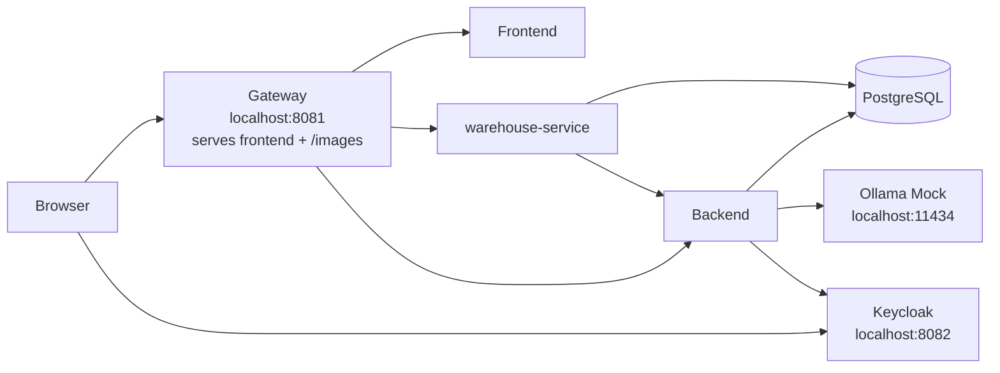

# Student Guide: Lightweight Profile

This guide is for the profile you will use most often:

- `lightweight-docker-compose.yml`

Its goal is to give you a fast local environment with:

- frontend (storefront and admin pages)
- backend (REST, GraphQL, authentication)
- warehouse-service (shipments, returns, suppliers and purchase orders)
- PostgreSQL shared by the backend and warehouse-service
- Keycloak for SSO and the mocked Google and GitHub social logins
- a gateway that serves the frontend, both APIs and the static product images
- a mocked LLM

The lightweight profile uses `ollama-mock` and expects the `qwen3.5:2b` request model.

## Main Idea

Treat this as a single local web app served through one URL:

- `http://localhost:8081`

Use that URL for:

- frontend pages
- backend API (`/api/v1/...`)
- warehouse API (shipments, returns, suppliers, purchase orders), routed by the gateway
- Swagger UI and the OpenAPI documents
- product images

Do not think in terms of “frontend on one port and backend on another port” for normal usage. The gateway on `8081` is the intended entrypoint; the backend and warehouse-service are not published on host ports.

Only two other host ports are published:

- `8082` for Keycloak (the SSO login page and the admin console)
- `11434` for the mocked LLM

Make sure `8081`, `8082` and `11434` are free before you start.

## Lightweight Architecture



The gateway sends fulfilment paths (`/api/v1/warehouse/...`, returns, suppliers,
purchase orders, order shipments) to warehouse-service and everything else under
`/api/v1/` to the backend. Both services accept the same JWT from
`POST /api/v1/users/signin`.

## Start The Profile

From the `awesome-localstack` directory run:

```bash
docker compose -f lightweight-docker-compose.yml up -d
```

This profile has its own Compose project name (`awesome-light`), so switching from the full profile should normally work without orphan warnings.

Still, do not run the full profile and the lightweight profile at the same time. They use the same local ports.

The first start downloads the images. After that the stack is usually ready within a minute; Keycloak is normally the last service to finish starting.

## Check That Containers Started

Run:

```bash
docker compose -f lightweight-docker-compose.yml ps -a
```

Long-running services, expected state `Up`:

- `backend` (`healthy`)
- `frontend`
- `gateway`
- `keycloak`
- `ollama-mock`
- `postgres` (`healthy`, shared by the backend and warehouse-service)
- `warehouse-service` (`healthy`, fulfilment, returns and purchasing)

One-shot setup containers, expected state `Exited (0)`:

- `postgres-roles` creates the warehouse database role
- `keycloak-init` sets the passwords of the social login mock users

`Exited (0)` is correct for these two. Without `-a`, `docker compose ps` hides them.

## Your Data Is Temporary

PostgreSQL in this profile keeps its data in memory (`tmpfs`). Every time the
`postgres` container is stopped or recreated, the database starts again from the
seeded demo data: your registrations, orders and edits disappear.

That is intended for training: `down` followed by `up -d` gives you a clean
environment.

## URLs You Should Know

Main application URL:

- `http://localhost:8081/login`

Useful lightweight URLs:

- frontend login: `http://localhost:8081/login`
- Swagger UI: `http://localhost:8081/swagger-ui/index.html` (definitions: backend JSON, backend YAML and "Warehouse service")
- backend OpenAPI JSON: `http://localhost:8081/v3/api-docs`
- warehouse OpenAPI JSON: `http://localhost:8081/warehouse/v3/api-docs`
- GraphiQL: `http://localhost:8081/api/v1/graphiql`
- sample image through gateway: `http://localhost:8081/images/iphone.png`
- Keycloak issuer: `http://localhost:8082/realms/awesome-testing`
- Keycloak admin console: `http://localhost:8082` (`admin` / `admin`)
- mocked LLM generate endpoint: `http://localhost:11434/api/generate`

Training users:

Application password login (also for `POST /api/v1/users/signin`):

- `admin` / `LocalDemoAdmin123!`
- `client` / `client`
- `client2` / `client2`
- `client3` / `client3`
- `warehouse` / `warehouse` (warehouse role)

Keycloak SSO login (the SSO option on the login page):

- `sso-e2e-client` / `SsoClient123!`
- `sso-admin` / `SsoAdmin123!`

Social login mocks (the Google and GitHub options on the login page):

- `google-user` / `GoogleUser123!`
- `github-user` / `GitHubUser123!`

For the full SSO flow and the difference between password login and SSO, see
[SSO_FLOW.md](SSO_FLOW.md). The social login mocks are described in
[SOCIAL_LOGIN.md](SOCIAL_LOGIN.md).

For everyday work, prefer `8081`.

## Verification Checklist

Follow these checks in order.

### 1. Frontend Loads

Open:

- `http://localhost:8081/login`

Expected:

- the login page loads
- styling is present
- images load

Sign in with one of the application-password or Keycloak SSO training users
listed above before continuing.

### 2. Swagger Loads

Open:

- `http://localhost:8081/swagger-ui/index.html`

Expected:

- Swagger UI loads
- API endpoints are listed under `/api/v1/...`

Important:

- Swagger requests should go to `http://localhost:8081/...`
- The "Select a definition" dropdown (top right) switches between the backend
  API and "Warehouse service" (shipments, returns, suppliers, purchase orders).
  Both use the same bearer token from `POST /api/v1/users/signin`; authorize
  again after switching definitions. The warehouse endpoints need the
  `warehouse` or `admin` user, or a client token for your own returns.

### 3. OpenAPI Docs Respond

Run:

```bash
curl -i http://localhost:8081/v3/api-docs
curl -i http://localhost:8081/warehouse/v3/api-docs
```

Expected:

- HTTP `200` for both

### 4. API Sign-In Works

Run:

```bash
curl -i -X POST http://localhost:8081/api/v1/users/signin \
  -H 'Content-Type: application/json' \
  -d '{"username":"client","password":"client"}'
```

Expected:

- HTTP `200` with a JSON body that contains the access token

### 5. Product Images Work

Run:

```bash
curl -i http://localhost:8081/images/iphone.png
```

Expected:

- HTTP `200`

### 6. Keycloak Responds

Run:

```bash
curl -i http://localhost:8082/realms/awesome-testing/.well-known/openid-configuration
```

Expected:

- HTTP `200`

### 7. Mocked LLM Responds

Run:

```bash
curl -i -X POST http://localhost:11434/api/generate \
  -H 'Content-Type: application/json' \
  -d '{"model":"qwen3.5:2b","prompt":"hello"}'
```

Expected:

- HTTP `200`

On Windows PowerShell use `curl.exe` instead of `curl`, because `curl` can be an
alias for `Invoke-WebRequest`. Put the JSON bodies in a file and pass
`-d '@body.json'` if PowerShell quoting gets in the way.

## Minimal Smoke Test

If you want one short sequence:

```bash
docker compose -f lightweight-docker-compose.yml up -d
docker compose -f lightweight-docker-compose.yml ps -a
curl -i http://localhost:8081/login
curl -i http://localhost:8081/v3/api-docs
curl -i http://localhost:8081/warehouse/v3/api-docs
curl -i http://localhost:8081/images/iphone.png
curl -i http://localhost:8082/realms/awesome-testing/.well-known/openid-configuration
curl -i -X POST http://localhost:11434/api/generate \
  -H 'Content-Type: application/json' \
  -d '{"model":"qwen3.5:2b","prompt":"hello"}'
```

These `curl` requests verify container and gateway availability only.

## How To Read Failures

### `502 Bad Gateway`

Usually means:

- backend or warehouse-service is still starting
- the backend and warehouse-service are ready within seconds once PostgreSQL is
  up; Keycloak is usually the last service to become ready

What to do:

```bash
docker compose -f lightweight-docker-compose.yml ps -a
docker compose -f lightweight-docker-compose.yml logs -f backend warehouse-service gateway
```

### A Container Keeps Restarting

Usually means Docker does not have enough memory. Give Docker Desktop or Rancher
Desktop at least 4 GB, then run:

```bash
docker compose -f lightweight-docker-compose.yml up -d
docker compose -f lightweight-docker-compose.yml logs -f postgres warehouse-service
```

### `port is already allocated`

Another program already uses `8081`, `8082` or `11434`. A locally installed
Ollama on `11434` is the most common case. Stop it, or find the owner:

```bash
lsof -i :11434
```

On Windows: `netstat -ano | findstr 11434`.

### Login Page Loads But Images Are Missing

Usually means one of these:

- gateway is still starting
- you are testing the wrong URL
- browser cache is stale after changes

What to check:

```bash
docker compose -f lightweight-docker-compose.yml ps -a
curl -i http://localhost:8081/images/iphone.png
```

### SSO Or Social Login Fails

Usually means Keycloak is still starting, or `keycloak-init` did not finish.

What to check:

```bash
curl -i http://localhost:8082/realms/awesome-testing/.well-known/openid-configuration
docker compose -f lightweight-docker-compose.yml ps -a keycloak keycloak-init
docker compose -f lightweight-docker-compose.yml logs keycloak-init
```

`keycloak-init` should be `Exited (0)`. If it failed because Keycloak was not
ready yet, run `docker compose -f lightweight-docker-compose.yml up -d` again.

### Swagger Loads But “Try it out” Fails

Usually means:

- backend is still starting
- Swagger is pointing to the wrong host

What to check:

```bash
curl -i http://localhost:8081/v3/api-docs
curl -i http://localhost:8081/warehouse/v3/api-docs
```

Both documents' `servers[0].url` should be `http://localhost:8081`, not
`http://localhost:4001` and not `http://localhost` (backend 3.14.1 and
warehouse-service 1.1.1 or later). A 404 for the "Warehouse service" definition
means Swagger UI was opened on the backend port directly instead of through the
gateway on 8081.

### Mocked LLM Is Not Responding

What to check:

```bash
docker compose -f lightweight-docker-compose.yml ps -a
curl -i -X POST http://localhost:11434/api/generate \
  -H 'Content-Type: application/json' \
  -d '{"model":"qwen3.5:2b","prompt":"hello"}'
docker compose -f lightweight-docker-compose.yml logs -f ollama-mock
```

### You Switched Profiles And Docker Still Looks Confused

Usually this means:

- a previous Compose run was interrupted

Fallback cleanup:

```bash
docker compose -f lightweight-docker-compose.yml down --remove-orphans
docker compose -f lightweight-docker-compose.yml up -d
```

## Useful Log Commands

Backend, warehouse-service and gateway:

```bash
docker compose -f lightweight-docker-compose.yml logs -f backend warehouse-service gateway
```

All lightweight services:

```bash
docker compose -f lightweight-docker-compose.yml logs -f
```

Keycloak and the mocked LLM:

```bash
docker compose -f lightweight-docker-compose.yml logs -f keycloak ollama-mock
```

## Stop The Profile

```bash
docker compose -f lightweight-docker-compose.yml down
```

Because PostgreSQL runs in memory, `down` already discards all data. The profile
creates no named volumes, so `down --volumes` is not needed.

## Additional GraphQL and gRPC exercises

The backend serves GraphQL alongside REST. Use `/api/v1/graphiql`
for schema exploration and queries with your normal JWT. Swagger continues to
cover REST; it does not list GraphQL fields or native gRPC methods. The storefront
starts in REST mode and offers a per-tab GraphQL selector.

Native gRPC is an optional local listener with four admin inventory operations,
not a replacement for the entire backend. Enable it by adding the override file
to the lightweight Compose command:

```bash
docker compose -f lightweight-docker-compose.yml -f docker-compose.grpc.yml up -d
```

The listener is published on `127.0.0.1:9091`. See the
[classroom runbook](GRPC_TRAINING_RUNBOOK.md) and [gRPC setup](GRPC_INVENTORY.md).
Follow the [protocol testing lab](PROTOCOL_TESTING_LAB.md) for equivalent stock
adjustments, partial-error assertions, native status codes, and safe traffic
monitoring.
