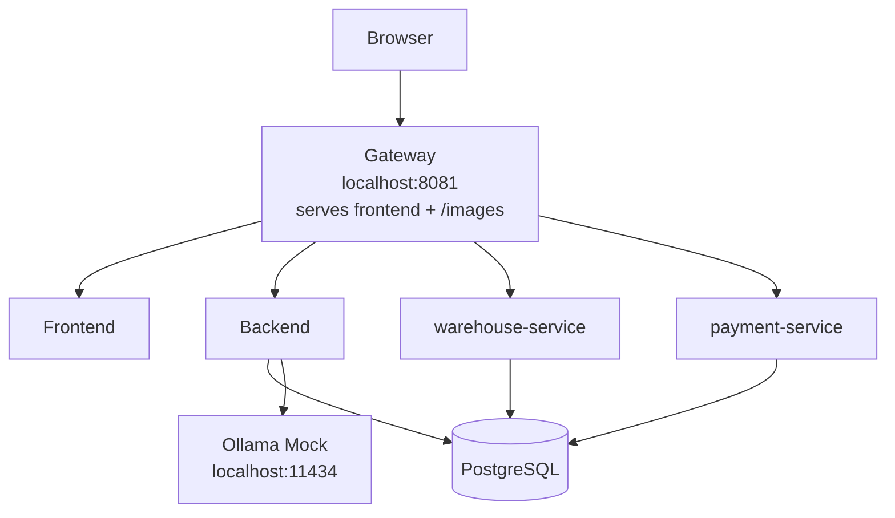

# Student Guide: Lightweight Profile

This guide is for the profile you will use most often:

- `lightweight-docker-compose.yml`

Its goal is to give you a fast local environment with:

- frontend (storefront and admin pages)
- backend (REST, GraphQL, authentication)
- warehouse-service (shipments, tracking, returns, suppliers and purchase orders)
- payment-service (card payments with test cards)
- PostgreSQL shared by the backend, warehouse-service and payment-service
- a gateway that serves the frontend, the three APIs and the static product images
- a mocked LLM

The lightweight profile uses `ollama-mock` and expects the `qwen3.5:2b` request model.

## Main Idea

Treat this as a single local web app served through one URL:

- `http://localhost:8081`

Use that URL for:

- frontend pages
- backend API (`/api/v1/...`)
- warehouse API (shipments, tracking, returns, suppliers, purchase orders), routed by the gateway
- payment API (`/api/v1/payments`), routed by the gateway
- Swagger UI and the OpenAPI documents
- product images

Do not think in terms of “frontend on one port and backend on another port” for normal usage. The gateway on `8081` is the intended entrypoint; the backend, warehouse-service and payment-service are not published on host ports.

Only one other host port is published:

- `11434` for the mocked LLM

Make sure `8081` and `11434` are free before you start.

## Lightweight Architecture



The gateway sends fulfilment paths (`/api/v1/warehouse/...`, returns, suppliers,
purchase orders, order shipments and tracking) to warehouse-service, payment
paths (`/api/v1/payments`, `/api/v1/admin/payments`,
`/api/v1/orders/{id}/payments`) to payment-service and everything else under
`/api/v1/` to the backend. All three services accept the same JWT from
`POST /api/v1/users/signin`.

## Start The Profile

From the `awesome-localstack` directory run:

```bash
docker compose -f lightweight-docker-compose.yml up -d
```

This profile has its own Compose project name (`awesome-light`), so switching from the full profile should normally work without orphan warnings.

Still, do not run the full profile and the lightweight profile at the same time. They use the same local ports.

The first start downloads the images. After that the stack is usually ready within a minute.

## Check That Containers Started

Run:

```bash
docker compose -f lightweight-docker-compose.yml ps -a
```

Long-running services, expected state `Up`:

- `backend` (`healthy`)
- `frontend`
- `gateway`
- `ollama-mock`
- `postgres` (`healthy`, shared by the backend, warehouse-service and payment-service)
- `warehouse-service` (`healthy`, fulfilment, tracking, returns and purchasing)
- `payment-service` (`healthy`, card payments)

One-shot setup container, expected state `Exited (0)`:

- `postgres-roles` creates the warehouse and payment database roles

`Exited (0)` is correct for it. Without `-a`, `docker compose ps` hides it.

## Your Data Is Temporary

PostgreSQL in this profile keeps its data in memory (`tmpfs`). Every time the
`postgres` container is stopped or recreated, the database starts again from the
seeded demo data: your registrations, orders and edits disappear.

That is intended for training: `down` followed by `up -d` gives you a clean
environment.

## URLs You Should Know

Main application URL:

- `http://localhost:8081/login`

Useful lightweight URLs:

- frontend login: `http://localhost:8081/login`
- Swagger UI: `http://localhost:8081/swagger-ui/index.html` (definitions: backend JSON, backend YAML, "Warehouse service" and "Payment service")
- backend OpenAPI JSON: `http://localhost:8081/v3/api-docs`
- warehouse OpenAPI JSON: `http://localhost:8081/warehouse/v3/api-docs`
- payment OpenAPI JSON: `http://localhost:8081/payment/v3/api-docs`
- GraphiQL: `http://localhost:8081/api/v1/graphiql`
- sample image through gateway: `http://localhost:8081/images/iphone.png`
- mocked LLM generate endpoint: `http://localhost:11434/api/generate`

Training users:

Application password login (also for `POST /api/v1/users/signin`):

- `admin` / `LocalDemoAdmin123!`
- `client` / `client`
- `client2` / `client2`
- `client3` / `client3`
- `warehouse` / `warehouse` (warehouse role)

SSO and the mocked Google/GitHub social login were removed from the stack on
2026-11-12, together with Keycloak. If your frontend image still shows a
**Sign in with SSO**, Google or GitHub button, ignore it and sign in with a
password.

For everyday work, prefer `8081`.

## Verification Checklist

Follow these checks in order.

### 1. Frontend Loads

Open:

- `http://localhost:8081/login`

Expected:

- the login page loads
- styling is present
- images load

Sign in with one of the training users listed above before continuing.

### 2. Swagger Loads

Open:

- `http://localhost:8081/swagger-ui/index.html`

Expected:

- Swagger UI loads
- API endpoints are listed under `/api/v1/...`

Important:

- Swagger requests should go to `http://localhost:8081/...`
- The "Select a definition" dropdown (top right) switches between the backend
  API, "Warehouse service" (shipments, tracking, returns, suppliers, purchase
  orders) and "Payment service" (card payments).
  All use the same bearer token from `POST /api/v1/users/signin`; authorize
  again after switching definitions. The warehouse endpoints need the
  `warehouse` or `admin` user, or a client token for your own returns.

### 3. OpenAPI Docs Respond

Run:

```bash
curl -i http://localhost:8081/v3/api-docs
curl -i http://localhost:8081/warehouse/v3/api-docs
curl -i http://localhost:8081/payment/v3/api-docs
```

Expected:

- HTTP `200` for all three

### 4. API Sign-In Works

Run:

```bash
curl -i -X POST http://localhost:8081/api/v1/users/signin \
  -H 'Content-Type: application/json' \
  -d '{"username":"client","password":"client"}'
```

Expected:

- HTTP `200` with a JSON body that contains the access token

### 5. Product Images Work

Run:

```bash
curl -i http://localhost:8081/images/iphone.png
```

Expected:

- HTTP `200`

### 6. Mocked LLM Responds

Run:

```bash
curl -i -X POST http://localhost:11434/api/generate \
  -H 'Content-Type: application/json' \
  -d '{"model":"qwen3.5:2b","prompt":"hello"}'
```

Expected:

- HTTP `200`

On Windows PowerShell use `curl.exe` instead of `curl`, because `curl` can be an
alias for `Invoke-WebRequest`. Put the JSON bodies in a file and pass
`-d '@body.json'` if PowerShell quoting gets in the way.

## Minimal Smoke Test

If you want one short sequence:

```bash
docker compose -f lightweight-docker-compose.yml up -d
docker compose -f lightweight-docker-compose.yml ps -a
curl -i http://localhost:8081/login
curl -i http://localhost:8081/v3/api-docs
curl -i http://localhost:8081/warehouse/v3/api-docs
curl -i http://localhost:8081/payment/v3/api-docs
curl -i http://localhost:8081/images/iphone.png
curl -i -X POST http://localhost:11434/api/generate \
  -H 'Content-Type: application/json' \
  -d '{"model":"qwen3.5:2b","prompt":"hello"}'
```

These `curl` requests verify container and gateway availability only.

## How To Read Failures

### `502 Bad Gateway`

Usually means:

- backend, warehouse-service or payment-service is still starting
- the backend, warehouse-service and payment-service are ready within seconds once PostgreSQL is
  up

What to do:

```bash
docker compose -f lightweight-docker-compose.yml ps -a
docker compose -f lightweight-docker-compose.yml logs -f backend warehouse-service payment-service gateway
```

### A Container Keeps Restarting

Usually means Docker does not have enough memory. Give Docker Desktop or Rancher
Desktop at least 4 GB, then run:

```bash
docker compose -f lightweight-docker-compose.yml up -d
docker compose -f lightweight-docker-compose.yml logs -f postgres-roles warehouse-service payment-service
```

### `port is already allocated`

Another program already uses `8081` or `11434`. A locally installed
Ollama on `11434` is the most common case. Stop it, or find the owner:

```bash
lsof -i :11434
```

On Windows: `netstat -ano | findstr 11434`.

### Login Page Loads But Images Are Missing

Usually means one of these:

- gateway is still starting
- you are testing the wrong URL
- browser cache is stale after changes

What to check:

```bash
docker compose -f lightweight-docker-compose.yml ps -a
curl -i http://localhost:8081/images/iphone.png
```

### Swagger Loads But “Try it out” Fails

Usually means:

- backend is still starting
- Swagger is pointing to the wrong host

What to check:

```bash
curl -i http://localhost:8081/v3/api-docs
curl -i http://localhost:8081/warehouse/v3/api-docs
```

Both documents' `servers[0].url` should be `http://localhost:8081`, not
`http://localhost:4001` and not `http://localhost` (backend 3.14.1 and
warehouse-service 1.1.1 or later). A 404 for the "Warehouse service" or "Payment service" definition
means Swagger UI was opened on the backend port directly instead of through the
gateway on 8081.

### Mocked LLM Is Not Responding

What to check:

```bash
docker compose -f lightweight-docker-compose.yml ps -a
curl -i -X POST http://localhost:11434/api/generate \
  -H 'Content-Type: application/json' \
  -d '{"model":"qwen3.5:2b","prompt":"hello"}'
docker compose -f lightweight-docker-compose.yml logs -f ollama-mock
```

### You Switched Profiles And Docker Still Looks Confused

Usually this means:

- a previous Compose run was interrupted

Fallback cleanup:

```bash
docker compose -f lightweight-docker-compose.yml down --remove-orphans
docker compose -f lightweight-docker-compose.yml up -d
```

## Useful Log Commands

Backend, warehouse-service, payment-service and gateway:

```bash
docker compose -f lightweight-docker-compose.yml logs -f backend warehouse-service payment-service gateway
```

All lightweight services:

```bash
docker compose -f lightweight-docker-compose.yml logs -f
```

The mocked LLM:

```bash
docker compose -f lightweight-docker-compose.yml logs -f ollama-mock
```

## Commerce Features To Explore

Everything goes through `http://localhost:8081` with a token from
`POST /api/v1/users/signin` unless marked public. Swagger UI lists every
parameter; the backend definition holds search, loyalty, gift cards, VAT,
currencies and webhooks.

- **Product search:** `GET /api/v1/products/search?q=phone&category=Electronics&minPrice=100&maxPrice=900&minRating=4&inStock=true&sort=price_asc&page=0&size=10`
  returns results with facets. `GET /api/v1/products` without parameters is
  unchanged.
- **Shipment tracking:** after the `warehouse` user ships an order without a
  tracking number, the simulated carrier advances it every two minutes
  (`POST /api/v1/warehouse/shipments/{id}/carrier/advance` skips ahead).
  Customers read `GET /api/v1/orders/{id}/shipment/tracking`; anyone can read
  `GET /api/v1/tracking/{trackingNumber}` without a token.
- **Payments:** `POST /api/v1/payments` with an `Idempotency-Key` header and
  `{orderId, card: {...}}` pays a `PENDING` order. Test cards (any future
  expiry, any CVC): `4242 4242 4242 4242` succeeds, `4000 0000 0000 0002` is
  declined, `4000 0000 0000 9995` has insufficient funds, `4000 0000 0000 3220`
  needs 3-D Secure (`POST /api/v1/payments/{id}/3ds` with code `123456`),
  `4000 0000 0000 0077` settles after 10 seconds. Full table:
  [PAYMENT_SERVICE_CONTRACT.md](PAYMENT_SERVICE_CONTRACT.md#test-cards).
  History: `GET /api/v1/orders/{id}/payments`; admins:
  `GET /api/v1/admin/payments`.
- **Loyalty points and gift cards:** paid orders earn points; points and gift
  card balances can be applied at checkout and come back on refunds. See the
  loyalty and gift card sections of the backend definition in Swagger UI.
- **VAT and currencies:** `GET /api/v1/vat-rates`,
  `GET /api/v1/vat-rates/{country}`, `GET /api/v1/cart/tax-preview`,
  `GET /api/v1/currencies` and `GET /api/v1/currencies/convert` (admins change
  rates under `/api/v1/admin/vat-rates` and `/api/v1/admin/currencies`).
- **Webhooks and the inbox:** subscribe to order and shipment events under
  `/api/v1/webhooks`. Without a public receiver, create a built-in inbox,
  subscribe with its `inbox://<token>` URL, send
  `POST /api/v1/webhooks/{id}/test` and read the signed request back through
  the API. Details: [WEBHOOKS.md](WEBHOOKS.md).

These features need backend 3.15.0, warehouse-service 1.2.0, payment-service
1.0.0 and frontend 3.12.0 (see
[CONTAINER_RELEASES.md](CONTAINER_RELEASES.md)).

## Performance Testing With k6 (Monitoring Overlay)

For k6 exercises, start the same profile with the monitoring overlay. It adds
Prometheus, Grafana, InfluxDB, cAdvisor and Node Exporter and needs the extra
ports `3000`, `9090` and `8086`:

```bash
docker compose -f lightweight-docker-compose.yml -f docker-compose.monitoring.yml up -d
```

- Grafana: `http://localhost:3000` (`admin` / `grafana`) with the **k6 Load
  Testing Results**, **Spring Boot 3.x Statistics**, **Spring Boot Http (3.x)**
  and **Container Resources** dashboards
- Prometheus: `http://localhost:9090` (Status, Targets: every target `UP`)
- send k6 results to InfluxDB with
  `k6 run --out influxdb=http://localhost:8086/db0 script.js`, or to
  Prometheus with
  `K6_PROMETHEUS_RW_SERVER_URL=http://localhost:9090/api/v1/write k6 run -o experimental-prometheus-rw script.js`

If one of those ports is taken, set `GRAFANA_PORT`, `PROMETHEUS_PORT` or
`INFLUXDB_PORT` before the command. Stop it with the same two `-f` files:

```bash
docker compose -f lightweight-docker-compose.yml -f docker-compose.monitoring.yml down
```

The overlay keeps k6 results in the `influxdb-storage` volume; add `--volumes`
to `down` to discard them.

## Stop The Profile

```bash
docker compose -f lightweight-docker-compose.yml down
```

Because PostgreSQL runs in memory, `down` already discards all data. The profile
creates no named volumes, so `down --volumes` is not needed (the monitoring
overlay above is the exception).

## Additional GraphQL and gRPC exercises

The backend serves GraphQL alongside REST. Use `/api/v1/graphiql`
for schema exploration and queries with your normal JWT. Swagger continues to
cover REST; it does not list GraphQL fields or native gRPC methods. The storefront
starts in REST mode and offers a per-tab GraphQL selector.

Native gRPC is an optional local listener with four admin inventory operations,
not a replacement for the entire backend. Enable it by adding the override file
to the lightweight Compose command:

```bash
docker compose -f lightweight-docker-compose.yml -f docker-compose.grpc.yml up -d
```

The listener is published on `127.0.0.1:9091`. See the
[classroom runbook](GRPC_TRAINING_RUNBOOK.md) and [gRPC setup](GRPC_INVENTORY.md).
Follow the [protocol testing lab](PROTOCOL_TESTING_LAB.md) for equivalent stock
adjustments, partial-error assertions, native status codes, and safe traffic
monitoring.
